# Carotenoid biosynthesis genes in 23,376 BFD fungal genomes

::: {.callout-important}
## What this is, and where it stops being reliable

- This is a **working analysis of search hits, not a gene census**. Steps 1 to 4 of the census plan are done (HMMs, score check, genome-wide search). Step 5 (tree placement, which decides what a hit is) was run for 11 of the 14 steps. It is a pilot for each of them. For `phytoene_synthase`, named lineage subclades cover only 22.8% of the candidates (section 6). For the five single-reference steps (`cars`, `acaa`, `tsp3`, `tsp2`, `tdh`), the target is a clade bounded by the labelled leaves put in the tree, not a set of orthologs (section 6f-2). **No hit in this report is a called pathway gene.**
- Every output is stamped `PROVISIONAL`. The pathway definition has `verified: false` (`refs/carotenoid/UNVERIFIED.md`).
- Nothing was tested at the bench. No BFD gene is shown to make a carotenoid.
- A "candidate row" is one protein scored against one step HMM. One protein can give rows for more than one step. The number of distinct proteins was not counted.
- Seven of the 14 step HMMs rest on one reference sequence. Their cutoffs are floors set by decoys, not by held-out references.
- **Owner decisions of 2026-11-23, all PROVISIONAL** (the owner wrote "yes follow your recommendations"; the list is in `docs/superpowers/notes/2026-11-22-owner-decisions.md`, section 2026-11-23). (1) The one-reference target rule is accepted as provisional (section 6f-2). (2) `crtr` is shown as "family present" and is dropped from the step list. (3) `carx` stays as a search-hit step and is flagged as not placeable. (4) `cars` and `tsp3` stay as two steps, and they are one protein set. (5) `tdh` uses the identity-0.8 run, with its caveat. (6) The floors of the single-reference steps are provisional and not validated.
:::

## 1. Findings so far

- **The search covered every listed genome.** 23,376 of 23,376 genomes were searched (244,451,335 proteins), with 0 genomes lost and 0 id-prefix errors. 987 of the 24,363 genomes in the table have no protein file and are excluded, not counted as absences (`results/chunk_excluded.tsv`).
- **No decoy and no reference of another step scores at or above a step's own-reference minimum** on any of the 14 step HMMs (0 rows in `targets_at_or_above_min.PROVISIONAL.tsv`). The test set is small: 69 decoys in total.
- **The search returned 238,898 candidate rows** at the cutoffs used. The counts range from 12 rows (`astaxanthin_synthase`) to 46,698 rows (`crtr`). The large counts come from single-reference steps with low floors, so most of those rows are expected to be family members. This is a reading of the counts, not a measurement.
- **A higher cutoff for two steps hides a large number of low-scoring proteins.** With a floor of 20 bits, `astaxanthin_synthase` returns 47,640 proteins and `ylo1` 20,276 proteins in 1,000 genomes. At the rule cutoff, the same run holds 2 and 458 proteins.
- **Step 5 pilot, `phytoene_synthase` and `lycopene_cyclase`: placement removes only a few candidates, and named lineage subclades cover a minority.** In the second run, with 13 named fungal members and 7 non-fungal outgroups in the tree, 10,815 of 10,863 candidates (99.6%) fall in the target clade. Four named subclades exist (Dothideomycetes, Eurotiomycetes, Mucoromycetes, Ustilaginomycetes) and hold 2,482 candidates (22.8%). 8,333 candidates (76.7%) lie in the target clade but in no named subclade (section 6b). The cyclase step gives the same picture: 9,492 of 9,530 candidates in the target clade, 2,177 (22.8%) in a named subclade (section 6c). The result is "consistent with the HMM", not "confirmed phytoene synthase".
- **The candidates of `phytoene_synthase` are not squalene synthase.** All 191 representatives score higher against the 5 synthase references than against a panel of 15 reviewed fungal squalene synthases (smallest margin 37.8 bits, median 128.1 bits).
- **The `ggpp_synthase` cutoff under-calls known GGPP synthases.** 13 of the 39 reviewed fungal entries named geranylgeranyl pyrophosphate synthase score below it (26 of 39 found, 67%), including budding-yeast BTS1 (section 6e). The heatmaps now use placement of hits of 150 bits or more in the GGPP synthase clade instead (section 6f).
- **Single-reference steps: a new target rule gives a placement for five of them, and the assigned genomes are 92.8 to 96.6% Mucoromycetes.** With one reference, the default target (smallest clade with the reference) is the reference leaf alone. The new rule takes the largest clade with the reference and no decoy, outgroup or named leaf (PROPOSED). It assigns 218 to 882 proteins per step in 263 to 292 genomes (section 6f-2). `carx` and `crtr` were not placed (section 6f-2).
- **A fifth step, `ggpp_synthase`, shares no gains or losses with the other steps beyond chance.** It is present in 1,540 of 1,609 tips with data (96%), with 0 gains and 60 losses. Its co-loss with the three core steps (3 to 4 branches, all tip edges) has p 0.44 to 0.68 against a prevalence-matched null. The core result is unchanged: 62 to 69 shared losses against a null mean of 8 to 10 (section 6h).
- **Three of the 14 steps have no placement:** `carx`, `crtr` and `ylo1`. The copy-number and phylum summaries (steps 6 to 8) wait for the placements to be reviewed.

## 2. The pathway, its references and the hits per step

The definition has 14 steps in 7 routes (`pathways/carotenoid.yaml`, `routes:`). It lists 30 references, of which 28 are verified and 2 are not (`refs/carotenoid/UNVERIFIED.md`). Under the strict reading of the evidence rule, which the owner chose on 2026-11-22, every complete route ends at evidence tier T3 (`docs/superpowers/plans/2026-11-21-stage1-review-packet.md`, item DC1).

<!-- step-table:begin -->
| Step | References | Decoys | Cutoff of the rule | Cutoff used | Candidate rows | Genomes with a row |
|---|---:|---:|---:|---:|---:|---:|
| `acaa` | 1 | 6 | 12.3 | 12.3 | 26,611 | 13,736 |
| `astaxanthin_synthase` | 2 | 5 | 1332.5 | 999.4 (lowered) | 12 | 12 |
| `cars` | 1 | 6 | 8 | 8 | 28,663 | 14,020 |
| `cart` | 2 | 6 | 615.8 | 615.8 | 5,533 | 4,818 |
| `carx` | 1 | 6 | 35.3 | 35.3 | 11,528 | 10,156 |
| `crtr` | 1 | 3 | 68.1 | 68.1 | 46,698 | 23,021 |
| `ggpp_synthase` | 2 | 4 | 369.3 | 369.3 | 22,924 | 15,919 |
| `lycopene_cyclase` | 5 | 9 | 174.1 | 174.1 | 9,530 | 9,311 |
| `phytoene_desaturase` | 4 | 5 | 706.6 | 706.6 | 9,784 | 9,495 |
| `phytoene_synthase` | 5 | 4 | 98.8 | 98.8 | 10,863 | 10,047 |
| `tdh` | 1 | 3 | 333.6 | 333.6 | 16,244 | 14,954 |
| `tsp2` | 1 | 1 | 109.7 | 109.7 | 15,976 | 8,273 |
| `tsp3` | 1 | 6 | 21.9 | 21.9 | 20,942 | 12,785 |
| `ylo1` | 2 | 5 | 640.7 | 480.5 (lowered) | 13,590 | 12,848 |
<!-- step-table:end -->

*Source: `results/step2/carotenoid/step_scores.PROVISIONAL.tsv`, `min_scores.exploratory25.PROVISIONAL.tsv` and `results/search/carotenoid_full/candidates.chunk*.PROVISIONAL.tsv.zst`. Table made by `reports/carotenoid/bin/make_step_table.py`. "Genomes with a row" counts distinct genomes with at least one row for that step, out of 23,376 searched.*

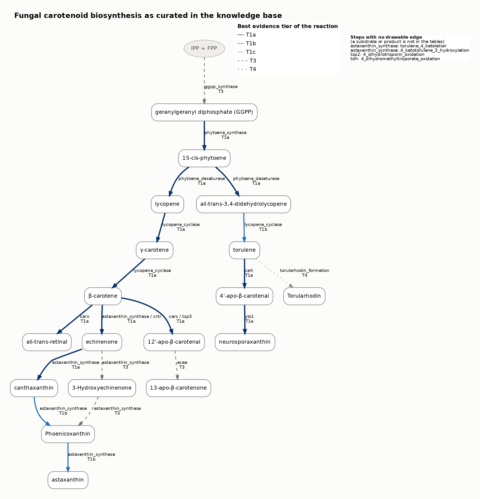

*Compounds are nodes; each edge is a curated reaction, labelled with the step (gene family) that does it and the best evidence tier among that reaction's links. IPP and FPP are drawn as one grey node, and 3-methylbut-2-enal (a cleavage by-product) is not drawn. **The edge tier is the best link of one reaction; the tier of a whole route is the weakest step on it, so an edge can be T1a while its route ends at T3 (section 1).** Four curated reactions have no edge because a substrate or product is not in the tables (listed in the box: `tsp2`, `tdh` and two astaxanthin-route steps). The diagram shows what is curated, not what is present in any genome. [PDF](figures/out/fig6_pathway_diagram.pdf), [SVG](figures/out/fig6_pathway_diagram.svg)*

**Two cutoffs differ from the rule.** For `astaxanthin_synthase` (rule 1332.5, used 999.4) and `ylo1` (rule 640.7, used 480.5) the owner lowered the cutoff by 25%. The two references of each step are nearly identical, so the held-out score only shows that the second reference is a close copy. The rule value is kept in the column `rule_min_score` of the cutoff file, and a hit of the rule is recovered by filtering on score. The table shows the rule value and the value used, so the two columns are not a contradiction.

**`crtr` is "family present", not a step (owner decision, 2026-11-23, PROVISIONAL).** Its 46,698 rows come from a generic NADPH-cytochrome P450 reductase (section 6f-2). The row stays in the table above as a search result and is dropped from the step list used in the placement and gain/loss sections.

## 3. Step 2: do references separate from decoys on the step HMMs?


*For the seven steps with a held-out value, the lowest held-out reference scores at least 1.8 times the highest decoy. The ratio is smallest for `ylo1` (640.7 against 358.7, 1.8) and `phytoene_synthase` (98.8 against 49.3, 2.0), and 5.9 or more for the other five. The seven steps with one reference have no held-out value (no orange diamond), so the figure shows only the decoy floor and the optimistic self-score; `tdh` is closest (776.0 against 333.6, 2.3). **This figure shows that the 69 decoys we chose do not look like references; it does not show that BFD has no other proteins that do.** The own-reference score (blue) is inflated, because the references train the HMM. [PDF](figures/out/fig1_step2_separation.pdf)*

How the cutoff was set (owner rule of 2026-11-22): a step with two or more references uses its lowest held-out score. A step with one reference uses its highest decoy score as a floor. The scripts are `bin/score_refs_decoys.py` and `bin/make_min_scores.py`, and the method is in `README.md`, section "Batched BFD search".

## 4. Step 4: the genome-wide search

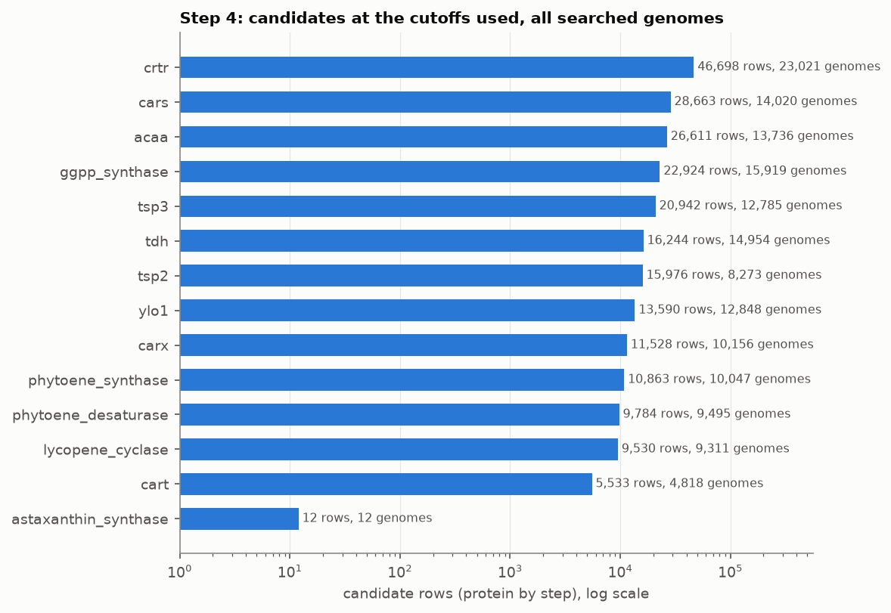

*A candidate row is a protein at or above the cutoff of its step. **Row counts say how many proteins to place in step 5, not how many genes the pathway has.** Four of the five largest counts belong to steps whose cutoff is a decoy floor (`crtr` 68.1, `cars` 8.0, `acaa` 12.3, `tsp3` 21.9). The fifth is `ggpp_synthase`, whose cutoff is its lowest held-out score (369.3). Genome counts are distinct genomes with at least one row, out of 23,376. [PDF](figures/out/fig2_candidates_per_step.pdf)*

Run facts (MEASURED): 6 jobs on the short queue (16 CPUs, 32 GB requested), 23 min 46 s to 28 min 0 s each, peak memory 22.5 to 22.7 GB. The 200-genome timing job predicted 26 minutes. Details are in `docs/superpowers/notes/2026-11-22-step4-results-and-decisions.md`.

## 5. What a high cutoff misses


*The first 1,000 genomes of the full run were searched again with a floor of 20 bits for the two steps whose cutoff was lowered. The bars are the proteins found; the lines are the two cutoffs. **The rule value and the lowered value cut a long tail of low scores that holds tens of thousands of proteins, so the figure supports "a lower floor floods placement", not "the proteins below the cutoff are real".** For `ylo1` the distribution has a second group at 300 to 480 bits (970 proteins) that lies below both cutoffs; what it is was not checked. [PDF](figures/out/fig3_low_cutoff_side_run.pdf)*

- `astaxanthin_synthase`: the full run, with the lowered cutoff, found 12 hits in 12 genomes. 8 meet the rule value (1332.5). 4 more score 1216 to 1300.
- `ylo1`: the full run found 13,590 hits. 11,194 meet the rule value. 2,396 more score 480.5 to 640.6, in 2,219 genomes. In the 1,000-genome side run the band 480 to 640.7 holds 98 proteins and the band 640.7 or higher holds 458.
- Decision (owner, 2026-11-22): keep the lowered cutoffs for step 5 and go no lower. The reason is in the same notes file.

## 6. Step 5 pilot: tree placement for `phytoene_synthase`

Method (PROPOSED settings marked): the 10,863 candidate proteins were cut to their aligned domain (padded by 20 residues, PROPOSED) and clustered with mmseqs2 at 0.5 identity and 0.8 coverage. The 191 clusters gave 191 representatives, so the cap of 300 never applied. The reference set holds the 5 references, 4 squalene synthase decoys and the 191 representatives (200 sequences; mafft, clipkit, 916 of 1,186 columns kept). The tree is raxml-ng 2.0.4 under LG+G4, rooted on the 4 decoys (PROPOSED; this step has no outgroup file). All 10,863 candidate domains were aligned to it with hmmalign and placed with epa-ng 0.3.8. A candidate counts as `target` when at least 0.5 of its likelihood weight (PROPOSED) lies in the smallest clade that holds all 5 references.

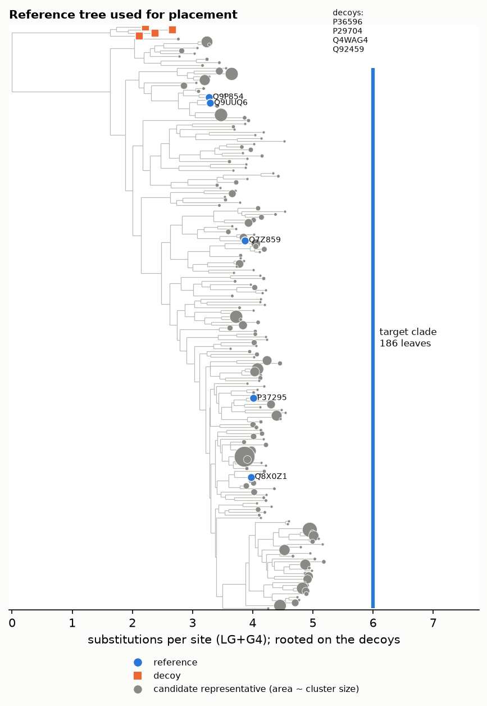

*Grey circles are candidate representatives, sized by the number of candidate domains in their cluster. Blue circles are the 5 references and the four orange squares at the top are the decoys. **The figure shows that the target clade (blue bar) is not a narrow group around the references: the 5 references sit apart from each other inside one clade of 186 leaves, so "placed in the target clade" cannot separate one kind of candidate from another.** Phyla of the representatives are not drawn. [PDF](figures/out/fig4_reference_tree.pdf)*

| Result (MEASURED, `results/step5/carotenoid/phytoene_synthase/SUMMARY.tsv`) | Value |
|---|---|
| Candidate domains extracted and placed | 10,863 of 10,863 (0 extraction failures) |
| Called `target` / `decoy` | 10,708 / 155 |
| Support of the `target` calls (likelihood weight in the clade) | median 1.0, minimum 0.745; 10,705 of 10,708 at 0.9 or more |
| Long pendant branch (above 1.0) | 0 of 10,863 (median 0.167, maximum 0.832) |
| `assign_steps` labels | 10,708 assigned, 155 unassigned, 0 fusion candidates |
| Assigned proteins | 10,708 in 9,896 genomes; copies per genome 1 (9,328), 2 (354), 3 (191), 4 (19), 5 (1), 6 (3) |
| Representatives in target / decoy side | 181 of 191 / 10 of 191 |

- **Reading trap: "assigned" here means placed in the target clade.** The 5 references are not close relatives, so the smallest clade that holds all of them spans 181 of the 191 representatives. A support of 1.0 therefore says the candidate is not on the decoy side. It does not say it is a phytoene synthase rather than a relative. Because every best-clade support is 0.745 or more, the 0.5 threshold removes nothing.
- **Where the 10,708 fall inside the clade** (reported by the pilot run, not saved as a script, so not repeated by me): about 9,082 candidates in the subclade of P37295 and Q8X0Z1 (78 leaves, 76 of them Ascomycota representatives), about 281 in the subclade of Q9P854 and Q9UUQ6, 1,333 elsewhere in the target, 155 outside it, 12 unassigned.
- **The 155 candidates on the decoy side** sit on a branch of 10 representatives next to the decoys. What they are was not checked.
- **A support of 1.0 does not mean the placement is certain.** Only 5 references and 4 decoys give the tree its anchors. The other 191 leaves are representatives, which are candidates themselves.
- **Reviewed fungal bifunctional lycopene cyclase / phytoene synthase entries beyond the 5 references exist.** A UniProt query (EC 2.5.1.32, Fungi, reviewed, run 2026-11-22) returns 19 entries, 14 of them not among our 5 references. Against this panel 140 of the 191 representatives score higher than against the 5 references (median best score 183 against 160 bits). The panel holds full-length proteins and the references are cut domains, so this comparison favours the panel. The evidence behind those 14 entries was not checked. They are the obvious named members to add to the tree (`bin/check_paralog_panel.sh`, output `paralog_panel_lcps/`).

### 6b. Second run: named tree members, non-fungal outgroups and lineage subclades

The first run left the 5 references spread through one clade. The second run adds 13 reviewed fungal bifunctional lycopene cyclase / phytoene synthase entries as named tree leaves, and 7 non-fungal outgroups (bacterial and cyanobacterial CrtB, plant PSY, one CrtM). The curated files are in `refs/carotenoid/tree_members/` (`README.md` there). **12 of the 13 named members are annotated only by similarity to reference P37295; only Q67GH9 has experimental evidence.** They are tree leaves with names. They are not references and not evidence for any step call. One entry (S0EQ07) was excluded because its record has no domain Region feature.

The tree has 220 leaves (5 references, 4 decoys, 13 named members, 7 outgroups, 191 representatives); raxml-ng 2.0.4, LG+G4, 3 starts. A named subclade is defined by a rule that is PROPOSED: for a taxonomic class with at least 2 labelled leaves, the smallest clade holding them is a subclade only if it holds no labelled leaf of another class and no decoy or outgroup.


*Teal diamonds are named members, black triangles outgroups, grey circles candidate representatives (area is the number of candidate domains in the cluster). Dark bars mark the four named subclades and the blue bar the target clade. **The figure shows that the named leaves all lie inside the target clade and that four classes form their own groups; it does not show that a candidate inside a group has that group's function, because the names come from annotation by similarity.** Near-overlapping labels belong to leaves that sit very close together. [PDF](figures/out/fig5_reference_tree_v2.pdf)*

| Result (MEASURED, `results/step5/carotenoid/phytoene_synthase_v2/SUMMARY.tsv`) | Value |
|---|---|
| Target clade | 185 leaves: 5 references, 13 of 13 named members, 167 representatives |
| Candidates called `target` / `decoy` side | 10,815 / 48 (first run: 10,708 / 155) |
| Support in the target clade | median 1.0, minimum 0.670; 10,812 of 10,815 at 0.9 or more |
| Long pendant branch | 0 of 10,863 |
| `assign_steps` | 10,815 assigned, 48 unassigned, in 10,003 genomes (copies per genome: 1 in 9,435, 2 in 354, 3 in 191, 4 in 19, 5 in 1, 6 in 3) |
| Outgroups monophyletic | no: their common ancestor holds the 7 outgroups and the 4 squalene synthase decoys (11 leaves) |

| Named subclade | Labelled leaves | Leaves in clade | Representatives | Candidates called into it |
|---|---:|---:|---:|---:|
| Dothideomycetes | 3 | 3 | 0 | 813 |
| Eurotiomycetes | 4 | 34 | 30 | 1,376 |
| Mucoromycetes | 3 | 10 | 7 | 232 |
| Ustilaginomycetes | 2 | 4 | 2 | 61 |
| none (target clade only) | | | | 8,333 |

*Source: `subclade_counts.tsv`. 2,482 + 8,333 + 48 = 10,863 candidates. No subclade call lies outside the target clade.*

- **Reading trap: the Dothideomycetes subclade holds 0 representatives and 813 candidates.** The subclade is the 3 named leaves alone. Candidates are placed on the edges of the 3 leaves, so they call into it without a representative of their own. A call into a subclade means "placed next to those named leaves", at the tree distances below.
- **Sordariomycetes has no subclade.** Its 5 labelled leaves (2 references and 3 named members) lie in a 50-leaf clade that also holds the 3 Dothideomycetes members. The rule does not force a group. The Tremellomycetes class has 1 labelled leaf (Q7Z859) and cannot form one.
- **Nearest labelled leaf is not close.** The median tree distance from a representative to its nearest labelled leaf is 1.62 substitutions per site (maximum 4.03). By class of the nearest leaf: Dothideomycetes 60 representatives (8,182 candidates in their clusters), Mucoromycetes 46, Eurotiomycetes 30, Sordariomycetes 23, Tremellomycetes 22, Ustilaginomycetes 10 (`nearest_labelled_by_class.tsv`). Median distances run from 1.09 (Sordariomycetes) to 3.20 (Mucoromycetes).
- **The root is uncertain.** The squalene synthase decoys sit inside the outgroups' common ancestor, so the tree is rooted above both. Three raxml-ng starts (log-likelihoods -113644.9, -113638.6, -113648.9) do not show that the best tree is the global optimum (UNVERIFIED). Three earlier submissions failed for resource reasons and are listed in `RUN.md` of that folder.

### 6c. Placement for `lycopene_cyclase`

Same method and the same 13 named members, with their cyclase domains. The tree has 66 leaves (5 references, 13 named members, 1 outgroup, 47 representatives) and no decoys: the filter `bin/filter_decoys_for_tree.py` kept none of the 9 decoys, because none aligns over at least half of the HMM (the best, Q9KK78, covers 18%). **The cyclase placement therefore has no decoy test.** It is rooted on the one aligned outgroup, Q9HNE5.

| Result (MEASURED, `results/step5/carotenoid/lycopene_cyclase_v2/SUMMARY.tsv`) | Value |
|---|---|
| Target clade | 52 leaves: 5 references, 13 of 13 named members, 34 representatives |
| Candidates called `target` / decoy side | 9,492 / 38 (of 9,530) |
| Support in the target clade | median 1.0, minimum 0.94 |
| `assign_steps` | 9,492 assigned in 9,277 genomes (copies per genome: 1 in 9,085, 2 in 176, 3 in 12, 4 in 2, 5 in 1, 6 in 1) |
| Subclades (candidates called into them) | Dothideomycetes 981, Eurotiomycetes 853, Mucoromycetes 221, Ustilaginomycetes 122; none: 7,315 (76.8%) |

- **The result repeats the synthase result.** Four classes form named subclades, Sordariomycetes forms none (its clade also holds Eurotiomycetes and Dothideomycetes members), and about three quarters of the candidates lie in no named subclade. The synthase and cyclase domains are on one fused protein in most fungi, so the two steps are not independent evidence.
- **Reading trap: 7,993 candidates sit in clusters whose representatives are nearest to Dothideomycetes.** Two representatives carry most of them, so one large cluster dominates that count. It is a statement about cluster size, not about how many genomes carry the gene.
- **Three attempts were needed** (`RUN.md`-level facts, MEASURED): the first stopped on the clade check (unalignable decoys in the tree, section 7); a retry died on a `raxml-ng` core-oversubscription abort on node r41; the second tree had Q9KK78 as its only decoy and stopped again because Q9KK78 fell inside the fungal clade; the third had no tree decoys and ran.

### 6c-2. Placement for `phytoene_desaturase` and `cart` (small trees)

Same method as above, but with at most one named lineage member and distant outgroups (`refs/carotenoid/tree_members/`, `README.md` there). No decoy of either step aligns over more than 20% of the step HMM, so no decoy is in either tree.

| Result (MEASURED, `results/step5/carotenoid/<step>/SUMMARY.tsv`) | `phytoene_desaturase` | `cart` |
|---|---:|---:|
| Candidates placed | 9,784 | 5,533 |
| Reference tree leaves | 15 (4 references, 1 named member, 7 outgroups, 3 representatives) | 27 (2 references, 5 outgroups, 20 representatives) |
| Called `target` / outside | 9,760 / 24 | 5,303 / 230 |
| Support in the target clade (median, minimum) | 1.0, 0.501 | 1.0, 0.773 |
| Assigned proteins and genomes | 9,760 in 9,473 | 5,303 in 4,610 |
| Genomes with 1, 2, 3 or more copies | 9,207, 256, 10 | 3,959, 613, 38 |

- **The outgroups are the only non-target anchors.** For `phytoene_desaturase` they are 5 bacterial CrtI-type enzymes, mouse retinol saturase and tomato CRTISO; for `cart` they are 5 vertebrate proteins (BCO1 and RPE65). Plant and cyanobacterial phytoene desaturases, and plant carotenoid cleavage dioxygenases, cover under 20% of the step HMM and could not be used.
- **Reading trap: a placed call here means "near the references".** All 9,784 desaturase candidates fall into only 3 clusters at 50% identity, so the tree cannot tell candidates apart. The call separates candidates from the outgroup side. It does not separate true desaturases from other FAD-dependent oxidoreductases of similar score, because none of those is in the tree.
- **No lineage subclades exist for these steps.** `phytoene_desaturase` has one named member (P48537, annotated by similarity only) and `cart` has none, because UniProt holds too few reviewed fungal entries.

### 6d. Which taxonomic groups have the steps

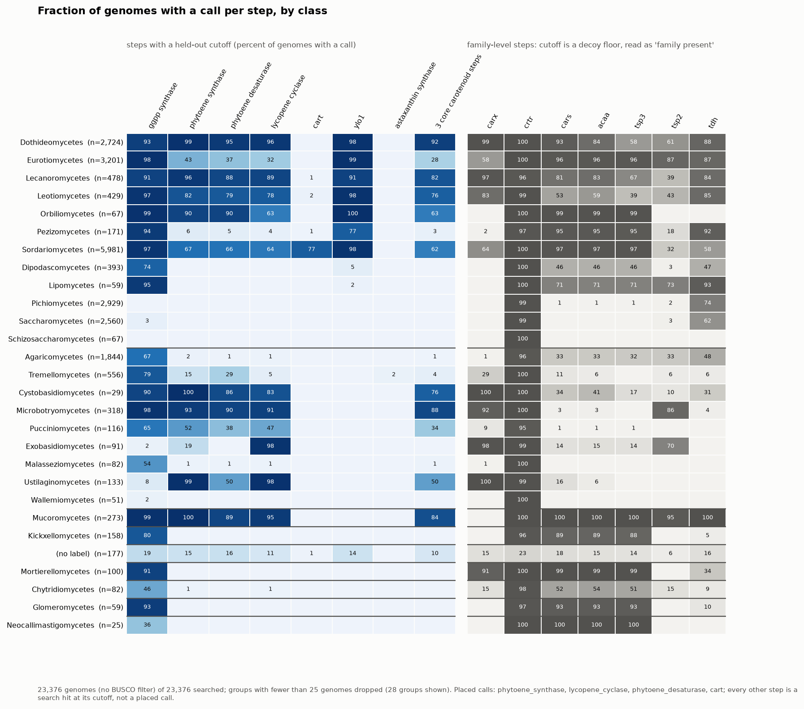

*Each cell is the percent of genomes of the class with at least one call for the step; the number of genomes is in the row label. The blue panel holds the steps whose cutoff comes from held-out references; the grey panel holds the steps whose cutoff is only a decoy floor, which hit nearly every genome and must be read as "family present". **Five columns are placed calls (tree placement, sections 6 to 6f): `ggpp_synthase` (hits of 150 bits or more placed in the GGPP synthase clade, section 6f), `phytoene_synthase`, `lycopene_cyclase`, `phytoene_desaturase` and `cart`. The desaturase and `cart` placements use small trees (15 and 27 leaves) and are a weaker filter than the other two. Every other column is a search hit at its cutoff.** Blank cells are exactly zero; "<0.5" marks a non-zero share below 0.5%. The "3 core carotenoid steps" column is the share of genomes with all of `phytoene_synthase`, `phytoene_desaturase` and `lycopene_cyclase`. All 23,376 searched genomes are used, with no BUSCO filter (see the reading traps). [PDF](figures/out/fig7_presence_by_class.pdf)*

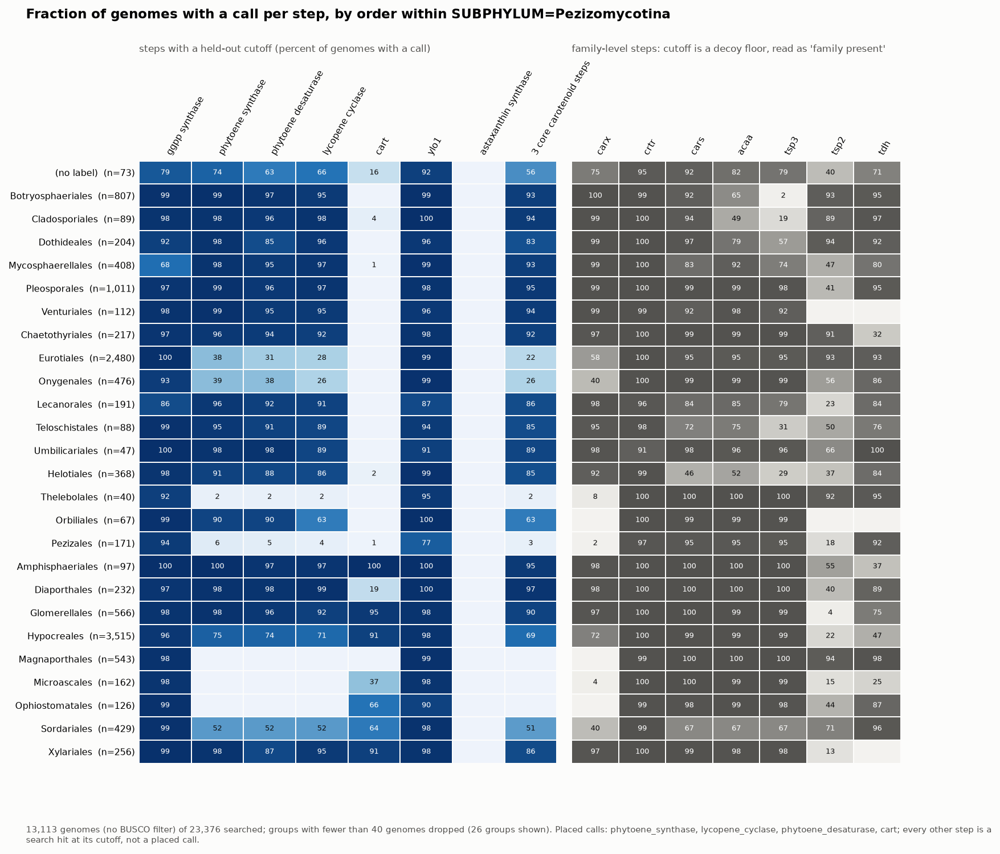

*Orders of Pezizomycotina with at least 40 genomes (13,113 genomes in 26 groups). **The figure shows that the core steps are not spread evenly within the subphylum; it does not show gains or losses, because it has no tree.** [PDF](figures/out/fig8_presence_by_order_pezizomycotina.pdf)*

What the figures show (MEASURED counts of genomes with a call; descriptive only):

- **Classes.** `phytoene_synthase` / `phytoene_desaturase` / `lycopene_cyclase` have calls in 99 / 95 / 96% of Dothideomycetes (2,724 genomes), 43 / 37 / 32% of Eurotiomycetes (3,201), 67 / 66 / 64% of Sordariomycetes (5,981), 100 / 89 / 95% of Mucoromycetes (273), and 99 / 50 / 98% of Ustilaginomycetes (133). They have calls in 2 / 1 / 1% of Agaricomycetes (1,844) and in fewer than 0.5% of Saccharomycetes (2,560), Pichiomycetes (2,929) and Schizosaccharomycetes (67).
- **Orders of Pezizomycotina.** The same three steps are at 38 / 31 / 28% in Eurotiales (2,480 genomes), 75 / 74 / 71% in Hypocreales (3,515), 52 / 52 / 52% in Sordariales (429), 6 / 5 / 4% in Pezizales (171) and 2 / 2 / 2% in Thelebolales (40), against 85 to 99% in Botryosphaeriales, Cladosporiales, Dothideales, Mycosphaerellales, Pleosporales and Venturiales. Magnaporthales (543), Microascales (162) and Ophiostomatales (126) are below 0.5% for all three.
- **`cart`** has calls in 77% of Sordariomycetes and in at most 2% of any other class shown (Leotiomycetes 1.9%). Among the orders of Pezizomycotina it ranges from below 0.5% (Magnaporthales, 543 genomes) through 19% (Diaporthales) and 64% (Sordariales) to 100% (Amphisphaeriales, 97 genomes).

Reading traps and limits:

- **`ggpp_synthase` calls changed after section 6e (owner decision, 2026-11-23).** The first version of this figure used the 369.3-bit hit and read 3% for Saccharomycetes and under 0.5% for Pichiomycetes, which was an artefact of a cutoff that misses yeast GGPP synthases. The column now counts a genome when a hit of 150 bits or more is placed in the GGPP synthase clade (section 6f): Saccharomycetes 94%, Pichiomycetes 82%. 1,274 genomes still have no hit at 150 bits.
- **`ylo1` is at 90% or more in nearly every order of Pezizomycotina.** That pattern fits a widely shared protein family, not a pathway-specific step. These are search hits and are not placed. `ggpp_synthase` is also near-universal there, now as placed calls.
- **A "call" is at least one protein in the genome.** An incomplete assembly gives a false absence. A BUSCO filter of 90 would remove whole lineages (MEASURED: Saccharomycetes 2,560 genomes to 0, Pichiomycetes 2,929 to 2, Schizosaccharomycetes and Wallemiomycetes to 0), so it is not applied. The 177 genomes with no class label form their own row.
- **The synthase and cyclase columns are not independent.** In most fungi both are domains of one fused protein (section 6c).
- **Percent of genomes is not percent of species or lineages.** Genome counts follow what has been sequenced; Eurotiales, Hypocreales and Sordariomycetes are large because many strains are sequenced.

### 6e. Do the cutoffs find known entries? A sensitivity audit

For every step that has an EC number of its own in the tables, `bin/sensitivity_audit.py` fetched the reviewed fungal UniProt entries of that EC (`ec:<EC> AND taxonomy_id:4751 AND reviewed:true`, 2026-11-22), removed the step's own references and decoys, and scored the rest with the step HMM (`hmmsearch`, E-value limit 1000, best domain score).

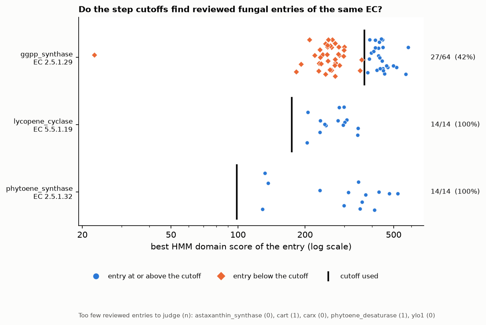

*Blue circles are entries at or above the cutoff (black bar) and orange diamonds are entries below it. **The figure shows that the `ggpp_synthase` cutoff lies inside the score range of known GGPP synthases and the other two cutoffs do not; it does not show that the other steps are sensitive, because the 14 entries of each of the other two are the same bifunctional proteins that serve as named tree members, close relatives of the references.** Steps with fewer than 5 reviewed entries are not drawn (list under the figure). [PDF](figures/out/fig12_sensitivity_audit.pdf)*

| Step | EC | Reviewed fungal entries (not our references) | At or above the cutoff | Lowest score | Cutoff |
|---|---|---:|---:|---:|---:|
| `ggpp_synthase` | 2.5.1.29 | 64 (39 named geranylgeranyl pyrophosphate synthase) | 27 (26 of the 39 named) | 22.6 | 369.3 |
| `phytoene_synthase` | 2.5.1.32 | 14 | 14 | 129.0 | 98.8 |
| `lycopene_cyclase` | 5.5.1.19 | 14 | 14 | 204.2 | 174.1 |
| `phytoene_desaturase` | 1.3.99.30, 1.3.99.31 | 1 | 1 | not judged | 706.6 |
| `cart` | 1.13.11.59 | 1 | 1 | not judged | 615.8 |
| `astaxanthin_synthase`, `carx`, `ylo1` | | 0 | | | |

*Source: `results/audit/carotenoid/sensitivity_summary.tsv` and `sensitivity_entries.tsv`. Six steps (`acaa`, `cars`, `crtr`, `tdh`, `tsp2`, `tsp3`) have no EC of their own in the tables and are not auditable (`not_auditable.tsv`).*

- **`ggpp_synthase` misses real GGPP synthases.** 13 of the 39 entries named geranylgeranyl pyrophosphate synthase score below the cutoff: budding-yeast BTS1 (Q12051, 284.8), *Eremothecium* (Q758K0, 282.4), *Aspergillus nidulans* AN1592 (A0A1U8QLG8, 352.4), *Zymoseptoria* (F9XLC1, 285.6) and fission-yeast O59703 (22.6), among others. This is a sensitivity gap of a two-reference HMM, and it explains the low yeast calls in section 6d.
- **Reading trap: the headline 27 of 64 (42%) is not the recall.** 25 of the 64 entries carry EC 2.5.1.29 but are named terpene synthases (for example variediene synthase, fusicoccadiene synthase), and only 1 of them reaches the cutoff. They are not GGPP synthases proper. The fair figure is 26 of 39 (67%).
- **The synthase and cyclase checks are easy cases.** The lowest entry scores (129.0 and 204.2) are close to the cutoffs (98.8 and 174.1), so the margin is thin; the entries are annotated by similarity to the references.
- **Five steps cannot be judged.** UniProt returned 0, 0, 0, 1 and 1 reviewed entries beyond our references under the EC numbers in the tables. Whether the table numbers are out of date was not checked (UNVERIFIED).
- **A lower `ggpp_synthase` cutoff is an option, not applied (PROPOSED).** At 200 bits, 38 of the 39 named GGPP synthases are found, and the highest decoy scores 37.1. The same cutoff would also call 23 of the 25 terpene synthases, which carry a prenyltransferase domain. What those are in BFD was not checked, and the BFD search was not re-run.
- **What would settle it:** a 1,000-genome search at the lower cutoff, added yeast GGPP synthases as references, or family membership (InterPro) of reviewed entries as the audit set.

### 6f. Three cutoff tests: `ggpp_synthase`, the `cart` alignability rule and `astaxanthin_synthase`

**`ggpp_synthase`: where should the cutoff be?** Section 6e showed that the cutoff of 369.3 bits misses known GGPP synthases. Two tests followed (nothing is applied; the cutoff of 369.3 is still used everywhere else in this report).

1. **Leave-one-out with a wider HMM.** For each of the 39 reviewed fungal entries named geranylgeranyl pyrophosphate synthase, an HMM was built from the 2 references plus the other 38 and the held-out entry was scored (`bin/expanded_hmm_cv.py`).
2. **A low-floor search of 1,000 genomes** (the first 1,000 of the full run) with the current HMM and with the wider HMM built from all 41 sequences, kept down to 100 bits (`bin/cutoff_sweep.py`).

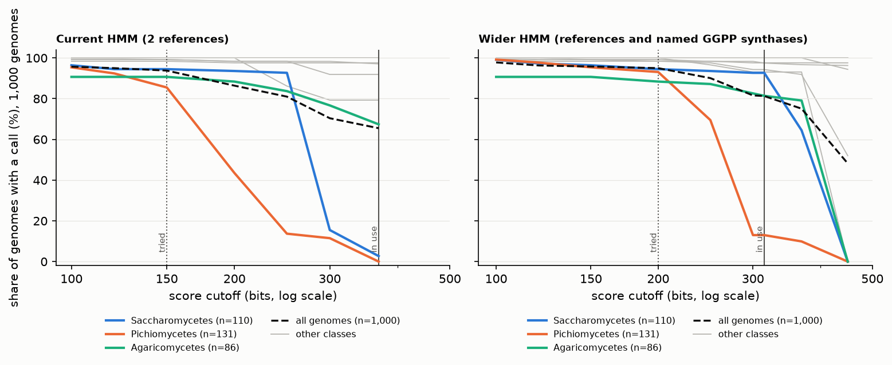

*Left: the current two-reference HMM. Right: the wider HMM. Solid black line marks the cutoff in use, dotted line the cutoff tried. **The figure shows that the share of genomes with a call rises steeply as the cutoff falls to 200 or 150 bits, most for the budding yeasts; it does not show that the extra calls are GGPP synthases, because the share of genomes with a call is a proxy for sensitivity and says nothing about what the extra proteins are.** [PDF](figures/out/fig14_ggpp_cutoff_sweep.pdf)*

| Cutoff (bits), current HMM | All genomes | Saccharomycetes (110) | Pichiomycetes (131) | Agaricomycetes (86) | Genomes with 0 / 1 / 2 / 3 or more calls |
|---:|---:|---:|---:|---:|---|
| 369.3 (in use) | 65.5% | 2.7% | 0.0% | 67.4% | 345 / 437 / 143 / 75 |
| 300 | 70.4% | 15.5% | 11.5% | 76.7% | 296 / 464 / 153 / 87 |
| 250 | 81.0% | 92.7% | 13.7% | 83.7% | 190 / 465 / 163 / 182 |
| 200 | 86.4% | 93.6% | 43.5% | 88.4% | 136 / 423 / 177 / 264 |
| 150 | 93.8% | 94.5% | 85.5% | 90.7% | 62 / 484 / 177 / 277 |
| 100 | 95.7% | 96.4% | 95.4% | 90.7% | 43 / 497 / 176 / 284 |

*First 1,000 genomes of the search (`results/audit/ggpp_eval/sweep_current/`). Of the 39 named entries, the current HMM scores 26 at or above 369.3 bits, 28 at or above 300 and 38 at or above 200; the wider HMM, leave-one-out, scores 29 at or above 369.3 and 38 at or above 300. One entry, fission-yeast O59703, is the miss in both (22.6 and 43.3 bits).*

- **A lower cutoff recovers the yeasts.** At 150 bits the current HMM gives a call in 94.5% of Saccharomycetes and 85.5% of Pichiomycetes genomes, against 2.7% and 0.0% at 369.3. The calls per genome rise too (genomes with 3 or more calls: 75 to 277), as expected where a family has several members or terpene synthases carry a prenyltransferase domain; what the extra calls are was not tested.
- **Specificity at 150 bits is not safe by score alone (corrected, see the placement test below).** I first wrote that the current HMM looked safe to about 150 bits because the 4 decoys score at most 37.1 and only 71 hits lie between 100 and 150 bits in 1,000 genomes. The placement of all 52,479 candidates at 150 bits shows otherwise: 15,444 (29%) fall in the farnesyl synthase clade, with a median score of 243 bits.
- **The wider HMM brings the farnesyl pyrophosphate synthases closer.** The three farnesyl pyrophosphate synthases rise from at most 37.1 to between 117.5 and 126.6 bits under the wider HMM (the hexaprenyl one to 50.1), and below about 130 bits it floods: the number of hits between 100 and 120 bits is 725, and the genomes with exactly 2 calls rise from 175 (at 150 bits) to 442 (at 100). Its lowest leave-one-out score (excluding O59703) is 314.8, and it improves Pichiomycetes only slightly (13% at 314.8). It also scores fission-yeast O59703 (a GGPP synthase in UniProt) below that species' own farnesyl pyrophosphate synthase decoy, so O59703 should not be trusted as a positive.
- **An E-value cutoff gives no advantage.** In the 1,000-genome search the median i-Evalue is 4.7e-50 for hits of 150 to 200 bits, 1.2e-64 at 200 to 250 and 2e-124 at 369 to 450. The E-value depends on the size of the searched set (the full BFD is about 23 times larger), so a bit-score cutoff is the portable one; "i-Evalue at most 1e-49" in this 1,000-genome search is about 150 bits.
- **Reading trap: "share of genomes with a call" assumes GGPP synthase is near-universal.** That assumption is UNVERIFIED (budding-yeast BTS1 is not essential, for example). It is a sensitivity check, not a count of real genes.
- **Placement test (done, nothing applied to the other sections).** All 23,376 genomes were searched at 150 bits (52,479 candidates in 22,102 genomes) and the candidates were placed on a tree of the 2 references, 63 named members (38 named GGPP synthases and 25 bifunctional terpene synthases with a prenyltransferase domain) and 10 farnesyl synthase decoys (`results/step5/carotenoid/ggpp_synthase/`; the hexaprenyl decoy covers only 24% of the wider HMM and is left out; 300 representatives; one tree from 2 `raxml-ng` starts, rooted on the decoys; fission-yeast O59703 is excluded). In the tree, 33 of the 38 named GGPP synthases lie in the target clade (the smallest clade holding both references; 190 leaves), the 10 decoys form their own clade, and 24 of the 25 bifunctional entries and 5 named GGPP synthases (amyG, sdnC, GGS-A, GGS3 and GA5, which are pathway-dedicated enzymes by name) lie outside both.

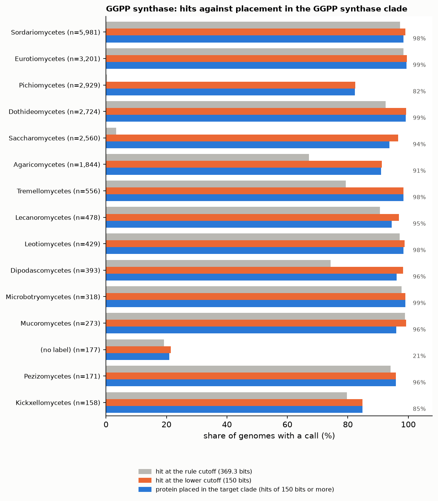

*Classes with at least 150 genomes, all 23,376 searched genomes. **The figure shows that placing the 150-bit candidates in the GGPP synthase clade keeps almost every genome that has a 150-bit hit (21,933 of 22,102), and that both recover the yeasts that the rule cutoff misses; it does not show that every placed protein is a GGPP synthase, because the target clade is defined by only two references and the tree is a single run.** [PDF](figures/out/fig15_ggpp_placed_vs_hits.pdf)*

| Genomes with a call (of 23,376) | Hit at 369.3 bits (rule) | Hit at 150 bits | Placed in the GGPP synthase clade |
|---|---:|---:|---:|
| All | 15,919 (68.1%) | 22,102 (94.5%) | 21,933 (93.8%) |
| Saccharomycetes (2,560) | 3.4% | 96.7% | 93.8% |
| Pichiomycetes (2,929) | 0.4% | 82.5% | 82.4% |
| Ustilaginomycetes (133) | 7.5% | 100% | 100% |
| Agaricomycetes (1,844) | 67.1% | 91.3% | 91.1% |

| Candidate score (bits) | In the target clade | On the farnesyl side | Unassigned |
|---|---:|---:|---:|
| 150 to 200 | 1,979 | 2,558 | 907 |
| 200 to 250 | 1,577 | 7,234 | 1,419 |
| 250 to 300 | 2,746 | 5,617 | 3,413 |
| 300 to 369.3 | 2,060 | 17 | 28 |
| 369.3 to 450 | 7,966 | 5 | 3 |
| 450 or more | 14,915 | 13 | 22 |

*Source: `results/audit/ggpp_eval/placed_vs_hits/` (`bin/placed_vs_hits_by_class.py`). "Farnesyl side" means placed with the 10 farnesyl synthase decoys.*

- **Score alone separates only at 300 bits and above.** From 300 bits up, 98 to 100% of candidates are in the target clade. Between 150 and 300 bits only 15 to 36% are (6,302 of 28,094 in the band); the rest are on the farnesyl side (15,409) or unassigned (5,739). A lower cutoff without placement would call the farnesyl-side proteins too.
- **Placement removes few genomes.** 169 genomes have a 150-bit hit and no protein in the clade (74 Saccharomycetes, 40 Sordariomycetes, 11 Lecanoromycetes, 9 Mucoromycetes). Most genomes with a farnesyl-side hit also have a target protein (6,679 of 6,818).
- **What the farnesyl-side proteins are is not known.** 14,659 of the 15,444 (95%) come from Sordariomycetes, Eurotiomycetes and Dothideomycetes. The tree places them with the farnesyl synthase decoys; they may be farnesyl-type enzymes more diverged than the decoys, or another prenyl diphosphate synthase.
- **Genomes still without a call at 150 bits:** 1,274, mostly Pichiomycetes (513), Agaricomycetes (161), unlabelled (139), Saccharomycetes (85), Schizosaccharomycetes (67, where the GGPP synthase scores 22.6 bits), Sordariomycetes (57), Wallemiomycetes (50) and Kickxellomycetes (24).
- **Recommendation (PROPOSED): call `ggpp_synthase` by placement in the GGPP synthase clade for hits of 150 bits or more, in place of the 369.3-bit hit.** The owner accepted it on 2026-11-23: the heatmaps (section 6d) and the gain/loss analysis (sections 6g and 6h) use it, and the step table in section 2 still shows the rule cutoff. The target clade excludes 5 named pathway-dedicated GGPP synthases, so the call is conservative for those.

**`cart`: should the alignability rule count all domains of a hit?** The rule for tree outgroups and decoys uses the best single domain (at least 10 bits and at least 50% of the HMM). With the union of all domains of 10 bits or more (`--coverage-mode union` in `bin/filter_decoys_for_tree.py`, default unchanged), 4 more entries pass: human and mouse BCO2 (0.69, 0.67), *Drosophila* NinaB (0.69) and *Arabidopsis* CCD8 (0.501, borderline). The 6 current `cart` decoys and the other plant and cyanobacterial oxygenases still fail (union 0.08 to 0.41). The placement was re-run with the 5 old and 4 new outgroups (`results/step5/carotenoid/cart_alldomains/`).

| | Current (5 outgroups) | All-domains (9 outgroups) |
|---|---:|---:|
| Tree leaves | 27 | 31 |
| Target clade (references and representatives) | 22 | 17 |
| Candidates called target / non-target ingroup clade / unassigned | 5,303 / 0 / 230 | 5,308 / 190 / 35 |
| Genomes with an assigned protein | 4,610 | 4,690 |
| Support in the target clade, minimum | 0.773 | 0.98 |

- **No non-target oxygenase shows up among the candidates.** No representative groups with BCO2, NinaB or CCD8, and for all 20 representatives the best blastp hit is a `cart` reference (491 to 880 bits), against 93 to 174 bits for the best outgroup.
- **The call boundary moves.** 411 of 5,533 proteins change status, and 298 genomes change presence: 109 lose it (98 Sordariomycetes) and 189 gain it (all Sordariomycetes), a net gain of 80. The change comes from the tree shape with distant outgroups (CCD8 has a pendant branch of 1.95), not from any non-target enzyme.
- **Recommendation (PROPOSED): keep the best-domain rule.** The union rule adds no specificity here, changes the calls of 7% of the proteins through tree shape, and its CCD8 entry sits at the limit. Whether another random seed gives the same topology was not tested (UNVERIFIED). The presence calls in sections 6d and 6g are unchanged.

**`astaxanthin_synthase`: why the heatmap column is nearly empty.** The step is not missing. It has calls in 12 of 23,376 genomes (0.05%), all *Phaffia* (10 *P. rhodozyma*, *P. australis*, *P. tasmanica*), with scores of 1216 to 1343 bits over the full HMM, so the column reads 2% for Tremellomycetes and zero elsewhere. The heatmaps now print "<0.5" for any non-zero share below 0.5% (a blank cell is an exact zero).

- **Related P450s exist below the cutoff, and a placement shows they are far from the references.** In a search of all 23,376 genomes at a floor of 300 bits, 4,459 candidates in 1,937 genomes (8.3%) were found, mostly basidiomycete P450s. They were placed on a tree of the 2 references, 16 reviewed fungal P450s as outgroups (all alignable: at least 100 bits and 50% of the HMM; mostly *Postia placenta*, *Ampulloclitocybe clavipes* and *Ganoderma* entries) and 90 representatives (`results/step5/carotenoid/astaxanthin_synthase/`). Existing decoys could not be used: none covers more than 44% of the HMM.
- **No candidate other than the *Phaffia* ones lies near the references.** The nearest leaf to the two references is the cluster of 12 near-identical *Phaffia* candidates (patristic distance 0.087 substitutions per site). The next nearest are paralogs inside *Phaffia* genomes (distance 1.0 to 1.06; 10 candidates). The *Mrakia*, *Udeniomyces*, *Krasilnikovozyma* and *Cystofilobasidium* groups, which score 410 to 550 bits, lie at 1.4 to 1.9; the outgroups lie at 2.0 to 3.2. A group more distant than the paralogs inside *Phaffia* is not evidence of an ortholog of the astaxanthin P450, and none is called.
- **Reading trap: the 12 *Phaffia* candidates are "unassigned", not lost.** The target clade is only the two references, so a near-identical candidate is placed on the branch below that clade (stem weight 0.898 against 0.102 inside) and the rule that counts only weight inside the clade does not assign it. The other 4,447 candidates are on the non-target side (4,288) or in the outgroups' common ancestor (159); that ancestor holds 48 representatives, because the 16 outgroups are not monophyletic (their ancestor has 64 leaves).
- **What this supports:** in BFD, the astaxanthin P450 is found only in *Phaffia* genomes (12 of 23,376), and the rule cutoff is not hiding orthologs in the other Cystofilobasidiales. It does not show that the step is absent elsewhere in fungi, and the tree is one run of 3 `raxml-ng` starts (UNVERIFIED).

### 6f-2. Placement of the single-reference steps (`cars`, `acaa`, `tsp3`, `tsp2`, `tdh`; `carx` and `crtr` not placed)

Record: `results/step5/carotenoid/single_ref_steps_RUN.md` and `README.md`, section "Step 5 for the single-reference steps" (2026-11-23). Everything here is PROVISIONAL. Run folders and inputs are in `results/step5/carotenoid/` and `single_ref_inputs/`.

**The problem with the default target rule.** The default rule takes as `target` the smallest tree side that holds all references and no decoy or outgroup. With one reference, that side is the reference leaf, and a placement cannot fall inside a leaf. The first `cars` run shows it: `target_size` is 1 and 0 of 1,804 candidates are called `target` (1,505 decoy side, 299 unassigned; `cars/SUMMARY.tsv`).

**The new rule (PROPOSED, `bin/step5_single_ref_clades.py`).** `target` is the largest tree side that holds the reference and no decoy, outgroup or named leaf. These sides are nested, so the largest is unique. **The target is a clade bounded by the labelled leaves that were put in the tree. It is not a set of orthologs, and fewer labelled leaves give a larger target.** The files of the default rule are kept in each run folder as `clade_members.smallest.tsv` and `clade_report.smallest.json`.

**Floors (PROPOSED, not validated against known orthologs).** Each step has a search floor higher than the decoy floor, because the decoy floor returns tens of thousands of rows of family members. The floor is a choice read from the score distribution (`results/search/<step>_floor<N>/filter_summary.json`).

| Step | Floor (bits) | Rows kept of rows in step | Reason read from the score distribution |
|---|---:|---:|---|
| `carx` | 200 | 9,673 of 11,528 | Few rows at 100 to 300 bits. Not placed. |
| `cars` | 100 | 1,804 of 28,663 | More than 20,000 rows are below 100 bits. |
| `acaa` | 150 | 2,358 of 26,611 | Bulk of rows at 120 to 150 bits (4,110 rows). |
| `tsp3` | 100 | 2,208 of 20,942 | Same pattern as `cars`. |
| `tsp2` | 150 | 1,196 of 15,976 | 13,682 rows at 110 to 150 bits. |
| `tdh` | 360 | 6,142 of 16,244 | The cutoff is a decoy floor (333.6). There is no valley from 334 to 400, so 360 is a choice. |

*Source: `single_ref_steps_RUN.md`, section "Floors". UNVERIFIED: that any floor keeps all true orthologs.*

| Result (MEASURED, `<run>/SUMMARY.tsv`) | `cars_v2` | `acaa` | `tsp3_v2` | `tsp2` | `tdh_id80` |
|---|---:|---:|---:|---:|---:|
| Tree leaves | 131 | 105 | 116 | 64 | 266 |
| Target size (leaves, reference included) | 13 | 37 | 10 | 9 | 75 |
| Candidates placed | 1,804 | 2,358 | 2,208 | 1,196 | 6,142 |
| Called `target` | 331 | 495 | 319 | 829 | 882 |
| Called decoy side (non-target) | 1,351 | 1,674 | 1,800 | 359 | 5,260 |
| Unassigned (weight below 0.5) | 122 | 189 | 89 | 8 | 0 |
| Assigned proteins | 331 | 495 | 319 | 829 | 882 |
| Genomes with an assigned protein (of 23,376) | 292 | 284 | 291 | 263 | 288 |
| Of those, Mucoromycetes (class of 273 genomes) | 271 (92.8%) | 269 (94.7%) | 271 (93.1%) | 254 (96.6%) | 272 (94.4%) |

*Genomes by class: `<run>/single_ref_report/calls_by_class.tsv`. Support in the target is at least 0.529 for every run (`cars_v2` 0.989, `acaa` 0.991, `tsp3_v2` 0.529, `tsp2` 0.578, `tdh_id80` 0.985). No candidate has a long pendant branch. Labelled leaves in the trees: `cars_v2` 4 outgroups and 3 named leaves; `acaa` 6 outgroups and 4 named leaves; `tsp3_v2` 2 outgroups and 3 named leaves; `tsp2` 1 decoy and 22 named leaves; `tdh_id80` 3 decoys. Outgroups are the alignable members of the carotenoid cleavage oxygenase family (BCO1, BCO2 and NinaB entries, `single_ref_steps_RUN.md`) under the rule "at least 10 bits and at least 50% of the HMM".*

- **Reading trap: "assigned" means placed in the clade bounded by the labelled leaves.** It does not mean "an ortholog of the reference". The same warning applies to the `phytoene_synthase` pilot (section 6).
- **What the Mucoromycetes share does and does not show.** In each run 92.8 to 96.6% of the assigned genomes are Mucoromycetes, and the 5 references come from *Phycomyces*, *Blakeslea* and *Mucor* (organisms in the headers of `refs/carotenoid/<step>.faa`), which are Mucorales. It shows that the target clade is close to the references and that fungi outside Mucoromycetes mostly fall on the decoy side (for `cars_v2`, 1,351 of 1,804 candidates). **It does not show that the proteins have the function of the reference.** One Eurotiomycetes genome is assigned in each run (of 3,201). A candidate in another class on the decoy side is not shown to lack the function either, because the target is bounded by few labelled leaves.
- **`cars` and `tsp3` are one protein set.** The two target sets share 319 proteins in 291 genomes (`single_ref_inputs/target_overlap_cars_acaa_tsp3.tsv`). The `cars` target has 331 proteins and the `tsp3` target 319, so `tsp3` is contained in `cars` (319 shared = all of `tsp3`). The HMM of each step scores the reference of the other: `cars` HMM on the `tsp3` reference 1126.8 bits (own reference 1547.8), `tsp3` HMM on the `cars` reference 1120.1 bits (own 1634.6). In the first trees, the two references are sisters at a distance of 0.276 substitutions per site. The first runs, which kept the partner reference as a named leaf, gave a `cars` target of 1 leaf and a `tsp3` target of 4 leaves; the second runs leave the partner out. **The two steps are kept as two columns, and their results are not independent evidence (owner decision, PROVISIONAL).**
- **`acaa` is a separate set.** It shares 0 proteins and 0 genomes with `cars_v2` or `tsp3_v2`. At search level, 391 to 451 proteins with a score of 200 bits or more are shared between pairs of `cars`, `acaa` and `tsp3` (`hit_overlap_ge200.tsv`: `cars` and `acaa` 419, `cars` and `tsp3` 451, `acaa` and `tsp3` 391), and 378 proteins hit all three. So the hits overlap, and the placed targets do not for `acaa`.
- **`tsp2`: 22 paralogous short-chain dehydrogenases (SDR) are named leaves, not an outgroup.** Of 274 reviewed fungal SDR entries, 160 have a domain of 10 bits or more against the `tsp2` HMM, and 24 score 50 bits or more (`sdr_screen.tsv`). The 22 kept as named leaves score 51 to 101 bits. The old decoy CSGA (P21158, 109.7 bits) stays a decoy and roots the tree. The target holds 9 leaves and the `tsp2` assigned proteins have many copies per genome (1 copy in 62 genomes, 2 or more in 201 of 263).
- **`tdh`: the HMM matches aldo-keto reductases, not SDRs.** Of 274 reviewed fungal SDRs, 0 have a domain hit against the `tdh` HMM. The only hits are the reference (776.0 bits) and 3 yeast aldo-keto reductases (GRE3 333.6, YPR1 158.3, GCY1 156.0), which serve as decoys and as the root. No reviewed fungal SDR is in the tree. **Whether the `tdh` reference Q01213 is an SDR or an aldo-keto reductase was not checked (UNVERIFIED).** At the default identity of 0.5, the 6,142 domains fall into 2 clusters and the tree has 6 leaves (`tdh/`; 481 target, 4,272 decoy side, 1,389 unassigned; kept as a diagnostic result). The run `tdh_id80` uses an identity of 0.8 (PROPOSED), gives 262 clusters and a tree of 266 leaves, and is the one in the table. Its target has 75 leaves and 882 proteins. These have 1 copy in 88 of 288 genomes and 2 or more in 200.

**Not placed.**

- **`carx`: no alignable non-target leaf.** 22 proteins were screened against the `carx` HMM (696 match states): the 9 `cart` outgroups, the oxygenase named leaves and the 6 old decoys. The best score of any protein other than the reference is 35.3 bits (RCO1_ASPFU, coverage 0.125), and the best coverage is 0.19 (ADO_THET4, 31.0 bits). None passes the alignability rule (`cco_screen.tsv`). Without such a leaf, `target` would be the whole tree. The step stays a search-hit step at the floor of 200 bits (9,673 rows), flagged as not placeable (owner decision, PROVISIONAL).
- **`crtr`: treated as "family present".** 98.5% of the 23,376 genomes have a hit at the cutoff of 68.1 bits (97.4% at 200 bits or more, 70.7% at 500 bits or more; `crtr_hits_by_class.tsv`). The reference B6D970 is named "NADPH--cytochrome P450 reductase" in UniProt (1808.1 bits), a generic enzyme. 10 reviewed fungal NADPH-cytochrome P450 reductases score 448.4 to 1009.6 bits with coverage 0.91 to 0.96, and the 3 old decoys score 28.3 to 68.1. The HMM therefore does not separate the reference from housekeeping reductases, and a tree has no labelled non-target leaf to show a carotenoid-specific clade. `crtr` is dropped from the step list and shown as "family present" (owner decision, PROVISIONAL). UNVERIFIED: whether *Phaffia* has a second, carotenoid-specific reductase.

**Not done here.** The new steps are not added to the heatmaps (figures 7 and 8), which still show these steps as search hits. A check that a floor keeps known orthologs, a second tree or seed for each run, and an ortholog test (for example a reviewed Mucoromycetes set for each step) are not done. A test that settles the target rule: add labelled non-target leaves from several classes and see whether the target size and the assigned count stay stable.

### 6g. Are the steps gained and lost together? A first pass on the genus tree

One genome per genus. The 30 Microsporidia tips are dropped (owner decision, 2026-11-23: all 30 are absent for all four steps, and their long branches make the root of the tree unreliable), which leaves 1,613 tips of the phyling genus tree, 1,609 with data (4 have no searched genome and are NA). Each of the five placed steps is a present or absent call per genus representative: the four carotenoid steps and `ggpp_synthase`, called by placement of hits of 150 bits or more in the GGPP synthase clade (section 6f). Ancestral states were reconstructed per step with a Mk model (castor), and a branch counts as a gain or loss only when both ends have probability 0.8 or more. Each step is reported under its better model by AIC (ARD for four steps, ER for `ggpp_synthase`). `ylo1` and the family-level steps are left out, because their calls are not placed (section 6e). The five-step record is `results/gainloss/carotenoid_noMicro_blasto_5steps/RUN.md`; the four-step folder `carotenoid_noMicro_blasto/` is unchanged. No BUSCO filter is applied (section 6h).

**Tree and root (PROPOSED, with the owner's choice of root).** The FastTree concatenation tree (branch lengths in substitutions per site) is used, rooted on Blastocladiomycota (6 tips: *Sorochytrium*, *Catenaria*, *Allomyces*, *Blastocladiella*, *Coelomomyces*, *Paraphysoderma*; they form one clade with nothing else inside). The Opisthosporidia split used in the earlier run held 30 Microsporidia, 2 Aphelidiomycota and 1 Rozellomycota (*Paramicrosporidium*); there is no *Rozella* or *Sanchytrium* tip, so after dropping Microsporidia it holds 3 tips and no longer supports a root. A second root on Chytridiomycota (36 tips) gives identical gains, losses and co-event counts. The ASTRAL consensus tree is rooted but has coalescent-unit branch lengths and lower support (70.9% of nodes at 0.8 or more, against 93.9%); the two trees differ by an unrooted Robinson-Foulds distance of 1,008 of 3,280, and the Mk likelihood is higher on FastTree for all four carotenoid steps (the ASTRAL comparison was not repeated with `ggpp_synthase`).

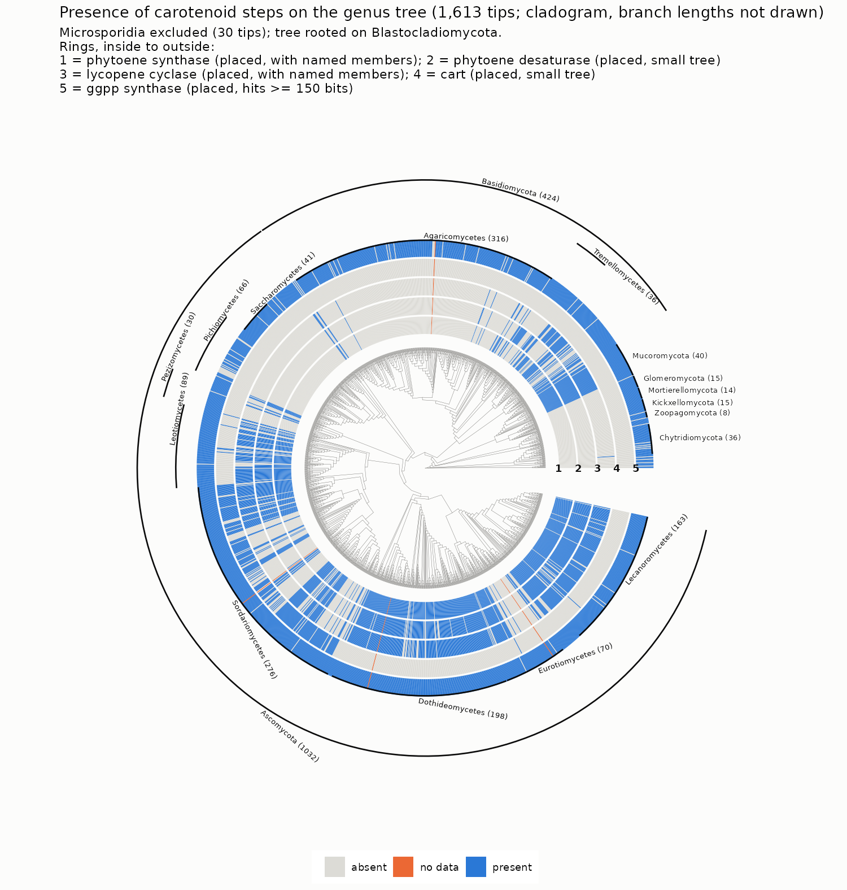

*Rings from inside: `phytoene_synthase`, `phytoene_desaturase`, `lycopene_cyclase`, `cart`, `ggpp_synthase` (placed, hits of 150 bits or more); blue is present, grey absent, orange no data. Microsporidia are excluded and the tree is rooted on Blastocladiomycota. Clades are labelled by the largest clade of at least 90% purity for each class or phylum. **The figure shows that presence is clustered by clade, that the first three rings agree closely, and that the fifth ring is nearly all present with absent tips mostly single or in Pichiomycetes and Agaricomycetes; it does not show where the steps were gained or lost, because branch lengths are not drawn and one genome stands for each genus.** [PDF](figures/out/fig9_tree_presence.pdf)*

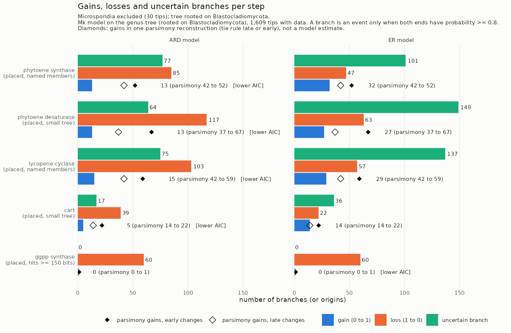

*Counts of branches under the all-rates-different model (ARD) and the equal-rates model (ER); "[lower AIC]" marks the better model of each step (ARD for the four carotenoid steps, ER for `ggpp_synthase` by 0.4 AIC units). Diamonds are gains in one parsimony reconstruction under two tie rules. **The figure shows that the gain count depends on the method (for `phytoene_synthase`, 13 under ARD against a parsimony range several times higher), while the loss count is stable under ARD; it does not give one true number of gains. For `ggpp_synthase` the figure shows 0 gains and 60 losses under both models, which is what a step present in 96% of tips gives.** [PDF](figures/out/fig10_gain_loss_counts.pdf)*

| Step | Present / absent tips | Gains | Losses | Uncertain branches | Gains on tip / internal edges | Losses on tip / internal edges |
|---|---:|---:|---:|---:|---:|---:|
| `phytoene_synthase` | 737 / 872 | 13 | 85 | 77 | 11 / 2 | 65 / 20 |
| `phytoene_desaturase` | 687 / 922 | 13 | 117 | 64 | 9 / 4 | 94 / 23 |
| `lycopene_cyclase` | 683 / 926 | 15 | 103 | 75 | 13 / 2 | 82 / 21 |
| `cart` | 217 / 1,392 | 5 | 39 | 17 | 4 / 1 | 34 / 5 |
| `ggpp_synthase` (ER) | 1,540 / 69 | 0 | 60 | 0 | 0 / 0 | 57 / 3 |

*Better model by AIC per step (ARD for four steps, ER for `ggpp_synthase`), 0.8 rule, Blastocladiomycota root, 1,609 tips with data (`results/gainloss/carotenoid_noMicro_blasto_5steps/gainloss_counts.tsv`). ARD is better than ER for the four carotenoid steps by 53 to 154 AIC units. For `ggpp_synthase`, ER is better by 0.4 AIC units, so the two models are not distinguished, and both give 0 gains and 60 losses. The ARD gain rate of `ggpp_synthase` is 0 (at the boundary), and the loss rate is 0.164 under ARD and 0.167 under ER. The four carotenoid rows equal the four-step run.*

**`ggpp_synthase` is present in 1,540 of 1,609 tips (96%), so it carries little information on gains.** Of 1,608 internal nodes, 1,599 are called present, 9 absent and 0 uncertain, and the root is called present (probability 0.9998). The 60 loss branches are 57 tip edges and 3 internal edges. The 3 internal edges are clades with every tip absent: 7 Pichiomycetes, 2 Pichiomycetes and 3 Agaricomycetes (`ggpp_synthase_absent_blocks.tsv`). Parsimony gives 60 changes and 0 or 1 gain. **An absent call is not a loss.** A missing placed hit can be a loss, a cutoff problem or a divergent protein (the fission-yeast GGPP synthase scores 22.6 bits on the HMM, section 6e).

- **Absent tips by class (genus tips, `ggpp_synthase_absent_by_class.tsv`):** 69 of 1,609. Agaricomycetes 23 of 318, Pichiomycetes 16 of 66 (24%), Lecanoromycetes 4 of 164, Chytridiomycetes 3 of 35. 57 of the 69 are single tips surrounded by present tips.
- **Absent genomes by class (all 23,376 searched genomes, `ggpp_synthase_absent_by_class_all_genomes.tsv`):** 1,443 genomes have no placed protein. Pichiomycetes 516 of 2,929 (17.6%), Agaricomycetes 165 of 1,844 (8.9%), Saccharomycetes 159 of 2,560 (6.2%), no class label 140 of 177 (79%). **Two whole lineages are absent: Schizosaccharomycetes 67 of 67 and Wallemiomycetes 50 of 51 genomes.** These may be a cutoff or divergence effect and not a loss (UNVERIFIED; the same cause as for fission yeast was not tested).
- **Reading trap: 1,443 here and 1,274 in section 6f are both correct.** 1,274 genomes have no hit at 150 bits. 169 more have a candidate but no protein placed in the GGPP synthase clade. 1,274 + 169 = 1,443.

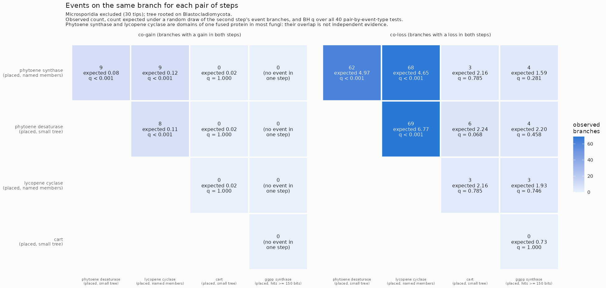

*Observed branches with an event in both steps, the count expected if one step's events were drawn at random among eligible branches, and the BH q value over 40 tests (10 pairs by 4 event types). **The figure shows that gains and losses of the three core steps fall on the same branches far more often than a random draw predicts, and that `ggpp_synthase` does not (co-loss q 0.28 to 1.0, no co-gain because it has no gain); it does not show that the null is right, because the draw ignores tree structure and the q values of the core pairs sit at the permutation floor (0.0005). Section 6h uses a tree-aware null.** [PDF](figures/out/fig11_co_events.pdf)*

| Pair | Co-gain: observed (on tip edges) | Co-loss: observed (on tip edges) |
|---|---:|---:|
| synthase and desaturase | 9 (7) | 62 (49) |
| synthase and cyclase | 9 (8) | 68 (52) |
| desaturase and cyclase | 8 (7) | 69 (56) |
| synthase and `cart` | 0 | 3 |
| desaturase and `cart` | 0 | 6 (q 0.068) |
| cyclase and `cart` | 0 | 3 |
| synthase and `ggpp_synthase` | 0 (no gain in `ggpp_synthase`) | 4 (q 0.28) |
| desaturase and `ggpp_synthase` | 0 | 4 (q 0.46) |
| cyclase and `ggpp_synthase` | 0 | 3 (q 0.75) |
| `cart` and `ggpp_synthase` | 0 | 0 (q 1.0) |

What the counts say (descriptive): of the 13 `phytoene_synthase` gains, 9 fall on branches that also gain desaturase and 9 on branches that also gain cyclase; of its 85 losses, 62 fall on branches that also lose desaturase and 68 on branches that also lose cyclase. `cart` shows no co-gain and only weak co-loss with desaturase. The `ggpp_synthase` co-losses are 3 to 4 branches, all tip edges (single genome tips in Lecanoromycetes, Pezizomycetes, Pneumocystomycetes, Agaricomycetes and Sordariomycetes), which is what missing data in single genomes would give.

Reading traps and limits:

- **Reading trap: synthase and cyclase are one gene in most fungi,** so their shared events count once. The synthase and desaturase pair is the informative one among the three.
- **Most events are on tip edges.** For `phytoene_synthase`, 11 of 13 gains and 65 of 85 losses sit on tip edges, as do 49 of the 62 synthase and desaturase co-losses. One genus representative stands for the genus, so a missed gene or an incomplete assembly can look like a loss. No completeness filter is applied in the main results (section 6h).
- **A shared miss can have a common technical cause.** A divergent copy that falls below the cutoffs of several steps in one lineage gives co-loss without a biological loss. The sensitivity audit (section 6e) covers only some steps.
- **The tree-blind permutation null in Figure 11 is too permissive;** the tree-aware null is in section 6h. The Pagel tests (likelihood ratio 352 to 537 for the three core pairs, p from 8e-75 to 8e-115; 832 to 1,207 s per pair) only show that two clustered traits are associated; any two traits that follow clade structure can give a small p. No error rates were simulated, and no multiple-test correction was applied. Pagel was not re-run for the `cart` pairs on this tree. **One Pagel test was run for `ggpp_synthase`: `phytoene_synthase` and `ggpp_synthase`, 1,609 tips, likelihood ratio 21.4 (4 df), p 2.6e-4 (AIC independent 1366.2, dependent 1352.8; 618 s; `pagel/pagel.phytoene_synthase__ggpp_synthase.tsv`).** It is not read as a link. With `ggpp_synthase` present in 96% of tips the dependent model has little to fit, and presence follows clade structure, so a small p is expected for any clustered trait (UNVERIFIED). The test of shared events is the one in section 6h (p 0.44).
- **The two small-tree steps are weak filters.** Switching `phytoene_desaturase` and `cart` between search hits and placed calls moves 10 and 11 genomes (from present to absent) in the earlier run and changes counts by a few branches. That does not show that either is correct.
- **Marginal probabilities were computed by our own code.** castor's `reroot=TRUE` marginals returned 0 for every node on a toy tree under the ARD model. The own two-pass code matches castor under ER to 1.7e-05 (unit test).

### 6h. Do the shared losses exceed chance on this tree? Simulation null, root and dropped tips, BUSCO and a second tree

Checks on the result in section 6g. The full records are `results/gainloss/carotenoid_noMicro_blasto_5steps/RUN.md` (new primary, five steps), `results/gainloss/carotenoid_noMicro_blasto_5steps_null/` (simulation null) and `results/gainloss/RUN_followup.md` (BUSCO and ASTRAL runs, made on the earlier primary with four steps).

**A tree-aware simulation null (new primary: Microsporidia dropped, Blastocladiomycota root).** Each step is simulated independently on the same tree, 2,000 replicates; each replicate is refitted, reconstructed and called with the same 0.8 rule, and co-events are counted on all edges and on internal edges only. Internal-edge events cannot come from an incomplete assembly. **The null is model-aware (a change from the four-step null, which used ARD for every step): each step is simulated and refitted under its own AIC-best model, ARD for the four carotenoid steps and ER for `ggpp_synthase`.** The reason is that the ARD gain rate of `ggpp_synthase` is 0, so an ARD simulation cannot produce a gain (`sim_params.tsv`). The four carotenoid steps keep ARD, and the null means for the core pairs equal the four-step run to within 0.1.

- **Reading trap: the null as first specified is wrong for these data.** With a stationary root the simulated steps have a mean of 28 to 179 present tips for the four carotenoid steps and 786 for `ggpp_synthase`, against 217 to 737 and 1,540 observed. Gains are about twice the observed number for the carotenoid steps (25 against 13 for `phytoene_synthase`), while their losses are far below it. Such a null can hardly produce a co-loss, so its p values sit at the floor for a reason unrelated to the pair (`fig13_null_co_events`).
- **A prevalence-matched null is the main reading (PROPOSED).** Same rates, but each replicate is drawn until its present-tip count is within 10% of the observed count. It reproduces the gains and the present-tip counts of the four carotenoid steps (215 to 730 against 217 to 737) and overshoots their losses. It matches prevalence, not clade structure. **For `ggpp_synthase` the window allows at most 1,609 present tips, so the matched null's present-tip mean is 1,464 against 1,540 observed** (2.7 gains and 53 losses against 0 and 60 observed; `null_step_diagnostics.tsv`). The `ggpp_synthase` null is therefore not a close match of the observation.

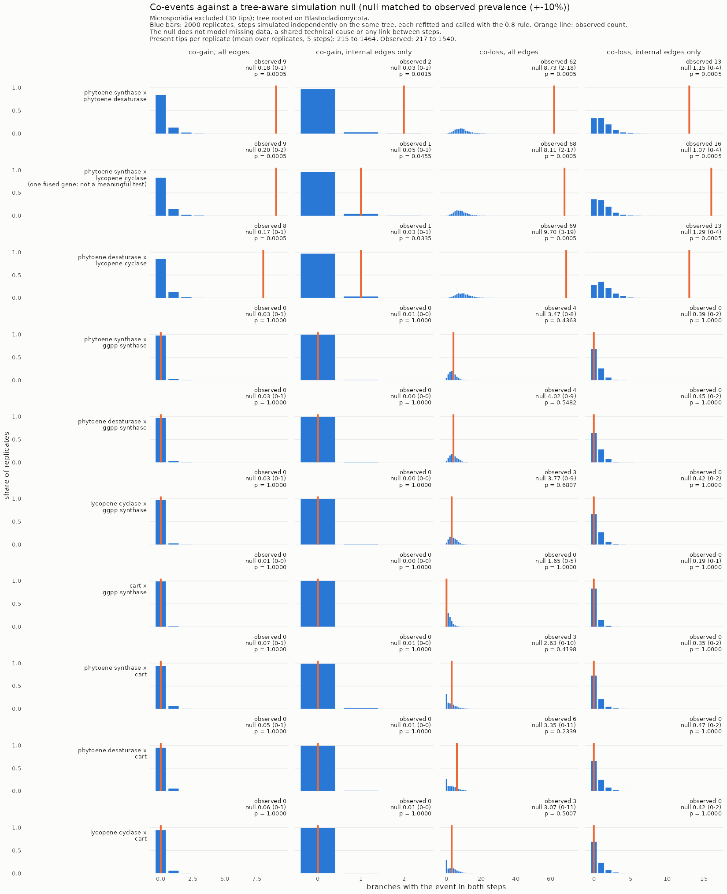

*Blue bars are the null (2,000 replicates), the orange line is the observed count, for all edges and for internal edges only, for the 10 pairs of five steps. Microsporidia are excluded and the root is Blastocladiomycota. **The figure shows that the shared losses of the three core steps lie far outside the null on all edges and on internal edges, while the `cart` and `ggpp_synthase` pairs lie inside it; it does not show that the steps are functionally linked, and the `phytoene_synthase` and `lycopene_cyclase` row is not a meaningful test because the two are one fused gene.** The null does not model missing data or a shared technical cause. [PDF](figures/out/fig13b_null_co_events_prevalence_matched.pdf)*

| Pair and event | Observed all edges (internal) | Null mean all edges (internal) | p |
|---|---:|---:|---:|
| synthase and desaturase, co-loss | 62 (13) | 8.7 (1.2) | 0.0005 |
| synthase and cyclase, co-loss (fused gene) | 68 (16) | 8.2 (1.1) | 0.0005 |
| desaturase and cyclase, co-loss | 69 (13) | 9.6 (1.3) | 0.0005 |
| synthase and desaturase, co-gain | 9 (2) | 0.18 (0.03) | 0.0005 (internal 0.0015, q 0.015) |
| synthase and cyclase, co-gain (fused gene) | 9 (1) | 0.20 (0.05) | 0.0005 (internal 0.045, q 0.30) |
| desaturase and cyclase, co-gain | 8 (1) | 0.17 (0.03) | 0.0005 (internal 0.033, q 0.27) |
| `cart` pairs, co-loss | 3 to 6 (0) | 2.6 to 3.4 (0.35 to 0.47) | 0.23 to 0.50 |
| `cart` pairs, co-gain | 0 (0) | 0.05 to 0.07 | 1.0 |
| `ggpp_synthase` with synthase, desaturase, cyclase, co-loss | 4, 4, 3 (0) | 3.5, 4.0, 3.8 (0.39, 0.45, 0.42) | 0.44, 0.55, 0.68 |
| `ggpp_synthase` with `cart`, co-loss | 0 (0) | 1.65 (0.19) | 1.0 |
| `ggpp_synthase` pairs, co-gain | 0 (0) | 0.01 to 0.03 | 1.0 |

*N = 2,000, so the smallest possible p is 0.0005 (`results/gainloss/carotenoid_noMicro_blasto_5steps_null/null_summary.tsv`, variant `stationary_match0.1`). The q values are those of the file. The upper limit of the null's 95% interval is 17 to 19 for the core co-loss on all edges and 4 on internal edges, and 8 to 9 for the `ggpp_synthase` co-loss with the core steps. `ggpp_synthase` has no gain, so a co-gain with it cannot be tested.*

- **Core co-loss is more than chance on this tree.** 62 to 69 observed branches against a null mean of 8 to 10, and 13 to 16 internal-edge branches against about 1.1 to 1.3.
- **Core co-gain on all edges also exceeds the null** (8 to 9 branches against about 0.2), but only 1 to 2 of them are on internal edges. The 2 internal branches for synthase and desaturase are beyond chance; the single internal branch for each cyclase pair is within chance after correction (q 0.27 to 0.30). That is weak evidence.
- **`cart` is within chance.** Its co-loss p is 0.23 to 0.50 and it has no co-gain. It is not called co-lost with the other steps. The as-specified (stationary) null gave `cart` co-loss p of 0.0035 to 0.0095, which the matched null does not support.
- **`ggpp_synthase` shares no events with the other steps beyond chance.** It has 0 gains and 60 losses (section 6g). Its co-loss with synthase, desaturase and cyclase is 4, 4 and 3 branches against a matched-null mean of 3.5, 4.0 and 3.8 (p 0.44, 0.55, 0.68), and 0 with `cart` against 1.65 (p 1.0). Every shared branch is a tip edge, and 0 internal-edge co-losses are observed in any pair. The as-specified null gives p 0.028 to 0.048 (q 0.098 to 0.15) for the three core pairs, and that null is misspecified for this step (786 present tips against 1,540 observed). **The result adds nothing to the co-event pattern. It does not show that `ggpp_synthase` is retained independently of the other steps, because 57 of its 60 losses are single tip edges, which may be missing data (section 6g).**
- **What this does not establish.** It does not show a functional link; a shared technical cause (a divergent copy falling below several cutoffs in one lineage) would also give co-loss; the simulation also leaves out missing data. The Pagel results are in section 6g and have the clade-clustering limit stated there.
- **The root of the simulation is open.** A stationary root was used; a root drawn from the reconstruction (N = 100, earlier primary, smallest p 0.0099) gave the same pattern.

**Dropped tips and root: three runs.** A is the earlier primary (all 1,643 tips, Opisthosporidia root), B the new primary (Microsporidia dropped, Blastocladiomycota root), C all tips with the Blastocladiomycota root, which separates the effect of the root from the effect of dropping the tips.

| Run | Gains / losses: synthase | desaturase | cyclase | `cart` | Co-loss: synthase and desaturase | synthase and cyclase | desaturase and cyclase |
|---|---|---|---|---|---:|---:|---:|
| A | 13 / 88 | 13 / 117 | 11 / 104 | 5 / 39 | 65 | 71 | 71 |
| B | 13 / 85 | 13 / 117 | 15 / 103 | 5 / 39 | 62 | 68 | 69 |
| C | 13 / 88 | 13 / 117 | 12 / 105 | 5 / 39 | 65 | 71 | 71 |

*ARD, 0.8 rule (`results/gainloss/carotenoid_noMicro_blasto_compare/`). Co-gain is 9, 9 and 7 or 8 in all three runs, and the `cart` pairs have no co-gain in any.*

- **None of run A's events sits on an edge with a Microsporidia tip,** and all 30 Microsporidia tips are absent for all four steps, so dropping them removes no event directly.
- **The root alone moves only `lycopene_cyclase`,** by 1 to 5 branches, and leaves the co-event counts identical (A against C). The change from A to B comes from refitting the model on a different set of tips (for `phytoene_synthase` the gain rate moves from 0.079 to 0.095, which shifts some node probabilities across the 0.8 line).
- **The conclusions of this section are the same in all three runs.** Runs A to C have four steps. The five-step run (B with `ggpp_synthase`) leaves the core, `cart` and root results unchanged (co-gain 9, 9, 8; co-loss 62, 68, 69; `cart` pairs within chance).

**BUSCO filter (owner decision, 2026-11-23: not applied).** The main analysis in sections 6g and 6h uses all tips. The runs below (on the earlier primary: all 1,643 tips, Opisthosporidia root) set tips whose genus representative has `busco_complete` below a cutoff to NA, as a sensitivity check only. A filter is not applied because the BFD BUSCO run used `fungi_odb12` for every genome and the budding yeasts score low as a group (Saccharomycetes median 75.4, 10th to 90th percentile 72.2 to 77.9, 2,589 genomes), which fits markers missing from the lineage and not poor assemblies (UNVERIFIED; open question Q2 in `docs/superpowers/notes/2026-11-22-open-questions.md`). A floor of 65 to 70 therefore cannot catch an incomplete yeast assembly, and a higher floor removes the yeasts; given that uncertainty the owner dropped the filter. Cutoff 70 removes 69 of 1,654 representatives; cutoff 65 removes 59.

| Step | Tips with data (unfiltered, 70) | Gains | Losses | Losses on tip / internal edges |
|---|---|---:|---:|---|
| `phytoene_synthase` | 1,639 / 1,570 | 13 / 13 | 88 / 77 | 66 / 22 and 58 / 19 |
| `phytoene_desaturase` | 1,639 / 1,570 | 13 / 12 | 117 / 114 | 94 / 23 and 90 / 23 |
| `lycopene_cyclase` | 1,639 / 1,570 | 11 / 15 | 104 / 96 | 82 / 23 and 75 / 21 |
| `cart` | 1,639 / 1,570 | 5 / 5 | 39 / 38 | 34 / 5 and 33 / 5 |

*Earlier primary (all tips, Opisthosporidia root), ARD model, 0.8 rule (`results/gainloss/carotenoid_busco_compare/`). Cutoffs 65 and 70 give counts within 2 branches of each other.*

- **The filter changes counts by 13% or less, and removes mostly tips that are absent for every step, so dropping it costs little.** Of the 69 removed tips, 31 have no class label (30 Microsporidia and 1 Rozellomycota by the phylum column; all absent for all four steps; why their BUSCO is low was not tested), 12 are Agaricomycetes (all absent), and 7 are Lecanoromycetes (71% present for each core step). Saccharomycetes loses 1 and Pichiomycetes 0.
- **Core co-loss falls from 65 to 71 branches to 59 to 65 at cutoff 70** (internal-edge co-losses are 14 to 15 at cutoffs 65 and 70, against 15 to 18 unfiltered), and co-gain changes by at most 1.


**A second tree (ASTRAL, earlier primary: all tips, counts only).** The ASTRAL consensus tree was used with its own root. Its branch lengths are coalescent units, so rates are not comparable with FastTree and this is a topology check.

| Step | Gains FastTree / ASTRAL as given / ASTRAL all lengths 1 | Losses FastTree / as given / all 1 |
|---|---|---|
| `phytoene_synthase` | 13 / 14 / 32 | 88 / 74 / 46 |
| `phytoene_desaturase` | 13 / 13 / 24 | 117 / 104 / 74 |
| `lycopene_cyclase` | 11 / 13 / 27 | 104 / 99 / 64 |
| `cart` | 5 / 5 / 7 | 39 / 42 / 43 |

- **The core co-event pattern holds on the ASTRAL tree with its own lengths:** co-gain 8 to 10 (FastTree 7 to 9), co-loss 57 to 61 (FastTree 65 to 71), internal co-loss 14 to 16 (15 to 17). `cart` pairs have 0 co-gains on all three versions.
- **Counts depend on branch lengths.** With all lengths set to 1, gains are two to three times higher and losses lower. The numbers of gains and losses are method-dependent; the sign of the pattern is not.
- **Not done here:** Pagel on ASTRAL or at cutoff 65; the simulation on ASTRAL or at cutoff 65; a test of why the 31 low-BUSCO unlabelled tips are low; the BUSCO and ASTRAL runs with `ggpp_synthase` (they have four steps).

## 7. Negative and unresolved results

- **Single-reference steps cannot be checked for sensitivity.** Seven steps (`acaa`, `cars`, `carx`, `crtr`, `tdh`, `tsp2`, `tsp3`) have one reference. Removing it leaves nothing to score, so there is no held-out value. More references would help; a structure model would not.
- **The held-out check is weak for near-identical references.** For `astaxanthin_synthase` the lowest held-out score is 1332.5 and the lowest own score is 1343.2, because the two references are almost the same sequence. The cutoff therefore says little about distant homologs. The 25% reduction is a test of this, not a fix.
- **The lycopene cyclase decoys test the cutoff weakly.** The highest decoy score is 29.3 and the lowest held-out reference score is 174.1. Any cutoff in between is consistent with the decoys, and none was tested on a genome (`refs/carotenoid/decoys/LYCOPENE_CYCLASE_DECOYS.md`).
- **A same-function homolog from Archaea (Q9HNE5) scores 115.6 on the cyclase HMM.** It is a tree outgroup only, not a decoy, so it does not set the cutoff (`refs/carotenoid/outgroups/`).
- **The first step 5 design did not discriminate for `phytoene_synthase`, and adding named members helped only partly.** In the first run the clade of the 5 references was too broad and every support was high, so placement removed only the 155 candidates on the decoy side. With 13 named members and 7 outgroups, four classes form named subclades, but 76.7% of candidates (8,333 of 10,863) stay in the target clade with no named subclade, and Sordariomycetes, the class of two references, forms none. The expectation that the candidates would include many squalene synthases was wrong: all 191 representatives score higher against the references than against 15 reviewed fungal squalene synthases (`bin/check_paralog_panel.sh`, `paralog_panel/summary.tsv`: smallest margin 37.8 bits). The 4 decoys probe the root of the tree, not the candidate set.
- **The first two `lycopene_cyclase` trees stopped by their own check (2026-11-22).** The tool refuses to go on when the 5 references do not form a clade free of decoys and outgroups. **This was a design error of ours, not a biological result.** In the first tree, 5 decoys (the four PF05834 proteins and Q9KK79) lay inside the clade of the references; they have no detectable homology to the fungal cyclase domain (`refs/carotenoid/decoys/LYCOPENE_CYCLASE_DECOYS.md`), so they cannot be aligned. A filter that kept decoys scoring at least 10 bits left Q9KK78, which aligns over only 44 of 241 HMM positions (18%) and also fell inside the fungal clade (pendant branch 3.8). The rule now also needs a coverage of at least 50% of the HMM, which keeps no decoy. The decoys still serve the cutoff and the absence check. The first two folders are kept as records (`lycopene_cyclase/`, `lycopene_cyclase_v2/attempt2_decoy_Q9KK78/`).
- **A measurement in the decoy notes does not reproduce.** The decoy notes list step-HMM scores of 10.1 for A1XI29 and 12.9 for Q93QX4. A new `hmmsearch` of the cyclase HMM against the 9 decoys (E-value limit 1000 for sequences and domains, HMMER 3.4) reports only Q9KK78 (29.3 bits). The cause was not found. The tree filter uses the value that reproduces.
- **The default target rule gave no target for a single-reference step (2026-11-23).** In the first `cars` run the target was the reference leaf, and 0 of 1,804 candidates were called `target`. This is a property of the rule, not a biological result. The new rule fixes it (section 6f-2), and its target depends on which labelled leaves are in the tree.
- **`tdh` at the default clustering identity gave a 6-leaf tree.** The 6,142 domains fell into 2 clusters at identity 0.5. The run at 0.8 gave 262 clusters. The first run is kept as a diagnostic result (section 6f-2).
- **`carx` cannot be placed and `crtr` cannot be separated from housekeeping reductases.** No alignable non-target leaf exists for `carx` (best 35.3 bits, coverage at most 0.19). For `crtr`, 98.5% of genomes have a hit and the HMM scores 10 reviewed fungal NADPH-cytochrome P450 reductases at 448.4 to 1009.6 bits (section 6f-2).
- **The metabolomics corpus cannot test carotenoids.** REPORTED by the EBC side: 0 of 84 fungal-reference accessions show beta-carotene, zeaxanthin or canthaxanthin (`docs/superpowers/notes/2026-11-21-exploration-log.md`, section 1). This is a statement about the corpus, not about BFD genomes.

## 8. What would change this, and what was not done

**What would change the findings.** More named members from lineages that have none yet (Sordariomycetes outside the 5 labelled leaves, Agaricomycetes, early-diverging groups) would show whether the 8,333 unnamed candidates split into groups. Named members with experimental evidence would let a subclade name stand for function. A rerun with more raxml-ng starts and with the outgroups rooted without the squalene synthase decoys would test the root. A decoy or a non-pathway family member that places inside a target clade would show that a step's HMM cannot separate it. A reference set with more members for a single-reference step would change its floor.

**Not done here:**

- Step 5 for `carx`, `crtr` and `ylo1` (sections 6f-2 and 2). The other 11 steps have a placement (sections 6, 6c, 6c-2, 6f, 6f-2). The `lycopene_cyclase` tree has no decoy, and the five single-reference trees have targets bounded by few labelled leaves.
- The single-reference steps are not in the heatmaps (figures 7 and 8). They would need `fig_presence_heatmap.py --placed STEP=assigned.tsv` for `cars_v2`, `acaa`, `tsp3_v2`, `tsp2` and `tdh_id80`, and a look at the layout. `cars` and `tsp3` are one protein set (section 6f-2) and could be merged in a plot.
- Quality, contamination and haplotype flags (step 7). There is no fungal versus non-fungal reference set, so counts will be raw first.
- The copy matrix and phylum summary (step 8), the deposited versus BFD comparison (steps 9, 10), the tblastn absence check (step 11) and triage (step 12).
- **Co-gain and co-loss, beyond sections 6g and 6h.** Not done: the single-reference steps were not added to the gain/loss analysis; a test of whether the whole-lineage `ggpp_synthase` absences (Schizosaccharomycetes, Wallemiomycetes) are a cutoff or divergence effect; a yeast-specific BUSCO set (the 65 to 70 floor cannot catch an incomplete yeast assembly); the simulation null on a second tree or at cutoff 65; replicate genomes per genus; and the same analysis for the other steps. No completeness filter is applied in the main results (owner decision, 2026-11-23); the BUSCO 65 and 70 runs are a sensitivity check.
- The root of the genus tree is the owner's choice (Blastocladiomycota, with Microsporidia dropped); a second root on Chytridiomycota gives identical counts. The simulation null was not run for run C (all tips, Blastocladiomycota root), and Pagel was not re-run for the `cart` pairs on the new tree.
- The question of whether fungal lycopene cyclases have diversified in some groups (`docs/superpowers/notes/2026-11-22-open-questions.md`, Q1). It needs step 5 first.

## 9. Methods, tools and files

| What | Where |
|---|---|
| Step HMMs (14, from `refs/carotenoid/*.faa`) | `results/hmms/carotenoid/*.PROVISIONAL.hmm`, `bin/build_step_hmms.py` |
| Reference and decoy scoring, held-out check | `bin/score_refs_decoys.py`, `slurm/score_refs_decoys.sbatch`, job 32375043 |
| Cutoffs | `bin/make_min_scores.py`; used: `results/step2/carotenoid/min_scores.exploratory25.PROVISIONAL.tsv` |
| Chunks and search | `bin/make_chunks.py`, `bin/search_chunk.py`, `slurm/search_chunk.sbatch`; jobs 32375296 to 32375301; side run 32375378 |
| Step 5 pilot | `bin/step5_place.py`, `slurm/step5_prepare.sbatch`, `slurm/step5_place.sbatch`, `tests/test_step5_place.py`; jobs 32376309 and 32376554; output `results/step5/carotenoid/phytoene_synthase/` (`RUN.md` lists commands and tool versions) |
| Named tree members (v2) | `refs/carotenoid/tree_members/` (13 members, 7 outgroups, provenance, README), `tests/test_tree_members.py`; v2 run `results/step5/carotenoid/phytoene_synthase_v2/` (`RUN.md`), jobs 32377324 and 32377370 |
| Decoy filter for trees | `bin/filter_decoys_for_tree.py` (score >= 10 bits and HMM coverage >= 0.5, PROPOSED), `tests/test_filter_decoys_for_tree.py`; used with `PC_DECOYS_FA` in `slurm/step5_prepare.sbatch` |
| Gain and loss | `bin/make_calls_table.py`, `bin/gainloss_lib.R`, `bin/run_gainloss.R`, `bin/run_pagel.R`, `bin/gainloss_compare_trees.R`, `slurm/gainloss_*.sbatch`, figures `fig9_tree_presence.R`, `fig10_gain_loss_counts.R`, `fig11_co_events.R`; output `results/gainloss/carotenoid/` (`RUN.md` has commands, versions, jobs); tree `BFD_dashboard/atlas_data/phylo/results/protein/buildtree/fungi_odb10/fasttree/*.support.treefile`; R 4.2.0 (ape, castor, phytools, ggtree) |
| Gain/loss follow-up | `bin/filter_calls_busco.py`, `compare_busco_versions.py`, `gainloss_null_lib.R`, `run_null_sim.R`, `summarise_null.R`, `run_astral_compare.R`, `slurm/gainloss_null.sbatch`, `fig13_null_co_events.R`, tests `test_gainloss_null.py`, `test_filter_calls_busco.py`; results `results/gainloss/carotenoid_noMicro_blasto/` (new primary, with `_null/` and `_compare/`), `carotenoid_busco70/`, `carotenoid_busco65/`, `carotenoid_null/`, `carotenoid_busco70_null/`, `carotenoid_astral/` (earlier primary), records `carotenoid_noMicro_blasto/RUN.md` and `results/gainloss/RUN_followup.md` |
| Five-step gain/loss | `results/gainloss/carotenoid_noMicro_blasto_5steps/` (`RUN.md`, `gainloss_counts.tsv`, `co_events.tsv`, `ggpp_synthase_absent_*.tsv`, `pagel/`), null `results/gainloss/carotenoid_noMicro_blasto_5steps_null/`; code `bin/gainloss_null_models.R`, `bin/run_null_sim_models.R`, `bin/summarise_null_models.R`, `bin/ggpp_absence_analysis.R`, `slurm/gainloss_null_models.sbatch`, `tests/test_gainloss_null_models.py`; figures 9, 10, 11, 13 and 13b are made by the `fig{9,10,11,13}_*_5steps.R` scripts in `reports/carotenoid/figures/bin/` |
| Single-reference placement | `results/step5/carotenoid/single_ref_steps_RUN.md`, run folders `cars`, `cars_v2`, `acaa`, `tsp3`, `tsp3_v2`, `tsp2`, `tdh`, `tdh_id80` and `single_ref_inputs/`; code `bin/step5_single_ref_clades.py`, `bin/filter_candidate_folder.py`, `bin/screen_outgroups.py`, `bin/select_by_screen.py`, `bin/single_ref_nearest.py`, `bin/target_overlap.py`, `bin/hits_by_class_floors.py`, `slurm/step5_single_ref_clades.sbatch`, `slurm/step5_prepare_ident.sbatch`, `tests/test_single_ref_tools.py`; floors in `results/search/<step>_floor<N>/` |
| Desaturase and cart placement | `results/step5/carotenoid/phytoene_desaturase/` and `cart/` (jobs 32377960 to 32377963); outgroups in `refs/carotenoid/tree_members/` |
| Cyclase placement | `results/step5/carotenoid/lycopene_cyclase_v2/` (jobs 32377644 and 32377645) |
| GGPP placement | `bin/make_ggpp_test_set.py`, `bin/placed_vs_hits_by_class.py`, `fig_placed_vs_hits.py` (figure 15), `tests/test_placed_vs_hits_by_class.py`, `tests/test_fig_placed_vs_hits.py`; results `results/search/ggpp_floor150/`, `results/step5/carotenoid/ggpp_synthase/` (a first assignment used the wrong candidate set and is kept in `wrong_candidate_set/`) |
| Cutoff tests | `bin/expanded_hmm_cv.py`, `bin/cutoff_sweep.py`, `bin/filter_decoys_for_tree.py --coverage-mode`, figure `fig_cutoff_sweep.py` (figure 14), tests `test_cutoff_sweep.py`, `test_fig_cutoff_sweep.py`, `test_filter_decoys_for_tree.py`; results `results/audit/ggpp_eval/`, `results/search/ggpp_eval/`, `results/search/ggpp_eval_wide/`, `results/hmms/ggpp_expanded/`, `results/step5/carotenoid/cart_alldomains/` |
| Sensitivity audit | `bin/sensitivity_audit.py`, `tests/test_sensitivity_audit.py`, figure `reports/carotenoid/figures/bin/fig_sensitivity_audit.py` (figure 12); output `results/audit/carotenoid/`; UniProt REST queries of 2026-11-22 |
| Presence heatmaps | `reports/carotenoid/figures/bin/fig_presence_heatmap.py` (figures 7 and 8), `tests/test_fig_presence_heatmap.py`; inputs `results/genomes.tsv.zst`, `species.parquet`, `results/search/carotenoid_full/`, the two `assigned.PROVISIONAL.tsv` files |
| Pathway diagram | `reports/carotenoid/figures/bin/fig_pathway_diagram.py` (Graphviz), `tests/test_fig_pathway_diagram.py`; data from `kb/carotenoid/` and `.cache/chebi/` |
| Paralog panel check | `reports/carotenoid/bin/check_paralog_panel.sh` (UniProt REST and blastp) |
| Figures | `reports/carotenoid/figures/bin/fig_census_search.py` (figures 1 to 3) and `fig_ref_tree.py` (figures 4 and 5), tested in `tests/test_fig_census_search.py` and `tests/test_fig_ref_tree.py` |
| Tool versions | hmmer 3.4, mafft 7.505, raxml-ng 2.0.4, epa-ng 0.3.8, mmseqs2 17-b804f, clipkit 1.3.0, Python 3.12, zstd 1.5.6 |
| Code commits | `32f2f90` (tools), `834288e` (notes) on branch `pathway-census-realdata` |
| Decisions and evidence | `docs/superpowers/notes/2026-11-22-owner-decisions.md`, `2026-11-22-step4-results-and-decisions.md` |

All `results/` files are git-ignored. The figures are regenerated from them by the script in the table.

Regenerate the figures and the table (run from `analysis/pathway_census`):

```sh
R=results
/usr/bin/python3.12 reports/carotenoid/figures/bin/fig_census_search.py \
  --step2-dir $R/step2/carotenoid --search-dir $R/search/carotenoid_full \
  --min-scores $R/step2/carotenoid/min_scores.exploratory25.PROVISIONAL.tsv \
  --side-dir $R/search/side_eval_low_cutoff --out-dir reports/carotenoid/figures/out
/usr/bin/python3.12 reports/carotenoid/bin/make_step_table.py \
  --step2-dir $R/step2/carotenoid --search-dir $R/search/carotenoid_full \
  --min-scores $R/step2/carotenoid/min_scores.exploratory25.PROVISIONAL.tsv \
  --refs-dir refs/carotenoid --report reports/carotenoid/REPORT.md
/usr/bin/python3.12 reports/carotenoid/figures/bin/fig_ref_tree.py \
  --step5-dir $R/step5/carotenoid/phytoene_synthase --out-dir reports/carotenoid/figures/out
/usr/bin/python3.12 reports/carotenoid/figures/bin/fig_ref_tree.py \
  --step5-dir $R/step5/carotenoid/phytoene_synthase_v2 --out-dir reports/carotenoid/figures/out \
  --name fig5_reference_tree_v2 --title "Reference tree with named members and outgroups (v2)"
/usr/bin/python3.12 reports/carotenoid/figures/bin/fig_pathway_diagram.py \
  --kb-dir kb/carotenoid --cache-dir .cache --out-dir reports/carotenoid/figures/out
S=/bigdata/stajichlab/shared/projects/BFD/Fungi_BFD_runs/tables/species.parquet
COMMON="--genomes $R/genomes.tsv.zst --species $S --search-dir $R/search/carotenoid_full \
  --min-scores $R/step2/carotenoid/min_scores.exploratory25.PROVISIONAL.tsv \
  --placed ggpp_synthase=$R/step5/carotenoid/ggpp_synthase/assigned.PROVISIONAL.tsv \
  --placed phytoene_synthase=$R/step5/carotenoid/phytoene_synthase_v2/assigned.PROVISIONAL.tsv \
  --placed lycopene_cyclase=$R/step5/carotenoid/lycopene_cyclase_v2/assigned.PROVISIONAL.tsv \
  --out-dir reports/carotenoid/figures/out"
/usr/bin/python3.12 reports/carotenoid/figures/bin/fig_presence_heatmap.py $COMMON --rank class --min-n 25 --name fig7_presence_by_class
/usr/bin/python3.12 reports/carotenoid/figures/bin/fig_presence_heatmap.py $COMMON --rank order \
  --within SUBPHYLUM=Pezizomycotina --min-n 40 --name fig8_presence_by_order_pezizomycotina
```
