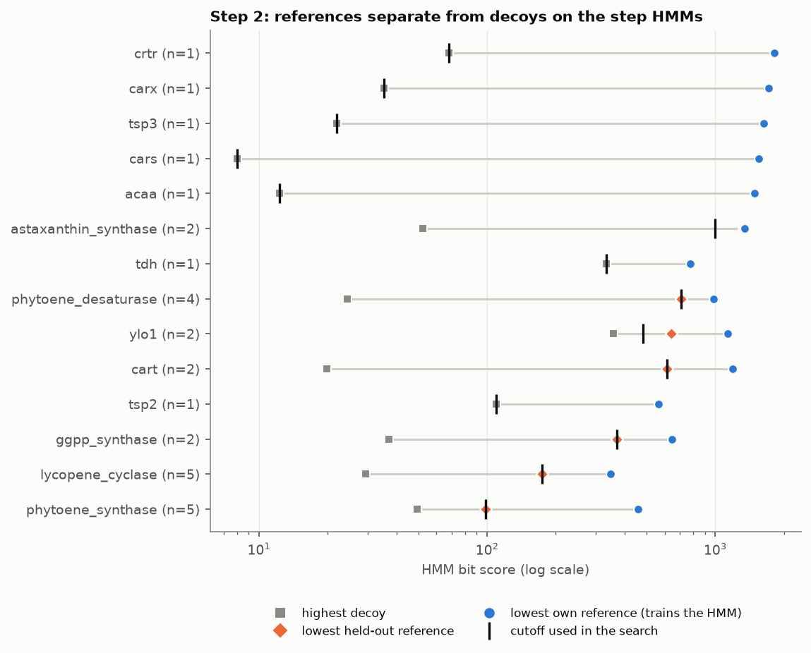
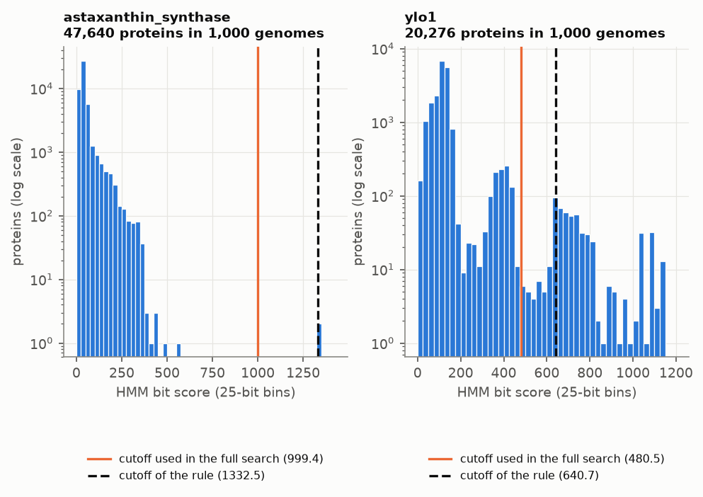

# Carotenoid biosynthesis genes in 23,376 BFD fungal genomes

::: {.callout-important}
## What this is, and where it stops being reliable

- This is a **working analysis of search hits, not a gene census**. Steps 1 to 4 of the census plan are done (HMMs, score check, genome-wide search). Step 5 (tree placement, which decides what a hit is) was run for one step only, `phytoene_synthase`, as a pilot, and named lineage subclades cover only 22.8% of its candidates (section 6). **No hit in this report is a called pathway gene.**
- Every output is stamped `PROVISIONAL`. The pathway definition has `verified: false` (`refs/carotenoid/UNVERIFIED.md`).
- Nothing was tested at the bench. No BFD gene is shown to make a carotenoid.
- A "candidate row" is one protein scored against one step HMM. One protein can give rows for more than one step. The number of distinct proteins was not counted.
- Seven of the 14 step HMMs rest on one reference sequence. Their cutoffs are floors set by decoys, not by held-out references.
:::

## 1. Findings so far

- **The search covered every listed genome.** 23,376 of 23,376 genomes were searched (244,451,335 proteins), with 0 genomes lost and 0 id-prefix errors. 987 of the 24,363 genomes in the table have no protein file and are excluded, not counted as absences (`results/chunk_excluded.tsv`).
- **No decoy and no reference of another step scores at or above a step's own-reference minimum** on any of the 14 step HMMs (0 rows in `targets_at_or_above_min.PROVISIONAL.tsv`). The test set is small: 69 decoys in total.
- **The search returned 238,898 candidate rows** at the cutoffs used. The counts range from 12 rows (`astaxanthin_synthase`) to 46,698 rows (`crtr`). The large counts come from single-reference steps with low floors, so most of those rows are expected to be family members. This is a reading of the counts, not a measurement.
- **A higher cutoff for two steps hides a large number of low-scoring proteins.** With a floor of 20 bits, `astaxanthin_synthase` returns 47,640 proteins and `ylo1` 20,276 proteins in 1,000 genomes. At the rule cutoff, the same run holds 2 and 458 proteins.
- **Step 5 pilot, `phytoene_synthase` and `lycopene_cyclase`: placement removes only a few candidates, and named lineage subclades cover a minority.** In the second run, with 13 named fungal members and 7 non-fungal outgroups in the tree, 10,815 of 10,863 candidates (99.6%) fall in the target clade. Four named subclades exist (Dothideomycetes, Eurotiomycetes, Mucoromycetes, Ustilaginomycetes) and hold 2,482 candidates (22.8%). 8,333 candidates (76.7%) lie in the target clade but in no named subclade (section 6b). The cyclase step gives the same picture: 9,492 of 9,530 candidates in the target clade, 2,177 (22.8%) in a named subclade (section 6c). The result is "consistent with the HMM", not "confirmed phytoene synthase".
- **The candidates of `phytoene_synthase` are not squalene synthase.** All 191 representatives score higher against the 5 synthase references than against a panel of 15 reviewed fungal squalene synthases (smallest margin 37.8 bits, median 128.1 bits).
- **The `ggpp_synthase` cutoff under-calls known GGPP synthases.** 13 of the 39 reviewed fungal entries named geranylgeranyl pyrophosphate synthase score below it (26 of 39 found, 67%), including budding-yeast BTS1 (section 6e).
- **Ten of the 14 steps have no placement yet.** The copy-number and phylum summaries (steps 6 to 8) wait for them.

## 2. The pathway, its references and the hits per step

The definition has 14 steps in 7 routes (`pathways/carotenoid.yaml`, `routes:`). It lists 30 references, of which 28 are verified and 2 are not (`refs/carotenoid/UNVERIFIED.md`). Under the strict reading of the evidence rule, which the owner chose on 2026-11-22, every complete route ends at evidence tier T3 (`docs/superpowers/plans/2026-11-21-stage1-review-packet.md`, item DC1).

<!-- step-table:begin -->
| Step | References | Decoys | Cutoff of the rule | Cutoff used | Candidate rows | Genomes with a row |
|---|---:|---:|---:|---:|---:|---:|
| `acaa` | 1 | 6 | 12.3 | 12.3 | 26,611 | 13,736 |
| `astaxanthin_synthase` | 2 | 5 | 1332.5 | 999.4 (lowered) | 12 | 12 |
| `cars` | 1 | 6 | 8 | 8 | 28,663 | 14,020 |
| `cart` | 2 | 6 | 615.8 | 615.8 | 5,533 | 4,818 |
| `carx` | 1 | 6 | 35.3 | 35.3 | 11,528 | 10,156 |
| `crtr` | 1 | 3 | 68.1 | 68.1 | 46,698 | 23,021 |
| `ggpp_synthase` | 2 | 4 | 369.3 | 369.3 | 22,924 | 15,919 |
| `lycopene_cyclase` | 5 | 9 | 174.1 | 174.1 | 9,530 | 9,311 |
| `phytoene_desaturase` | 4 | 5 | 706.6 | 706.6 | 9,784 | 9,495 |
| `phytoene_synthase` | 5 | 4 | 98.8 | 98.8 | 10,863 | 10,047 |
| `tdh` | 1 | 3 | 333.6 | 333.6 | 16,244 | 14,954 |
| `tsp2` | 1 | 1 | 109.7 | 109.7 | 15,976 | 8,273 |
| `tsp3` | 1 | 6 | 21.9 | 21.9 | 20,942 | 12,785 |
| `ylo1` | 2 | 5 | 640.7 | 480.5 (lowered) | 13,590 | 12,848 |
<!-- step-table:end -->

*Source: `results/step2/carotenoid/step_scores.PROVISIONAL.tsv`, `min_scores.exploratory25.PROVISIONAL.tsv` and `results/search/carotenoid_full/candidates.chunk*.PROVISIONAL.tsv.zst`. Table made by `reports/carotenoid/bin/make_step_table.py`. "Genomes with a row" counts distinct genomes with at least one row for that step, out of 23,376 searched.*


*Compounds are nodes; each edge is a curated reaction, labelled with the step (gene family) that does it and the best evidence tier among that reaction's links. IPP and FPP are drawn as one grey node, and 3-methylbut-2-enal (a cleavage by-product) is not drawn. **The edge tier is the best link of one reaction; the tier of a whole route is the weakest step on it, so an edge can be T1a while its route ends at T3 (section 1).** Four curated reactions have no edge because a substrate or product is not in the tables (listed in the box: `tsp2`, `tdh` and two astaxanthin-route steps). The diagram shows what is curated, not what is present in any genome. [PDF](figures/out/fig6_pathway_diagram.pdf), [SVG](figures/out/fig6_pathway_diagram.svg)*

**Two cutoffs differ from the rule.** For `astaxanthin_synthase` (rule 1332.5, used 999.4) and `ylo1` (rule 640.7, used 480.5) the owner lowered the cutoff by 25%. The two references of each step are nearly identical, so the held-out score only shows that the second reference is a close copy. The rule value is kept in the column `rule_min_score` of the cutoff file, and a hit of the rule is recovered by filtering on score. The table shows the rule value and the value used, so the two columns are not a contradiction.

## 3. Step 2: do references separate from decoys on the step HMMs?



*For the seven steps with a held-out value, the lowest held-out reference scores at least 1.8 times the highest decoy. The ratio is smallest for `ylo1` (640.7 against 358.7, 1.8) and `phytoene_synthase` (98.8 against 49.3, 2.0), and 5.9 or more for the other five. The seven steps with one reference have no held-out value (no orange diamond), so the figure shows only the decoy floor and the optimistic self-score; `tdh` is closest (776.0 against 333.6, 2.3). **This figure shows that the 69 decoys we chose do not look like references; it does not show that BFD has no other proteins that do.** The own-reference score (blue) is inflated, because the references train the HMM. [PDF](figures/out/fig1_step2_separation.pdf)*

How the cutoff was set (owner rule of 2026-11-22): a step with two or more references uses its lowest held-out score. A step with one reference uses its highest decoy score as a floor. The scripts are `bin/score_refs_decoys.py` and `bin/make_min_scores.py`, and the method is in `README.md`, section "Batched BFD search".

## 4. Step 4: the genome-wide search


*A candidate row is a protein at or above the cutoff of its step. **Row counts say how many proteins to place in step 5, not how many genes the pathway has.** Four of the five largest counts belong to steps whose cutoff is a decoy floor (`crtr` 68.1, `cars` 8.0, `acaa` 12.3, `tsp3` 21.9). The fifth is `ggpp_synthase`, whose cutoff is its lowest held-out score (369.3). Genome counts are distinct genomes with at least one row, out of 23,376. [PDF](figures/out/fig2_candidates_per_step.pdf)*

Run facts (MEASURED): 6 jobs on the short queue (16 CPUs, 32 GB requested), 23 min 46 s to 28 min 0 s each, peak memory 22.5 to 22.7 GB. The 200-genome timing job predicted 26 minutes. Details are in `docs/superpowers/notes/2026-11-22-step4-results-and-decisions.md`.

## 5. What a high cutoff misses



*The first 1,000 genomes of the full run were searched again with a floor of 20 bits for the two steps whose cutoff was lowered. The bars are the proteins found; the lines are the two cutoffs. **The rule value and the lowered value cut a long tail of low scores that holds tens of thousands of proteins, so the figure supports "a lower floor floods placement", not "the proteins below the cutoff are real".** For `ylo1` the distribution has a second group at 300 to 480 bits (970 proteins) that lies below both cutoffs; what it is was not checked. [PDF](figures/out/fig3_low_cutoff_side_run.pdf)*

- `astaxanthin_synthase`: the full run, with the lowered cutoff, found 12 hits in 12 genomes. 8 meet the rule value (1332.5). 4 more score 1216 to 1300.
- `ylo1`: the full run found 13,590 hits. 11,194 meet the rule value. 2,396 more score 480.5 to 640.6, in 2,219 genomes. In the 1,000-genome side run the band 480 to 640.7 holds 98 proteins and the band 640.7 or higher holds 458.
- Decision (owner, 2026-11-22): keep the lowered cutoffs for step 5 and go no lower. The reason is in the same notes file.

## 6. Step 5 pilot: tree placement for `phytoene_synthase`

Method (PROPOSED settings marked): the 10,863 candidate proteins were cut to their aligned domain (padded by 20 residues, PROPOSED) and clustered with mmseqs2 at 0.5 identity and 0.8 coverage. The 191 clusters gave 191 representatives, so the cap of 300 never applied. The reference set holds the 5 references, 4 squalene synthase decoys and the 191 representatives (200 sequences; mafft, clipkit, 916 of 1,186 columns kept). The tree is raxml-ng 2.0.4 under LG+G4, rooted on the 4 decoys (PROPOSED; this step has no outgroup file). All 10,863 candidate domains were aligned to it with hmmalign and placed with epa-ng 0.3.8. A candidate counts as `target` when at least 0.5 of its likelihood weight (PROPOSED) lies in the smallest clade that holds all 5 references.


*Grey circles are candidate representatives, sized by the number of candidate domains in their cluster. Blue circles are the 5 references and the four orange squares at the top are the decoys. **The figure shows that the target clade (blue bar) is not a narrow group around the references: the 5 references sit apart from each other inside one clade of 186 leaves, so "placed in the target clade" cannot separate one kind of candidate from another.** Phyla of the representatives are not drawn. [PDF](figures/out/fig4_reference_tree.pdf)*

| Result (MEASURED, `results/step5/carotenoid/phytoene_synthase/SUMMARY.tsv`) | Value |
|---|---|
| Candidate domains extracted and placed | 10,863 of 10,863 (0 extraction failures) |
| Called `target` / `decoy` | 10,708 / 155 |
| Support of the `target` calls (likelihood weight in the clade) | median 1.0, minimum 0.745; 10,705 of 10,708 at 0.9 or more |
| Long pendant branch (above 1.0) | 0 of 10,863 (median 0.167, maximum 0.832) |
| `assign_steps` labels | 10,708 assigned, 155 unassigned, 0 fusion candidates |
| Assigned proteins | 10,708 in 9,896 genomes; copies per genome 1 (9,328), 2 (354), 3 (191), 4 (19), 5 (1), 6 (3) |
| Representatives in target / decoy side | 181 of 191 / 10 of 191 |

- **Reading trap: "assigned" here means placed in the target clade.** The 5 references are not close relatives, so the smallest clade that holds all of them spans 181 of the 191 representatives. A support of 1.0 therefore says the candidate is not on the decoy side. It does not say it is a phytoene synthase rather than a relative. Because every best-clade support is 0.745 or more, the 0.5 threshold removes nothing.
- **Where the 10,708 fall inside the clade** (reported by the pilot run, not saved as a script, so not repeated by me): about 9,082 candidates in the subclade of P37295 and Q8X0Z1 (78 leaves, 76 of them Ascomycota representatives), about 281 in the subclade of Q9P854 and Q9UUQ6, 1,333 elsewhere in the target, 155 outside it, 12 unassigned.
- **The 155 candidates on the decoy side** sit on a branch of 10 representatives next to the decoys. What they are was not checked.
- **A support of 1.0 does not mean the placement is certain.** Only 5 references and 4 decoys give the tree its anchors. The other 191 leaves are representatives, which are candidates themselves.
- **Reviewed fungal bifunctional lycopene cyclase / phytoene synthase entries beyond the 5 references exist.** A UniProt query (EC 2.5.1.32, Fungi, reviewed, run 2026-11-22) returns 19 entries, 14 of them not among our 5 references. Against this panel 140 of the 191 representatives score higher than against the 5 references (median best score 183 against 160 bits). The panel holds full-length proteins and the references are cut domains, so this comparison favours the panel. The evidence behind those 14 entries was not checked. They are the obvious named members to add to the tree (`bin/check_paralog_panel.sh`, output `paralog_panel_lcps/`).

### 6b. Second run: named tree members, non-fungal outgroups and lineage subclades

The first run left the 5 references spread through one clade. The second run adds 13 reviewed fungal bifunctional lycopene cyclase / phytoene synthase entries as named tree leaves, and 7 non-fungal outgroups (bacterial and cyanobacterial CrtB, plant PSY, one CrtM). The curated files are in `refs/carotenoid/tree_members/` (`README.md` there). **12 of the 13 named members are annotated only by similarity to reference P37295; only Q67GH9 has experimental evidence.** They are tree leaves with names. They are not references and not evidence for any step call. One entry (S0EQ07) was excluded because its record has no domain Region feature.

The tree has 220 leaves (5 references, 4 decoys, 13 named members, 7 outgroups, 191 representatives); raxml-ng 2.0.4, LG+G4, 3 starts. A named subclade is defined by a rule that is PROPOSED: for a taxonomic class with at least 2 labelled leaves, the smallest clade holding them is a subclade only if it holds no labelled leaf of another class and no decoy or outgroup.


*Teal diamonds are named members, black triangles outgroups, grey circles candidate representatives (area is the number of candidate domains in the cluster). Dark bars mark the four named subclades and the blue bar the target clade. **The figure shows that the named leaves all lie inside the target clade and that four classes form their own groups; it does not show that a candidate inside a group has that group's function, because the names come from annotation by similarity.** Near-overlapping labels belong to leaves that sit very close together. [PDF](figures/out/fig5_reference_tree_v2.pdf)*

| Result (MEASURED, `results/step5/carotenoid/phytoene_synthase_v2/SUMMARY.tsv`) | Value |
|---|---|
| Target clade | 185 leaves: 5 references, 13 of 13 named members, 167 representatives |
| Candidates called `target` / `decoy` side | 10,815 / 48 (first run: 10,708 / 155) |
| Support in the target clade | median 1.0, minimum 0.670; 10,812 of 10,815 at 0.9 or more |
| Long pendant branch | 0 of 10,863 |
| `assign_steps` | 10,815 assigned, 48 unassigned, in 10,003 genomes (copies per genome: 1 in 9,435, 2 in 354, 3 in 191, 4 in 19, 5 in 1, 6 in 3) |
| Outgroups monophyletic | no: their common ancestor holds the 7 outgroups and the 4 squalene synthase decoys (11 leaves) |

| Named subclade | Labelled leaves | Leaves in clade | Representatives | Candidates called into it |
|---|---:|---:|---:|---:|
| Dothideomycetes | 3 | 3 | 0 | 813 |
| Eurotiomycetes | 4 | 34 | 30 | 1,376 |
| Mucoromycetes | 3 | 10 | 7 | 232 |
| Ustilaginomycetes | 2 | 4 | 2 | 61 |
| none (target clade only) | | | | 8,333 |

*Source: `subclade_counts.tsv`. 2,482 + 8,333 + 48 = 10,863 candidates. No subclade call lies outside the target clade.*

- **Reading trap: the Dothideomycetes subclade holds 0 representatives and 813 candidates.** The subclade is the 3 named leaves alone. Candidates are placed on the edges of the 3 leaves, so they call into it without a representative of their own. A call into a subclade means "placed next to those named leaves", at the tree distances below.
- **Sordariomycetes has no subclade.** Its 5 labelled leaves (2 references and 3 named members) lie in a 50-leaf clade that also holds the 3 Dothideomycetes members. The rule does not force a group. The Tremellomycetes class has 1 labelled leaf (Q7Z859) and cannot form one.
- **Nearest labelled leaf is not close.** The median tree distance from a representative to its nearest labelled leaf is 1.62 substitutions per site (maximum 4.03). By class of the nearest leaf: Dothideomycetes 60 representatives (8,182 candidates in their clusters), Mucoromycetes 46, Eurotiomycetes 30, Sordariomycetes 23, Tremellomycetes 22, Ustilaginomycetes 10 (`nearest_labelled_by_class.tsv`). Median distances run from 1.09 (Sordariomycetes) to 3.20 (Mucoromycetes).
- **The root is uncertain.** The squalene synthase decoys sit inside the outgroups' common ancestor, so the tree is rooted above both. Three raxml-ng starts (log-likelihoods -113644.9, -113638.6, -113648.9) do not show that the best tree is the global optimum (UNVERIFIED). Three earlier submissions failed for resource reasons and are listed in `RUN.md` of that folder.

### 6c. Placement for `lycopene_cyclase`

Same method and the same 13 named members, with their cyclase domains. The tree has 66 leaves (5 references, 13 named members, 1 outgroup, 47 representatives) and no decoys: the filter `bin/filter_decoys_for_tree.py` kept none of the 9 decoys, because none aligns over at least half of the HMM (the best, Q9KK78, covers 18%). **The cyclase placement therefore has no decoy test.** It is rooted on the one aligned outgroup, Q9HNE5.

| Result (MEASURED, `results/step5/carotenoid/lycopene_cyclase_v2/SUMMARY.tsv`) | Value |
|---|---|
| Target clade | 52 leaves: 5 references, 13 of 13 named members, 34 representatives |
| Candidates called `target` / decoy side | 9,492 / 38 (of 9,530) |
| Support in the target clade | median 1.0, minimum 0.94 |
| `assign_steps` | 9,492 assigned in 9,277 genomes (copies per genome: 1 in 9,085, 2 in 176, 3 in 12, 4 in 2, 5 in 1, 6 in 1) |
| Subclades (candidates called into them) | Dothideomycetes 981, Eurotiomycetes 853, Mucoromycetes 221, Ustilaginomycetes 122; none: 7,315 (76.8%) |

- **The result repeats the synthase result.** Four classes form named subclades, Sordariomycetes forms none (its clade also holds Eurotiomycetes and Dothideomycetes members), and about three quarters of the candidates lie in no named subclade. The synthase and cyclase domains are on one fused protein in most fungi, so the two steps are not independent evidence.
- **Reading trap: 7,993 candidates sit in clusters whose representatives are nearest to Dothideomycetes.** Two representatives carry most of them, so one large cluster dominates that count. It is a statement about cluster size, not about how many genomes carry the gene.
- **Three attempts were needed** (`RUN.md`-level facts, MEASURED): the first stopped on the clade check (unalignable decoys in the tree, section 7); a retry died on a `raxml-ng` core-oversubscription abort on node r41; the second tree had Q9KK78 as its only decoy and stopped again because Q9KK78 fell inside the fungal clade; the third had no tree decoys and ran.

### 6c-2. Placement for `phytoene_desaturase` and `cart` (small trees)

Same method as above, but with at most one named lineage member and distant outgroups (`refs/carotenoid/tree_members/`, `README.md` there). No decoy of either step aligns over more than 20% of the step HMM, so no decoy is in either tree.

| Result (MEASURED, `results/step5/carotenoid/<step>/SUMMARY.tsv`) | `phytoene_desaturase` | `cart` |
|---|---:|---:|
| Candidates placed | 9,784 | 5,533 |
| Reference tree leaves | 15 (4 references, 1 named member, 7 outgroups, 3 representatives) | 27 (2 references, 5 outgroups, 20 representatives) |
| Called `target` / outside | 9,760 / 24 | 5,303 / 230 |
| Support in the target clade (median, minimum) | 1.0, 0.501 | 1.0, 0.773 |
| Assigned proteins and genomes | 9,760 in 9,473 | 5,303 in 4,610 |
| Genomes with 1, 2, 3 or more copies | 9,207, 256, 10 | 3,959, 613, 38 |

- **The outgroups are the only non-target anchors.** For `phytoene_desaturase` they are 5 bacterial CrtI-type enzymes, mouse retinol saturase and tomato CRTISO; for `cart` they are 5 vertebrate proteins (BCO1 and RPE65). Plant and cyanobacterial phytoene desaturases, and plant carotenoid cleavage dioxygenases, cover under 20% of the step HMM and could not be used.
- **Reading trap: a placed call here means "near the references".** All 9,784 desaturase candidates fall into only 3 clusters at 50% identity, so the tree cannot tell candidates apart. The call separates candidates from the outgroup side. It does not separate true desaturases from other FAD-dependent oxidoreductases of similar score, because none of those is in the tree.
- **No lineage subclades exist for these steps.** `phytoene_desaturase` has one named member (P48537, annotated by similarity only) and `cart` has none, because UniProt holds too few reviewed fungal entries.

### 6d. Which taxonomic groups have the steps


*Each cell is the percent of genomes of the class with at least one call for the step; the number of genomes is in the row label. The blue panel holds the steps whose cutoff comes from held-out references; the grey panel holds the steps whose cutoff is only a decoy floor, which hit nearly every genome and must be read as "family present". **Four columns are placed calls (tree placement, sections 6 to 6c-2): `phytoene_synthase`, `lycopene_cyclase`, `phytoene_desaturase` and `cart`. The desaturase and `cart` placements use small trees (15 and 27 leaves) and are a weaker filter than the other two. Every other column is a search hit at its cutoff.** Blank cells are below 0.5%. The "3 core carotenoid steps" column is the share of genomes with all of `phytoene_synthase`, `phytoene_desaturase` and `lycopene_cyclase`. All 23,376 searched genomes are used, with no BUSCO filter (see the reading traps). [PDF](figures/out/fig7_presence_by_class.pdf)*


*Orders of Pezizomycotina with at least 40 genomes (13,113 genomes in 26 groups). **The figure shows that the core steps are not spread evenly within the subphylum; it does not show gains or losses, because it has no tree.** [PDF](figures/out/fig8_presence_by_order_pezizomycotina.pdf)*

What the figures show (MEASURED counts of genomes with a call; descriptive only):

- **Classes.** `phytoene_synthase` / `phytoene_desaturase` / `lycopene_cyclase` have calls in 99 / 95 / 96% of Dothideomycetes (2,724 genomes), 43 / 37 / 32% of Eurotiomycetes (3,201), 67 / 66 / 64% of Sordariomycetes (5,981), 100 / 89 / 95% of Mucoromycetes (273), and 99 / 50 / 98% of Ustilaginomycetes (133). They have calls in 2 / 1 / 1% of Agaricomycetes (1,844) and in fewer than 0.5% of Saccharomycetes (2,560), Pichiomycetes (2,929) and Schizosaccharomycetes (67).
- **Orders of Pezizomycotina.** The same three steps are at 38 / 31 / 28% in Eurotiales (2,480 genomes), 75 / 74 / 71% in Hypocreales (3,515), 52 / 52 / 52% in Sordariales (429), 6 / 5 / 4% in Pezizales (171) and 2 / 2 / 2% in Thelebolales (40), against 85 to 99% in Botryosphaeriales, Cladosporiales, Dothideales, Mycosphaerellales, Pleosporales and Venturiales. Magnaporthales (543), Microascales (162) and Ophiostomatales (126) are below 0.5% for all three.
- **`cart`** has calls in 77% of Sordariomycetes and in at most 2% of any other class shown (Leotiomycetes 1.9%). Among the orders of Pezizomycotina it ranges from below 0.5% (Magnaporthales, 543 genomes) through 19% (Diaporthales) and 64% (Sordariales) to 100% (Amphisphaeriales, 97 genomes).

Reading traps and limits:

- **Reading trap: a low `ggpp_synthase` call rate is not absence.** The step has two references. The step HMM scores budding-yeast BTS1 (Q12051) at 284.8 bits and the *Eremothecium* GGPP synthase (Q758K0) at 282.4, both below the cutoff of 369.3; fission-yeast O59703 scores 22.6. Of the 39 reviewed fungal entries named geranylgeranyl pyrophosphate synthase that are not our references, 13 score below the cutoff (section 6e). This is why Saccharomycetes read 3% and Pichiomycetes blank. The cutoff is too strict for GGPP synthases outside the references' lineages, so the column under-calls.
- **`ylo1` and `ggpp_synthase` are at 90% or more in nearly every order of Pezizomycotina.** That pattern fits a widely shared protein family, not a pathway-specific step. These are search hits and are not placed.
- **A "call" is at least one protein in the genome.** An incomplete assembly gives a false absence. A BUSCO filter of 90 would remove whole lineages (MEASURED: Saccharomycetes 2,560 genomes to 0, Pichiomycetes 2,929 to 2, Schizosaccharomycetes and Wallemiomycetes to 0), so it is not applied. The 177 genomes with no class label form their own row.
- **The synthase and cyclase columns are not independent.** In most fungi both are domains of one fused protein (section 6c).
- **Percent of genomes is not percent of species or lineages.** Genome counts follow what has been sequenced; Eurotiales, Hypocreales and Sordariomycetes are large because many strains are sequenced.

### 6e. Do the cutoffs find known entries? A sensitivity audit

For every step that has an EC number of its own in the tables, `bin/sensitivity_audit.py` fetched the reviewed fungal UniProt entries of that EC (`ec:<EC> AND taxonomy_id:4751 AND reviewed:true`, 2026-11-22), removed the step's own references and decoys, and scored the rest with the step HMM (`hmmsearch`, E-value limit 1000, best domain score).


*Blue circles are entries at or above the cutoff (black bar) and orange diamonds are entries below it. **The figure shows that the `ggpp_synthase` cutoff lies inside the score range of known GGPP synthases and the other two cutoffs do not; it does not show that the other steps are sensitive, because the 14 entries of each of the other two are the same bifunctional proteins that serve as named tree members, close relatives of the references.** Steps with fewer than 5 reviewed entries are not drawn (list under the figure). [PDF](figures/out/fig12_sensitivity_audit.pdf)*

| Step | EC | Reviewed fungal entries (not our references) | At or above the cutoff | Lowest score | Cutoff |
|---|---|---:|---:|---:|---:|
| `ggpp_synthase` | 2.5.1.29 | 64 (39 named geranylgeranyl pyrophosphate synthase) | 27 (26 of the 39 named) | 22.6 | 369.3 |
| `phytoene_synthase` | 2.5.1.32 | 14 | 14 | 129.0 | 98.8 |
| `lycopene_cyclase` | 5.5.1.19 | 14 | 14 | 204.2 | 174.1 |
| `phytoene_desaturase` | 1.3.99.30, 1.3.99.31 | 1 | 1 | not judged | 706.6 |
| `cart` | 1.13.11.59 | 1 | 1 | not judged | 615.8 |
| `astaxanthin_synthase`, `carx`, `ylo1` | | 0 | | | |

*Source: `results/audit/carotenoid/sensitivity_summary.tsv` and `sensitivity_entries.tsv`. Six steps (`acaa`, `cars`, `crtr`, `tdh`, `tsp2`, `tsp3`) have no EC of their own in the tables and are not auditable (`not_auditable.tsv`).*

- **`ggpp_synthase` misses real GGPP synthases.** 13 of the 39 entries named geranylgeranyl pyrophosphate synthase score below the cutoff: budding-yeast BTS1 (Q12051, 284.8), *Eremothecium* (Q758K0, 282.4), *Aspergillus nidulans* AN1592 (A0A1U8QLG8, 352.4), *Zymoseptoria* (F9XLC1, 285.6) and fission-yeast O59703 (22.6), among others. This is a sensitivity gap of a two-reference HMM, and it explains the low yeast calls in section 6d.
- **Reading trap: the headline 27 of 64 (42%) is not the recall.** 25 of the 64 entries carry EC 2.5.1.29 but are named terpene synthases (for example variediene synthase, fusicoccadiene synthase), and only 1 of them reaches the cutoff. They are not GGPP synthases proper. The fair figure is 26 of 39 (67%).
- **The synthase and cyclase checks are easy cases.** The lowest entry scores (129.0 and 204.2) are close to the cutoffs (98.8 and 174.1), so the margin is thin; the entries are annotated by similarity to the references.
- **Five steps cannot be judged.** UniProt returned 0, 0, 0, 1 and 1 reviewed entries beyond our references under the EC numbers in the tables. Whether the table numbers are out of date was not checked (UNVERIFIED).
- **A lower `ggpp_synthase` cutoff is an option, not applied (PROPOSED).** At 200 bits, 38 of the 39 named GGPP synthases are found, and the highest decoy scores 37.1. The same cutoff would also call 23 of the 25 terpene synthases, which carry a prenyltransferase domain. What those are in BFD was not checked, and the BFD search was not re-run.
- **What would settle it:** a 1,000-genome search at the lower cutoff, added yeast GGPP synthases as references, or family membership (InterPro) of reviewed entries as the audit set.

### 6g. Are the steps gained and lost together? A first pass on the genus tree

One genome per genus (1,643 tips of the phyling genus tree; 1,639 with data, 4 with no searched genome are NA). Each of the four placed steps is a present or absent call per genus representative. Ancestral states were reconstructed per step with a Mk model (castor), and a branch counts as a gain or loss only when both ends have probability 0.8 or more. `ggpp_synthase`, `ylo1` and the family-level steps are left out, because their calls are family-level or under-called (section 6e).

**Tree and root (PROPOSED).** The FastTree concatenation tree (branch lengths in substitutions per site) is used, rooted on the Opisthosporidia split (Rozellomycota, Aphelidiomycota, Microsporidia; 32 of 33 such tips). The ASTRAL consensus tree is rooted but has coalescent-unit branch lengths and lower support (70.9% of nodes at 0.8 or more, against 93.9%); the two trees differ by an unrooted Robinson-Foulds distance of 1,008 of 3,280, and the Mk likelihood is higher on FastTree for all four steps. Rooting on Blastocladiomycota or Chytridiomycota instead changes the event counts by at most 3 branches. One Microsporidia tip sits elsewhere in the tree, so a long-branch artefact in the root is possible and was not tested.


*Rings from inside: `phytoene_synthase`, `phytoene_desaturase`, `lycopene_cyclase`, `cart`; blue is present, grey absent, orange no data. Clades are labelled by the largest clade of at least 90% purity for each class or phylum. **The figure shows that presence is clustered by clade and that the first three rings agree closely; it does not show where the steps were gained or lost, because branch lengths are not drawn and one genome stands for each genus.** [PDF](figures/out/fig9_tree_presence.pdf)*


*Counts of branches under the all-rates-different model (ARD, lower AIC for every step) and the equal-rates model (ER). Diamonds are gains in one parsimony reconstruction under two tie rules. **The figure shows that the gain count depends on the method (for `phytoene_synthase`, 13 under ARD, 33 under ER, 42 to 52 by parsimony), while the loss count is stable at 88 (ARD) against 47 (ER); it does not give one true number of gains.** [PDF](figures/out/fig10_gain_loss_counts.pdf)*

| Step | Present / absent tips | Gains | Losses | Uncertain branches | Parsimony gains (two tie rules) |
|---|---:|---:|---:|---:|---:|
| `phytoene_synthase` | 737 / 902 | 13 | 88 | 69 | 42 to 52 |
| `phytoene_desaturase` | 687 / 952 | 13 | 117 | 66 | 37 to 67 |
| `lycopene_cyclase` | 683 / 956 | 11 | 104 | 96 | 42 to 59 |
| `cart` | 217 / 1,422 | 5 | 39 | 17 | 14 to 22 |

*ARD model, 0.8 probability rule, Opisthosporidia root (`results/gainloss/carotenoid/gainloss_counts.tsv`). The probability threshold matters: for `phytoene_synthase` the ARD losses are 93, 88 and 79 at 0.7, 0.8 and 0.9 and the ER gains are 42, 33 and 24 (`threshold_sensitivity.tsv`). The `lycopene_cyclase` losses are 104 in this table and 105 in the edge and co-event tables; the cause was not found.*


*Observed branches with an event in both steps, the count expected if one step's events were drawn at random among eligible branches, and the BH q value over 24 tests. **The figure shows that gains and losses of the three core steps fall on the same branches far more often than a random draw predicts; it does not show that the null is right, because the draw ignores tree structure and the q values sit at the permutation floor (0.0004).** [PDF](figures/out/fig11_co_events.pdf)*

| Pair | Co-gain: observed (expected) | Co-loss: observed (expected) |
|---|---:|---:|
| synthase and desaturase | 9 (0.08) | 65 (5.19) |
| synthase and cyclase | 9 (0.09) | 71 (4.91) |
| desaturase and cyclase | 7 (0.07) | 71 (7.00) |
| synthase and `cart` | 0 (0.02) | 3 (2.16) |
| desaturase and `cart` | 0 (0.02) | 6 (2.24; q 0.053) |
| cyclase and `cart` | 0 (0.01) | 3 (2.16) |

What the counts say (descriptive): of the 13 `phytoene_synthase` gains, 9 fall on branches that also gain desaturase and 9 on branches that also gain cyclase; of its 88 losses, 65 fall on branches that also lose desaturase and 71 on branches that also lose cyclase. `cart` shows no co-gain and only weak co-loss with desaturase. Opposite events (a gain of one step with a loss of another) number 0 in 9 of 12 tests.

Reading traps and limits:

- **Reading trap: synthase and cyclase are one gene in most fungi,** so their shared events count once. The synthase and desaturase pair is the informative one among the three.
- **Most events are on tip edges.** For `phytoene_synthase`, 11 of 13 gains and 66 of 88 losses sit on tip edges, 8 of 9 synthase and cyclase co-gains and 53 of 71 co-losses do, and 50 of 65 synthase and desaturase co-losses do. One genus representative stands for the genus, so a single missing gene or an incomplete assembly can look like a loss. No completeness filter was applied.
- **A shared miss can have a common technical cause.** A divergent copy that falls below the cutoffs of several steps in one lineage gives co-loss without a biological loss. The sensitivity audit (section 6e) covers only some steps.
- **The permutation null ignores the tree,** so its p values are probably too small; a tree-aware simulation null is in section 6h. The Pagel tests (likelihood ratio 358 to 543 for the core pairs, p from 4e-76 to 3e-116; 47 to 54 for the `cart` pairs, p about 1e-9 to 5e-11; 498 to 870 s per pair) only show that two clustered traits are associated; any two traits that follow clade structure can give a small p. No error rates were simulated, and no multiple-test correction was applied to the Pagel p values.
- **The two small-tree steps are weak filters.** Switching `phytoene_desaturase` and `cart` between search hits and placed calls moves 10 and 11 genomes (from present to absent) and changes counts by a few branches (`results/gainloss/carotenoid_hits/`). That does not show that either is correct.
- **Marginal probabilities were computed by our own code.** castor's `reroot=TRUE` marginals returned 0 for every node on a toy tree under the ARD model. The own two-pass code matches castor under ER to 1.7e-05 (unit test).

### 6h. Do the shared losses exceed chance on this tree? BUSCO floor, a simulation null and a second tree

Three checks on the result in section 6g. The full record is `results/gainloss/RUN_followup.md`.

**BUSCO floor (owner decision: 65 to 70 for now).** Tips whose genus representative has `busco_complete` below the cutoff are set to NA. A higher cutoff is not used because the BFD BUSCO run used `fungi_odb12` for every genome and the budding yeasts score low as a group (Saccharomycetes median 75.4, 10th to 90th percentile 72.2 to 77.9, 2,589 genomes), which fits markers missing from the lineage and not poor assemblies (UNVERIFIED; open question Q2 in `docs/superpowers/notes/2026-11-22-open-questions.md`). A floor of 65 to 70 therefore cannot catch an incomplete yeast assembly. Cutoff 70 removes 69 of 1,654 representatives; cutoff 65 removes 59.

| Step | Tips with data (unfiltered, 70) | Gains | Losses | Losses on tip / internal edges |
|---|---|---:|---:|---|
| `phytoene_synthase` | 1,639 / 1,570 | 13 / 13 | 88 / 77 | 66 / 22 and 58 / 19 |
| `phytoene_desaturase` | 1,639 / 1,570 | 13 / 12 | 117 / 114 | 94 / 23 and 90 / 23 |
| `lycopene_cyclase` | 1,639 / 1,570 | 11 / 15 | 104 / 96 | 82 / 23 and 75 / 21 |
| `cart` | 1,639 / 1,570 | 5 / 5 | 39 / 38 | 34 / 5 and 33 / 5 |

*ARD model, 0.8 rule, Opisthosporidia root (`results/gainloss/carotenoid_busco_compare/`). Cutoffs 65 and 70 give counts within 2 branches of each other.*

- **The filter changes counts by 13% or less and removes mostly tips that are absent for every step.** Of the 69 removed tips, 31 have no class label (30 Microsporidia and 1 Rozellomycota by the phylum column; all absent for all four steps; why their BUSCO is low was not tested), 12 are Agaricomycetes (all absent), and 7 are Lecanoromycetes (71% present for each core step). Saccharomycetes loses 1 and Pichiomycetes 0.
- **Core co-loss falls from 65 to 71 branches to 59 to 65 at cutoff 70** (internal edges stay at 15 to 17 and 14 to 15), and co-gain changes by at most 1.

**A tree-aware simulation null.** Each step is simulated independently on the same tree under its own fitted ARD rates, 2,000 replicates; each replicate is refitted, reconstructed and called with the same 0.8 rule, and co-events are counted on all edges and on internal edges only. Internal-edge events cannot come from an incomplete assembly.

- **Reading trap: the null as first specified is wrong for these data.** With a stationary root the simulated steps have a mean of 150, 121, 122 and 26 present tips (`phytoene_synthase`, `phytoene_desaturase`, `lycopene_cyclase`, `cart`), against 737, 687, 683 and 217 observed, and only 1 to 2% of replicates reach the observed prevalence. Such a null can hardly produce a co-loss, so its p values sit at the floor for a reason unrelated to the pair (`fig13_null_co_events`).
- **A prevalence-matched null is the main reading (PROPOSED).** Same rates, but each replicate is drawn until its present-tip count is within 10% of the observed count. It reproduces the gains (12 against 13 for `phytoene_synthase`) and overshoots the losses (103 against 88). It matches prevalence, not clade structure.


*Blue bars are the null (2,000 replicates), the orange line is the observed count, for all edges and for internal edges only. **The figure shows that the shared losses of the three core steps lie far outside the null on all edges and on internal edges, while the `cart` pairs lie inside it; it does not show that the steps are functionally linked, and the `phytoene_synthase` and `lycopene_cyclase` row is not a meaningful test because the two are one fused gene.** The null does not model missing data or a shared technical cause. [PDF](figures/out/fig13b_null_co_events_prevalence_matched.pdf)*

| Pair and event | Observed all edges (internal) | Null mean all edges (internal) | p |
|---|---:|---:|---:|
| synthase and desaturase, co-loss | 65 (15) | 9.1 (1.2) | 0.0005 |
| synthase and cyclase, co-loss (fused gene) | 70 (17) | 8.7 (1.2) | 0.0005 |
| desaturase and cyclase, co-loss | 71 (15) | 10.5 (1.4) | 0.0005 |
| synthase and desaturase, co-gain | 9 (2) | 0.17 (0.03) | 0.0005 |
| synthase and cyclase, co-gain (fused gene) | 9 (1) | 0.18 (0.03) | 0.0005 (internal 0.029) |
| desaturase and cyclase, co-gain | 7 (1) | 0.18 (0.03) | 0.0005 (internal 0.035) |
| `cart` pairs, co-loss | 3 to 6 (0) | 2.7 to 3.5 (0.4 to 0.5) | 0.26 to 0.49 |
| `cart` pairs, co-gain | 0 (0) | 0.05 to 0.07 | 1.0 |

*Unfiltered tips, N = 2,000, so the smallest possible p is 0.0005 (`results/gainloss/carotenoid_null/null_summary.tsv`). At BUSCO 70 the core co-loss is 59 to 65 against a null mean of 7.1 to 8.6, internal 15 against about 1.0 to 1.2, p 0.0005 (`carotenoid_busco70_null/`). The internal-edge co-gain has 2 branches for synthase and desaturase (p 0.001) and 1 branch for the two cyclase pairs (p 0.043 to 0.047, q 0.19), so it is weak evidence.*

- **Core co-loss is more than chance on this tree.** 59 to 71 observed branches against a null mean of 7 to 10 (interval up to 14 to 20), and 15 to 17 internal-edge branches against about 1 (interval up to 4), unfiltered and at BUSCO 70.
- **`cart` is within chance.** Its co-loss p is 0.26 to 0.54 and it has no co-gain. It is not called co-lost with the other steps. The first null gave `cart` co-loss p of 0.0035 to 0.015, which the matched null does not support.
- **What this does not establish.** It does not show a functional link; a shared technical cause (a divergent copy falling below several cutoffs in one lineage) would also give co-loss; the simulation also leaves out missing data. Pagel at cutoff 70 for the core pairs gives p from 3.5e-72 to 2.3e-109 and has the clade-clustering limit already stated in section 6g.
- **The root of the simulation is open.** A stationary root was used; a root drawn from the reconstruction (N = 100, smallest p 0.0099) gave the same pattern.

**A second tree (ASTRAL, unfiltered, counts only).** The ASTRAL consensus tree was used with its own root. Its branch lengths are coalescent units, so rates are not comparable with FastTree and this is a topology check.

| Step | Gains FastTree / ASTRAL as given / ASTRAL all lengths 1 | Losses FastTree / as given / all 1 |
|---|---|---|
| `phytoene_synthase` | 13 / 14 / 32 | 88 / 74 / 46 |
| `phytoene_desaturase` | 13 / 13 / 24 | 117 / 104 / 74 |
| `lycopene_cyclase` | 11 / 13 / 27 | 104 / 99 / 64 |
| `cart` | 5 / 5 / 7 | 39 / 42 / 43 |

- **The core co-event pattern holds on the ASTRAL tree with its own lengths:** co-gain 8 to 10 (FastTree 7 to 9), co-loss 57 to 61 (FastTree 65 to 71), internal co-loss 14 to 16 (15 to 17). `cart` pairs have 0 co-gains on all three versions.
- **Counts depend on branch lengths.** With all lengths set to 1, gains are two to three times higher and losses lower. The numbers of gains and losses are method-dependent; the sign of the pattern is not.
- **Not done here:** Pagel on ASTRAL or at cutoff 65; the simulation on ASTRAL or at cutoff 65; a test of why the 31 low-BUSCO unlabelled tips are low.

## 7. Negative and unresolved results

- **Single-reference steps cannot be checked for sensitivity.** Seven steps (`acaa`, `cars`, `carx`, `crtr`, `tdh`, `tsp2`, `tsp3`) have one reference. Removing it leaves nothing to score, so there is no held-out value. More references would help; a structure model would not.
- **The held-out check is weak for near-identical references.** For `astaxanthin_synthase` the lowest held-out score is 1332.5 and the lowest own score is 1343.2, because the two references are almost the same sequence. The cutoff therefore says little about distant homologs. The 25% reduction is a test of this, not a fix.
- **The lycopene cyclase decoys test the cutoff weakly.** The highest decoy score is 29.3 and the lowest held-out reference score is 174.1. Any cutoff in between is consistent with the decoys, and none was tested on a genome (`refs/carotenoid/decoys/LYCOPENE_CYCLASE_DECOYS.md`).
- **A same-function homolog from Archaea (Q9HNE5) scores 115.6 on the cyclase HMM.** It is a tree outgroup only, not a decoy, so it does not set the cutoff (`refs/carotenoid/outgroups/`).
- **The first step 5 design did not discriminate for `phytoene_synthase`, and adding named members helped only partly.** In the first run the clade of the 5 references was too broad and every support was high, so placement removed only the 155 candidates on the decoy side. With 13 named members and 7 outgroups, four classes form named subclades, but 76.7% of candidates (8,333 of 10,863) stay in the target clade with no named subclade, and Sordariomycetes, the class of two references, forms none. The expectation that the candidates would include many squalene synthases was wrong: all 191 representatives score higher against the references than against 15 reviewed fungal squalene synthases (`bin/check_paralog_panel.sh`, `paralog_panel/summary.tsv`: smallest margin 37.8 bits). The 4 decoys probe the root of the tree, not the candidate set.
- **The first two `lycopene_cyclase` trees stopped by their own check (2026-11-22).** The tool refuses to go on when the 5 references do not form a clade free of decoys and outgroups. **This was a design error of ours, not a biological result.** In the first tree, 5 decoys (the four PF05834 proteins and Q9KK79) lay inside the clade of the references; they have no detectable homology to the fungal cyclase domain (`refs/carotenoid/decoys/LYCOPENE_CYCLASE_DECOYS.md`), so they cannot be aligned. A filter that kept decoys scoring at least 10 bits left Q9KK78, which aligns over only 44 of 241 HMM positions (18%) and also fell inside the fungal clade (pendant branch 3.8). The rule now also needs a coverage of at least 50% of the HMM, which keeps no decoy. The decoys still serve the cutoff and the absence check. The first two folders are kept as records (`lycopene_cyclase/`, `lycopene_cyclase_v2/attempt2_decoy_Q9KK78/`).
- **A measurement in the decoy notes does not reproduce.** The decoy notes list step-HMM scores of 10.1 for A1XI29 and 12.9 for Q93QX4. A new `hmmsearch` of the cyclase HMM against the 9 decoys (E-value limit 1000 for sequences and domains, HMMER 3.4) reports only Q9KK78 (29.3 bits). The cause was not found. The tree filter uses the value that reproduces.
- **The metabolomics corpus cannot test carotenoids.** REPORTED by the EBC side: 0 of 84 fungal-reference accessions show beta-carotene, zeaxanthin or canthaxanthin (`docs/superpowers/notes/2026-11-21-exploration-log.md`, section 1). This is a statement about the corpus, not about BFD genomes.

## 8. What would change this, and what was not done

**What would change the findings.** More named members from lineages that have none yet (Sordariomycetes outside the 5 labelled leaves, Agaricomycetes, early-diverging groups) would show whether the 8,333 unnamed candidates split into groups. Named members with experimental evidence would let a subclade name stand for function. A rerun with more raxml-ng starts and with the outgroups rooted without the squalene synthase decoys would test the root. A decoy or a non-pathway family member that places inside a target clade would show that a step's HMM cannot separate it. A reference set with more members for a single-reference step would change its floor.

**Not done here:**

- Step 5 for the other 13 steps. The tool is step-generic (`bin/step5_place.py`). `lycopene_cyclase` is done (section 6c); it has no decoy test in its tree.
- Quality, contamination and haplotype flags (step 7). There is no fungal versus non-fungal reference set, so counts will be raw first.
- The copy matrix and phylum summary (step 8), the deposited versus BFD comparison (steps 9, 10), the tblastn absence check (step 11) and triage (step 12).
- **Co-gain and co-loss, beyond sections 6g and 6h.** Not done: a yeast-specific BUSCO set (the 65 to 70 floor cannot catch an incomplete yeast assembly); the simulation null on a second tree or at cutoff 65; replicate genomes per genus; and the same analysis for the other steps.
- The root of the genus tree is a PROPOSED choice (Opisthosporidia); the sensitivity to Blastocladiomycota and Chytridiomycota roots is small (at most 3 branches), but one Microsporidia tip lies outside the group, and a long-branch artefact was not tested.
- The question of whether fungal lycopene cyclases have diversified in some groups (`docs/superpowers/notes/2026-11-22-open-questions.md`, Q1). It needs step 5 first.

## 9. Methods, tools and files

| What | Where |
|---|---|
| Step HMMs (14, from `refs/carotenoid/*.faa`) | `results/hmms/carotenoid/*.PROVISIONAL.hmm`, `bin/build_step_hmms.py` |
| Reference and decoy scoring, held-out check | `bin/score_refs_decoys.py`, `slurm/score_refs_decoys.sbatch`, job 32375043 |
| Cutoffs | `bin/make_min_scores.py`; used: `results/step2/carotenoid/min_scores.exploratory25.PROVISIONAL.tsv` |
| Chunks and search | `bin/make_chunks.py`, `bin/search_chunk.py`, `slurm/search_chunk.sbatch`; jobs 32375296 to 32375301; side run 32375378 |
| Step 5 pilot | `bin/step5_place.py`, `slurm/step5_prepare.sbatch`, `slurm/step5_place.sbatch`, `tests/test_step5_place.py`; jobs 32376309 and 32376554; output `results/step5/carotenoid/phytoene_synthase/` (`RUN.md` lists commands and tool versions) |
| Named tree members (v2) | `refs/carotenoid/tree_members/` (13 members, 7 outgroups, provenance, README), `tests/test_tree_members.py`; v2 run `results/step5/carotenoid/phytoene_synthase_v2/` (`RUN.md`), jobs 32377324 and 32377370 |
| Decoy filter for trees | `bin/filter_decoys_for_tree.py` (score >= 10 bits and HMM coverage >= 0.5, PROPOSED), `tests/test_filter_decoys_for_tree.py`; used with `PC_DECOYS_FA` in `slurm/step5_prepare.sbatch` |
| Gain and loss | `bin/make_calls_table.py`, `bin/gainloss_lib.R`, `bin/run_gainloss.R`, `bin/run_pagel.R`, `bin/gainloss_compare_trees.R`, `slurm/gainloss_*.sbatch`, figures `fig9_tree_presence.R`, `fig10_gain_loss_counts.R`, `fig11_co_events.R`; output `results/gainloss/carotenoid/` (`RUN.md` has commands, versions, jobs); tree `BFD_dashboard/atlas_data/phylo/results/protein/buildtree/fungi_odb10/fasttree/*.support.treefile`; R 4.2.0 (ape, castor, phytools, ggtree) |
| Gain/loss follow-up | `bin/filter_calls_busco.py`, `compare_busco_versions.py`, `gainloss_null_lib.R`, `run_null_sim.R`, `summarise_null.R`, `run_astral_compare.R`, `slurm/gainloss_null.sbatch`, `fig13_null_co_events.R`, tests `test_gainloss_null.py`, `test_filter_calls_busco.py`; results `results/gainloss/carotenoid_busco70/`, `carotenoid_busco65/`, `carotenoid_null/`, `carotenoid_busco70_null/`, `carotenoid_astral/`, record `results/gainloss/RUN_followup.md` |
| Desaturase and cart placement | `results/step5/carotenoid/phytoene_desaturase/` and `cart/` (jobs 32377960 to 32377963); outgroups in `refs/carotenoid/tree_members/` |
| Cyclase placement | `results/step5/carotenoid/lycopene_cyclase_v2/` (jobs 32377644 and 32377645) |
| Sensitivity audit | `bin/sensitivity_audit.py`, `tests/test_sensitivity_audit.py`, figure `reports/carotenoid/figures/bin/fig_sensitivity_audit.py` (figure 12); output `results/audit/carotenoid/`; UniProt REST queries of 2026-11-22 |
| Presence heatmaps | `reports/carotenoid/figures/bin/fig_presence_heatmap.py` (figures 7 and 8), `tests/test_fig_presence_heatmap.py`; inputs `results/genomes.tsv.zst`, `species.parquet`, `results/search/carotenoid_full/`, the two `assigned.PROVISIONAL.tsv` files |
| Pathway diagram | `reports/carotenoid/figures/bin/fig_pathway_diagram.py` (Graphviz), `tests/test_fig_pathway_diagram.py`; data from `kb/carotenoid/` and `.cache/chebi/` |
| Paralog panel check | `reports/carotenoid/bin/check_paralog_panel.sh` (UniProt REST and blastp) |
| Figures | `reports/carotenoid/figures/bin/fig_census_search.py` (figures 1 to 3) and `fig_ref_tree.py` (figures 4 and 5), tested in `tests/test_fig_census_search.py` and `tests/test_fig_ref_tree.py` |
| Tool versions | hmmer 3.4, mafft 7.505, raxml-ng 2.0.4, epa-ng 0.3.8, mmseqs2 17-b804f, clipkit 1.3.0, Python 3.12, zstd 1.5.6 |
| Code commits | `32f2f90` (tools), `834288e` (notes) on branch `pathway-census-realdata` |
| Decisions and evidence | `docs/superpowers/notes/2026-11-22-owner-decisions.md`, `2026-11-22-step4-results-and-decisions.md` |

All `results/` files are git-ignored. The figures are regenerated from them by the script in the table.

Regenerate the figures and the table (run from `analysis/pathway_census`):

```sh
R=results
/usr/bin/python3.12 reports/carotenoid/figures/bin/fig_census_search.py \
  --step2-dir $R/step2/carotenoid --search-dir $R/search/carotenoid_full \
  --min-scores $R/step2/carotenoid/min_scores.exploratory25.PROVISIONAL.tsv \
  --side-dir $R/search/side_eval_low_cutoff --out-dir reports/carotenoid/figures/out
/usr/bin/python3.12 reports/carotenoid/bin/make_step_table.py \
  --step2-dir $R/step2/carotenoid --search-dir $R/search/carotenoid_full \
  --min-scores $R/step2/carotenoid/min_scores.exploratory25.PROVISIONAL.tsv \
  --refs-dir refs/carotenoid --report reports/carotenoid/REPORT.md
/usr/bin/python3.12 reports/carotenoid/figures/bin/fig_ref_tree.py \
  --step5-dir $R/step5/carotenoid/phytoene_synthase --out-dir reports/carotenoid/figures/out
/usr/bin/python3.12 reports/carotenoid/figures/bin/fig_ref_tree.py \
  --step5-dir $R/step5/carotenoid/phytoene_synthase_v2 --out-dir reports/carotenoid/figures/out \
  --name fig5_reference_tree_v2 --title "Reference tree with named members and outgroups (v2)"
/usr/bin/python3.12 reports/carotenoid/figures/bin/fig_pathway_diagram.py \
  --kb-dir kb/carotenoid --cache-dir .cache --out-dir reports/carotenoid/figures/out
S=/bigdata/stajichlab/shared/projects/BFD/Fungi_BFD_runs/tables/species.parquet
COMMON="--genomes $R/genomes.tsv.zst --species $S --search-dir $R/search/carotenoid_full \
  --min-scores $R/step2/carotenoid/min_scores.exploratory25.PROVISIONAL.tsv \
  --placed phytoene_synthase=$R/step5/carotenoid/phytoene_synthase_v2/assigned.PROVISIONAL.tsv \
  --placed lycopene_cyclase=$R/step5/carotenoid/lycopene_cyclase_v2/assigned.PROVISIONAL.tsv \
  --out-dir reports/carotenoid/figures/out"
/usr/bin/python3.12 reports/carotenoid/figures/bin/fig_presence_heatmap.py $COMMON --rank class --min-n 25 --name fig7_presence_by_class
/usr/bin/python3.12 reports/carotenoid/figures/bin/fig_presence_heatmap.py $COMMON --rank order \
  --within SUBPHYLUM=Pezizomycotina --min-n 40 --name fig8_presence_by_order_pezizomycotina
```
