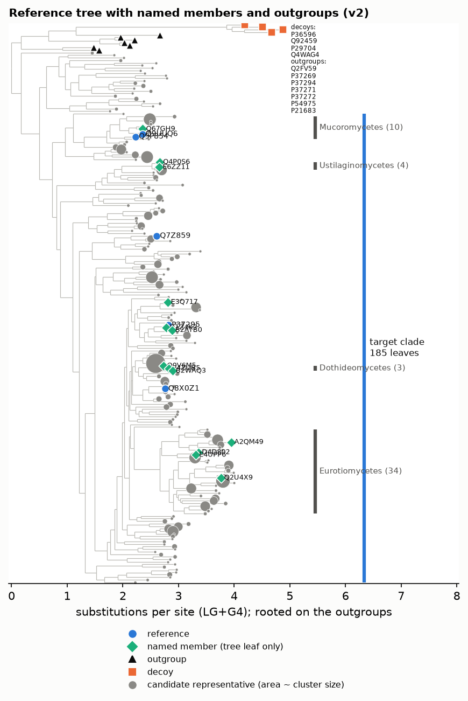

# Carotenoid biosynthesis genes in 23,376 BFD fungal genomes

::: {.callout-important}
## What this is, and where it stops being reliable

- This is a **working analysis of search hits, not a gene census**. Steps 1 to 4 of the census plan are done (HMMs, score check, genome-wide search). Step 5 (tree placement, which decides what a hit is) was run for one step only, `phytoene_synthase`, as a pilot, and named lineage subclades cover only 22.8% of its candidates (section 6). **No hit in this report is a called pathway gene.**
- Every output is stamped `PROVISIONAL`. The pathway definition has `verified: false` (`refs/carotenoid/UNVERIFIED.md`).
- Nothing was tested at the bench. No BFD gene is shown to make a carotenoid.
- A "candidate row" is one protein scored against one step HMM. One protein can give rows for more than one step. The number of distinct proteins was not counted.
- Seven of the 14 step HMMs rest on one reference sequence. Their cutoffs are floors set by decoys, not by held-out references.
:::

## 1. Findings so far

- **The search covered every listed genome.** 23,376 of 23,376 genomes were searched (244,451,335 proteins), with 0 genomes lost and 0 id-prefix errors. 987 of the 24,363 genomes in the table have no protein file and are excluded, not counted as absences (`results/chunk_excluded.tsv`).
- **No decoy and no reference of another step scores at or above a step's own-reference minimum** on any of the 14 step HMMs (0 rows in `targets_at_or_above_min.PROVISIONAL.tsv`). The test set is small: 69 decoys in total.
- **The search returned 238,898 candidate rows** at the cutoffs used. The counts range from 12 rows (`astaxanthin_synthase`) to 46,698 rows (`crtr`). The large counts come from single-reference steps with low floors, so most of those rows are expected to be family members. This is a reading of the counts, not a measurement.
- **A higher cutoff for two steps hides a large number of low-scoring proteins.** With a floor of 20 bits, `astaxanthin_synthase` returns 47,640 proteins and `ylo1` 20,276 proteins in 1,000 genomes. At the rule cutoff, the same run holds 2 and 458 proteins.
- **Step 5 pilot, `phytoene_synthase`: placement removes only a few candidates, and named lineage subclades cover a minority.** In the second run, with 13 named fungal members and 7 non-fungal outgroups in the tree, 10,815 of 10,863 candidates (99.6%) fall in the target clade. Four named subclades exist (Dothideomycetes, Eurotiomycetes, Mucoromycetes, Ustilaginomycetes) and hold 2,482 candidates (22.8%). 8,333 candidates (76.7%) lie in the target clade but in no named subclade (section 6). The result is "consistent with the HMM", not "confirmed phytoene synthase".
- **The candidates of `phytoene_synthase` are not squalene synthase.** All 191 representatives score higher against the 5 synthase references than against a panel of 15 reviewed fungal squalene synthases (smallest margin 37.8 bits, median 128.1 bits).
- **The other 13 steps have no placement yet.** The copy-number and phylum summaries (steps 6 to 8) wait for them.

## 2. The pathway, its references and the hits per step

The definition has 14 steps in 7 routes (`pathways/carotenoid.yaml`, `routes:`). It lists 30 references, of which 28 are verified and 2 are not (`refs/carotenoid/UNVERIFIED.md`). Under the strict reading of the evidence rule, which the owner chose on 2026-11-22, every complete route ends at evidence tier T3 (`docs/superpowers/plans/2026-11-21-stage1-review-packet.md`, item DC1).

<!-- step-table:begin -->
| Step | References | Decoys | Cutoff of the rule | Cutoff used | Candidate rows | Genomes with a row |
|---|---:|---:|---:|---:|---:|---:|
| `acaa` | 1 | 6 | 12.3 | 12.3 | 26,611 | 13,736 |
| `astaxanthin_synthase` | 2 | 5 | 1332.5 | 999.4 (lowered) | 12 | 12 |
| `cars` | 1 | 6 | 8 | 8 | 28,663 | 14,020 |
| `cart` | 2 | 6 | 615.8 | 615.8 | 5,533 | 4,818 |
| `carx` | 1 | 6 | 35.3 | 35.3 | 11,528 | 10,156 |
| `crtr` | 1 | 3 | 68.1 | 68.1 | 46,698 | 23,021 |
| `ggpp_synthase` | 2 | 4 | 369.3 | 369.3 | 22,924 | 15,919 |
| `lycopene_cyclase` | 5 | 9 | 174.1 | 174.1 | 9,530 | 9,311 |
| `phytoene_desaturase` | 4 | 5 | 706.6 | 706.6 | 9,784 | 9,495 |
| `phytoene_synthase` | 5 | 4 | 98.8 | 98.8 | 10,863 | 10,047 |
| `tdh` | 1 | 3 | 333.6 | 333.6 | 16,244 | 14,954 |
| `tsp2` | 1 | 1 | 109.7 | 109.7 | 15,976 | 8,273 |
| `tsp3` | 1 | 6 | 21.9 | 21.9 | 20,942 | 12,785 |
| `ylo1` | 2 | 5 | 640.7 | 480.5 (lowered) | 13,590 | 12,848 |
<!-- step-table:end -->

*Source: `results/step2/carotenoid/step_scores.PROVISIONAL.tsv`, `min_scores.exploratory25.PROVISIONAL.tsv` and `results/search/carotenoid_full/candidates.chunk*.PROVISIONAL.tsv.zst`. Table made by `reports/carotenoid/bin/make_step_table.py`. "Genomes with a row" counts distinct genomes with at least one row for that step, out of 23,376 searched.*

**Two cutoffs differ from the rule.** For `astaxanthin_synthase` (rule 1332.5, used 999.4) and `ylo1` (rule 640.7, used 480.5) the owner lowered the cutoff by 25%. The two references of each step are nearly identical, so the held-out score only shows that the second reference is a close copy. The rule value is kept in the column `rule_min_score` of the cutoff file, and a hit of the rule is recovered by filtering on score. The table shows the rule value and the value used, so the two columns are not a contradiction.

## 3. Step 2: do references separate from decoys on the step HMMs?


*For the seven steps with a held-out value, the lowest held-out reference scores at least 1.8 times the highest decoy. The ratio is smallest for `ylo1` (640.7 against 358.7, 1.8) and `phytoene_synthase` (98.8 against 49.3, 2.0), and 5.9 or more for the other five. The seven steps with one reference have no held-out value (no orange diamond), so the figure shows only the decoy floor and the optimistic self-score; `tdh` is closest (776.0 against 333.6, 2.3). **This figure shows that the 69 decoys we chose do not look like references; it does not show that BFD has no other proteins that do.** The own-reference score (blue) is inflated, because the references train the HMM. [PDF](figures/out/fig1_step2_separation.pdf)*

How the cutoff was set (owner rule of 2026-11-22): a step with two or more references uses its lowest held-out score. A step with one reference uses its highest decoy score as a floor. The scripts are `bin/score_refs_decoys.py` and `bin/make_min_scores.py`, and the method is in `README.md`, section "Batched BFD search".

## 4. Step 4: the genome-wide search


*A candidate row is a protein at or above the cutoff of its step. **Row counts say how many proteins to place in step 5, not how many genes the pathway has.** Four of the five largest counts belong to steps whose cutoff is a decoy floor (`crtr` 68.1, `cars` 8.0, `acaa` 12.3, `tsp3` 21.9). The fifth is `ggpp_synthase`, whose cutoff is its lowest held-out score (369.3). Genome counts are distinct genomes with at least one row, out of 23,376. [PDF](figures/out/fig2_candidates_per_step.pdf)*

Run facts (MEASURED): 6 jobs on the short queue (16 CPUs, 32 GB requested), 23 min 46 s to 28 min 0 s each, peak memory 22.5 to 22.7 GB. The 200-genome timing job predicted 26 minutes. Details are in `docs/superpowers/notes/2026-11-22-step4-results-and-decisions.md`.

## 5. What a high cutoff misses


*The first 1,000 genomes of the full run were searched again with a floor of 20 bits for the two steps whose cutoff was lowered. The bars are the proteins found; the lines are the two cutoffs. **The rule value and the lowered value cut a long tail of low scores that holds tens of thousands of proteins, so the figure supports "a lower floor floods placement", not "the proteins below the cutoff are real".** For `ylo1` the distribution has a second group at 300 to 480 bits (970 proteins) that lies below both cutoffs; what it is was not checked. [PDF](figures/out/fig3_low_cutoff_side_run.pdf)*

- `astaxanthin_synthase`: the full run, with the lowered cutoff, found 12 hits in 12 genomes. 8 meet the rule value (1332.5). 4 more score 1216 to 1300.
- `ylo1`: the full run found 13,590 hits. 11,194 meet the rule value. 2,396 more score 480.5 to 640.6, in 2,219 genomes. In the 1,000-genome side run the band 480 to 640.7 holds 98 proteins and the band 640.7 or higher holds 458.
- Decision (owner, 2026-11-22): keep the lowered cutoffs for step 5 and go no lower. The reason is in the same notes file.

## 6. Step 5 pilot: tree placement for `phytoene_synthase`

Method (PROPOSED settings marked): the 10,863 candidate proteins were cut to their aligned domain (padded by 20 residues, PROPOSED) and clustered with mmseqs2 at 0.5 identity and 0.8 coverage. The 191 clusters gave 191 representatives, so the cap of 300 never applied. The reference set holds the 5 references, 4 squalene synthase decoys and the 191 representatives (200 sequences; mafft, clipkit, 916 of 1,186 columns kept). The tree is raxml-ng 2.0.4 under LG+G4, rooted on the 4 decoys (PROPOSED; this step has no outgroup file). All 10,863 candidate domains were aligned to it with hmmalign and placed with epa-ng 0.3.8. A candidate counts as `target` when at least 0.5 of its likelihood weight (PROPOSED) lies in the smallest clade that holds all 5 references.


*Grey circles are candidate representatives, sized by the number of candidate domains in their cluster. Blue circles are the 5 references and the four orange squares at the top are the decoys. **The figure shows that the target clade (blue bar) is not a narrow group around the references: the 5 references sit apart from each other inside one clade of 186 leaves, so "placed in the target clade" cannot separate one kind of candidate from another.** Phyla of the representatives are not drawn. [PDF](figures/out/fig4_reference_tree.pdf)*

| Result (MEASURED, `results/step5/carotenoid/phytoene_synthase/SUMMARY.tsv`) | Value |
|---|---|
| Candidate domains extracted and placed | 10,863 of 10,863 (0 extraction failures) |
| Called `target` / `decoy` | 10,708 / 155 |
| Support of the `target` calls (likelihood weight in the clade) | median 1.0, minimum 0.745; 10,705 of 10,708 at 0.9 or more |
| Long pendant branch (above 1.0) | 0 of 10,863 (median 0.167, maximum 0.832) |
| `assign_steps` labels | 10,708 assigned, 155 unassigned, 0 fusion candidates |
| Assigned proteins | 10,708 in 9,896 genomes; copies per genome 1 (9,328), 2 (354), 3 (191), 4 (19), 5 (1), 6 (3) |
| Representatives in target / decoy side | 181 of 191 / 10 of 191 |

- **Reading trap: "assigned" here means placed in the target clade.** The 5 references are not close relatives, so the smallest clade that holds all of them spans 181 of the 191 representatives. A support of 1.0 therefore says the candidate is not on the decoy side. It does not say it is a phytoene synthase rather than a relative. Because every best-clade support is 0.745 or more, the 0.5 threshold removes nothing.
- **Where the 10,708 fall inside the clade** (reported by the pilot run, not saved as a script, so not repeated by me): about 9,082 candidates in the subclade of P37295 and Q8X0Z1 (78 leaves, 76 of them Ascomycota representatives), about 281 in the subclade of Q9P854 and Q9UUQ6, 1,333 elsewhere in the target, 155 outside it, 12 unassigned.
- **The 155 candidates on the decoy side** sit on a branch of 10 representatives next to the decoys. What they are was not checked.
- **A support of 1.0 does not mean the placement is certain.** Only 5 references and 4 decoys give the tree its anchors. The other 191 leaves are representatives, which are candidates themselves.
- **Reviewed fungal bifunctional lycopene cyclase / phytoene synthase entries beyond the 5 references exist.** A UniProt query (EC 2.5.1.32, Fungi, reviewed, run 2026-11-22) returns 19 entries, 14 of them not among our 5 references. Against this panel 140 of the 191 representatives score higher than against the 5 references (median best score 183 against 160 bits). The panel holds full-length proteins and the references are cut domains, so this comparison favours the panel. The evidence behind those 14 entries was not checked. They are the obvious named members to add to the tree (`bin/check_paralog_panel.sh`, output `paralog_panel_lcps/`).

### 6b. Second run: named tree members, non-fungal outgroups and lineage subclades

The first run left the 5 references spread through one clade. The second run adds 13 reviewed fungal bifunctional lycopene cyclase / phytoene synthase entries as named tree leaves, and 7 non-fungal outgroups (bacterial and cyanobacterial CrtB, plant PSY, one CrtM). The curated files are in `refs/carotenoid/tree_members/` (`README.md` there). **12 of the 13 named members are annotated only by similarity to reference P37295; only Q67GH9 has experimental evidence.** They are tree leaves with names. They are not references and not evidence for any step call. One entry (S0EQ07) was excluded because its record has no domain Region feature.

The tree has 220 leaves (5 references, 4 decoys, 13 named members, 7 outgroups, 191 representatives); raxml-ng 2.0.4, LG+G4, 3 starts. A named subclade is defined by a rule that is PROPOSED: for a taxonomic class with at least 2 labelled leaves, the smallest clade holding them is a subclade only if it holds no labelled leaf of another class and no decoy or outgroup.



*Teal diamonds are named members, black triangles outgroups, grey circles candidate representatives (area is the number of candidate domains in the cluster). Dark bars mark the four named subclades and the blue bar the target clade. **The figure shows that the named leaves all lie inside the target clade and that four classes form their own groups; it does not show that a candidate inside a group has that group's function, because the names come from annotation by similarity.** Near-overlapping labels belong to leaves that sit very close together. [PDF](figures/out/fig5_reference_tree_v2.pdf)*

| Result (MEASURED, `results/step5/carotenoid/phytoene_synthase_v2/SUMMARY.tsv`) | Value |
|---|---|
| Target clade | 185 leaves: 5 references, 13 of 13 named members, 167 representatives |
| Candidates called `target` / `decoy` side | 10,815 / 48 (first run: 10,708 / 155) |
| Support in the target clade | median 1.0, minimum 0.670; 10,812 of 10,815 at 0.9 or more |
| Long pendant branch | 0 of 10,863 |
| `assign_steps` | 10,815 assigned, 48 unassigned, in 10,003 genomes (copies per genome: 1 in 9,435, 2 in 354, 3 in 191, 4 in 19, 5 in 1, 6 in 3) |
| Outgroups monophyletic | no: their common ancestor holds the 7 outgroups and the 4 squalene synthase decoys (11 leaves) |

| Named subclade | Labelled leaves | Leaves in clade | Representatives | Candidates called into it |
|---|---:|---:|---:|---:|
| Dothideomycetes | 3 | 3 | 0 | 813 |
| Eurotiomycetes | 4 | 34 | 30 | 1,376 |
| Mucoromycetes | 3 | 10 | 7 | 232 |
| Ustilaginomycetes | 2 | 4 | 2 | 61 |
| none (target clade only) | | | | 8,333 |

*Source: `subclade_counts.tsv`. 2,482 + 8,333 + 48 = 10,863 candidates. No subclade call lies outside the target clade.*

- **Reading trap: the Dothideomycetes subclade holds 0 representatives and 813 candidates.** The subclade is the 3 named leaves alone. Candidates are placed on the edges of the 3 leaves, so they call into it without a representative of their own. A call into a subclade means "placed next to those named leaves", at the tree distances below.
- **Sordariomycetes has no subclade.** Its 5 labelled leaves (2 references and 3 named members) lie in a 50-leaf clade that also holds the 3 Dothideomycetes members. The rule does not force a group. The Tremellomycetes class has 1 labelled leaf (Q7Z859) and cannot form one.
- **Nearest labelled leaf is not close.** The median tree distance from a representative to its nearest labelled leaf is 1.62 substitutions per site (maximum 4.03). By class of the nearest leaf: Dothideomycetes 60 representatives (8,182 candidates in their clusters), Mucoromycetes 46, Eurotiomycetes 30, Sordariomycetes 23, Tremellomycetes 22, Ustilaginomycetes 10 (`nearest_labelled_by_class.tsv`). Median distances run from 1.09 (Sordariomycetes) to 3.20 (Mucoromycetes).
- **The root is uncertain.** The squalene synthase decoys sit inside the outgroups' common ancestor, so the tree is rooted above both. Three raxml-ng starts (log-likelihoods -113644.9, -113638.6, -113648.9) do not show that the best tree is the global optimum (UNVERIFIED). Three earlier submissions failed for resource reasons and are listed in `RUN.md` of that folder.

## 7. Negative and unresolved results

- **Single-reference steps cannot be checked for sensitivity.** Seven steps (`acaa`, `cars`, `carx`, `crtr`, `tdh`, `tsp2`, `tsp3`) have one reference. Removing it leaves nothing to score, so there is no held-out value. More references would help; a structure model would not.
- **The held-out check is weak for near-identical references.** For `astaxanthin_synthase` the lowest held-out score is 1332.5 and the lowest own score is 1343.2, because the two references are almost the same sequence. The cutoff therefore says little about distant homologs. The 25% reduction is a test of this, not a fix.
- **The lycopene cyclase decoys test the cutoff weakly.** The highest decoy score is 29.3 and the lowest held-out reference score is 174.1. Any cutoff in between is consistent with the decoys, and none was tested on a genome (`refs/carotenoid/decoys/LYCOPENE_CYCLASE_DECOYS.md`).
- **A same-function homolog from Archaea (Q9HNE5) scores 115.6 on the cyclase HMM.** It is a tree outgroup only, not a decoy, so it does not set the cutoff (`refs/carotenoid/outgroups/`).
- **The first step 5 design did not discriminate for `phytoene_synthase`, and adding named members helped only partly.** In the first run the clade of the 5 references was too broad and every support was high, so placement removed only the 155 candidates on the decoy side. With 13 named members and 7 outgroups, four classes form named subclades, but 76.7% of candidates (8,333 of 10,863) stay in the target clade with no named subclade, and Sordariomycetes, the class of two references, forms none. The expectation that the candidates would include many squalene synthases was wrong: all 191 representatives score higher against the references than against 15 reviewed fungal squalene synthases (`bin/check_paralog_panel.sh`, `paralog_panel/summary.tsv`: smallest margin 37.8 bits). The 4 decoys probe the root of the tree, not the candidate set.
- **The first `lycopene_cyclase` tree stopped by its own check (2026-11-22).** The tool refuses to go on when the 5 references do not form a clade free of decoys and outgroups, and it stopped: the common ancestor of the references held 5 decoys (the four PF05834 proteins and Q9KK79). **This is a design error of ours, not a biological result.** Those 5 decoys have no detectable homology to the fungal cyclase domain (`refs/carotenoid/decoys/LYCOPENE_CYCLASE_DECOYS.md`), so they cannot be aligned and land on arbitrary branches. They still serve the cutoff and the absence check. A second run keeps in the tree only decoys whose step-HMM score is at least 10 bits (PROPOSED; `bin/filter_decoys_for_tree.py`), which leaves Q9KK78 (29.3 bits) and the outgroup Q9HNE5. The first run's folder is kept as the record (`results/step5/carotenoid/lycopene_cyclase/`).
- **A measurement in the decoy notes does not reproduce.** The decoy notes list step-HMM scores of 10.1 for A1XI29 and 12.9 for Q93QX4. A new `hmmsearch` of the cyclase HMM against the 9 decoys (E-value limit 1000 for sequences and domains, HMMER 3.4) reports only Q9KK78 (29.3 bits). The cause was not found. The tree filter uses the value that reproduces.
- **The metabolomics corpus cannot test carotenoids.** REPORTED by the EBC side: 0 of 84 fungal-reference accessions show beta-carotene, zeaxanthin or canthaxanthin (`docs/superpowers/notes/2026-11-21-exploration-log.md`, section 1). This is a statement about the corpus, not about BFD genomes.

## 8. What would change this, and what was not done

**What would change the findings.** More named members from lineages that have none yet (Sordariomycetes outside the 5 labelled leaves, Agaricomycetes, early-diverging groups) would show whether the 8,333 unnamed candidates split into groups. Named members with experimental evidence would let a subclade name stand for function. A rerun with more raxml-ng starts and with the outgroups rooted without the squalene synthase decoys would test the root. A decoy or a non-pathway family member that places inside a target clade would show that a step's HMM cannot separate it. A reference set with more members for a single-reference step would change its floor.

**Not done here:**

- Step 5 for the other 13 steps. The tool is step-generic (`bin/step5_place.py`). `lycopene_cyclase` was run twice: the first tree stopped (section 7), and the result of the second run is not in this report yet.
- Quality, contamination and haplotype flags (step 7). There is no fungal versus non-fungal reference set, so counts will be raw first.
- The copy matrix and phylum summary (step 8), the deposited versus BFD comparison (steps 9, 10), the tblastn absence check (step 11) and triage (step 12).
- A species tree overlay. A genus-level tree exists (`BFD_dashboard/atlas_data/phylo/results/protein/tree/fungi_odb10/final_tree.nw`, 1,643 tips by a text scan of the file). Its root, outgroup and tip overlap with the FastTree trees were not checked.
- The question of whether fungal lycopene cyclases have diversified in some groups (`docs/superpowers/notes/2026-11-22-open-questions.md`, Q1). It needs step 5 first.

## 9. Methods, tools and files

| What | Where |
|---|---|
| Step HMMs (14, from `refs/carotenoid/*.faa`) | `results/hmms/carotenoid/*.PROVISIONAL.hmm`, `bin/build_step_hmms.py` |
| Reference and decoy scoring, held-out check | `bin/score_refs_decoys.py`, `slurm/score_refs_decoys.sbatch`, job 32375043 |
| Cutoffs | `bin/make_min_scores.py`; used: `results/step2/carotenoid/min_scores.exploratory25.PROVISIONAL.tsv` |
| Chunks and search | `bin/make_chunks.py`, `bin/search_chunk.py`, `slurm/search_chunk.sbatch`; jobs 32375296 to 32375301; side run 32375378 |
| Step 5 pilot | `bin/step5_place.py`, `slurm/step5_prepare.sbatch`, `slurm/step5_place.sbatch`, `tests/test_step5_place.py`; jobs 32376309 and 32376554; output `results/step5/carotenoid/phytoene_synthase/` (`RUN.md` lists commands and tool versions) |
| Named tree members (v2) | `refs/carotenoid/tree_members/` (13 members, 7 outgroups, provenance, README), `tests/test_tree_members.py`; v2 run `results/step5/carotenoid/phytoene_synthase_v2/` (`RUN.md`), jobs 32377324 and 32377370 |
| Decoy filter for trees | `bin/filter_decoys_for_tree.py`, `tests/test_filter_decoys_for_tree.py`; used with `PC_DECOYS_FA` in `slurm/step5_prepare.sbatch` |
| Paralog panel check | `reports/carotenoid/bin/check_paralog_panel.sh` (UniProt REST and blastp) |
| Figures | `reports/carotenoid/figures/bin/fig_census_search.py` (figures 1 to 3) and `fig_ref_tree.py` (figures 4 and 5), tested in `tests/test_fig_census_search.py` and `tests/test_fig_ref_tree.py` |
| Tool versions | hmmer 3.4, mafft 7.505, raxml-ng 2.0.4, epa-ng 0.3.8, mmseqs2 17-b804f, clipkit 1.3.0, Python 3.12, zstd 1.5.6 |
| Code commits | `32f2f90` (tools), `834288e` (notes) on branch `pathway-census-realdata` |
| Decisions and evidence | `docs/superpowers/notes/2026-11-22-owner-decisions.md`, `2026-11-22-step4-results-and-decisions.md` |

All `results/` files are git-ignored. The figures are regenerated from them by the script in the table.

Regenerate the figures and the table (run from `analysis/pathway_census`):

```sh
R=results
/usr/bin/python3.12 reports/carotenoid/figures/bin/fig_census_search.py \
  --step2-dir $R/step2/carotenoid --search-dir $R/search/carotenoid_full \
  --min-scores $R/step2/carotenoid/min_scores.exploratory25.PROVISIONAL.tsv \
  --side-dir $R/search/side_eval_low_cutoff --out-dir reports/carotenoid/figures/out
/usr/bin/python3.12 reports/carotenoid/bin/make_step_table.py \
  --step2-dir $R/step2/carotenoid --search-dir $R/search/carotenoid_full \
  --min-scores $R/step2/carotenoid/min_scores.exploratory25.PROVISIONAL.tsv \
  --refs-dir refs/carotenoid --report reports/carotenoid/REPORT.md
/usr/bin/python3.12 reports/carotenoid/figures/bin/fig_ref_tree.py \
  --step5-dir $R/step5/carotenoid/phytoene_synthase --out-dir reports/carotenoid/figures/out
/usr/bin/python3.12 reports/carotenoid/figures/bin/fig_ref_tree.py \
  --step5-dir $R/step5/carotenoid/phytoene_synthase_v2 --out-dir reports/carotenoid/figures/out \
  --name fig5_reference_tree_v2 --title "Reference tree with named members and outgroups (v2)"
```
