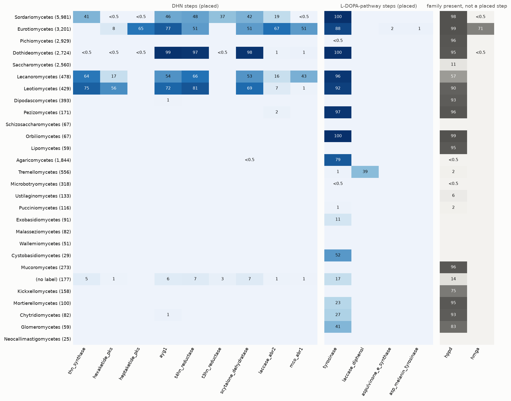
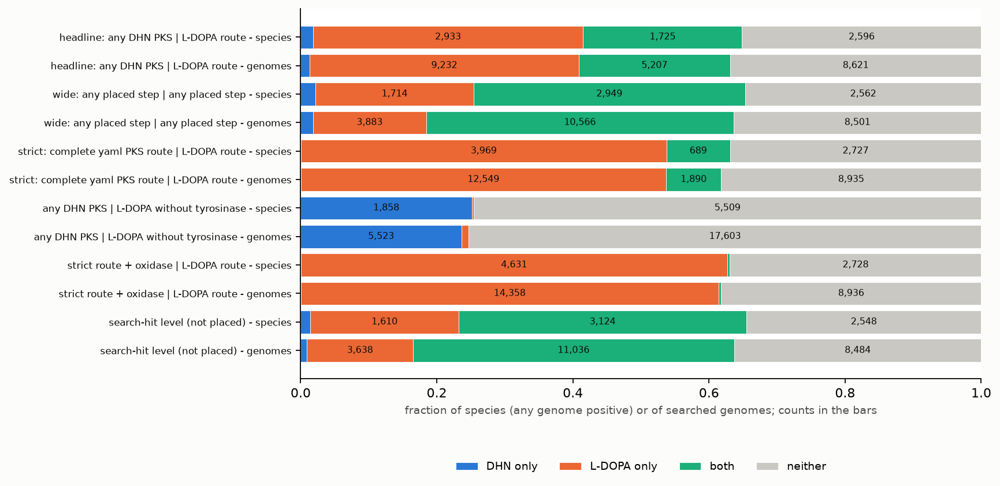
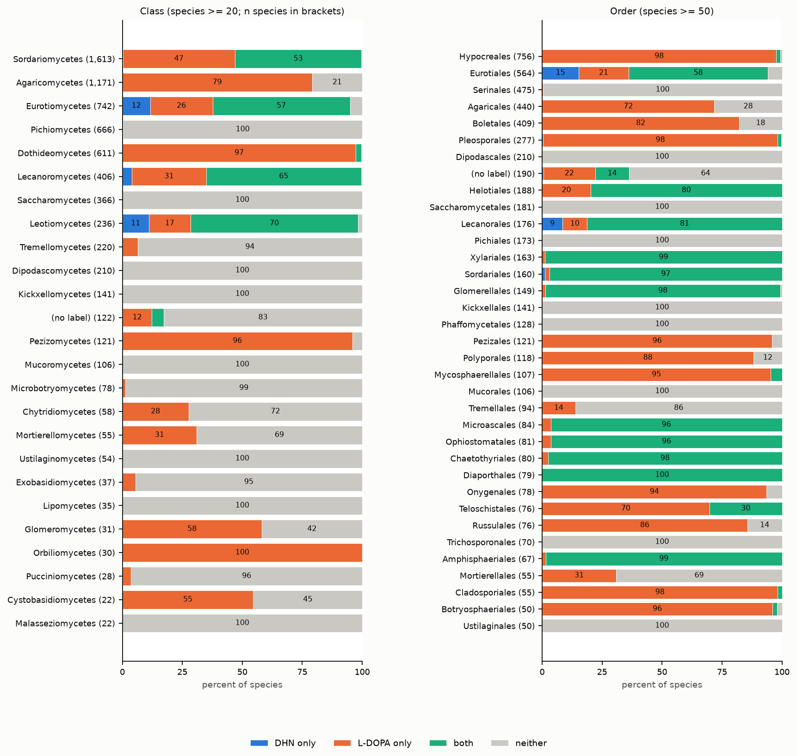
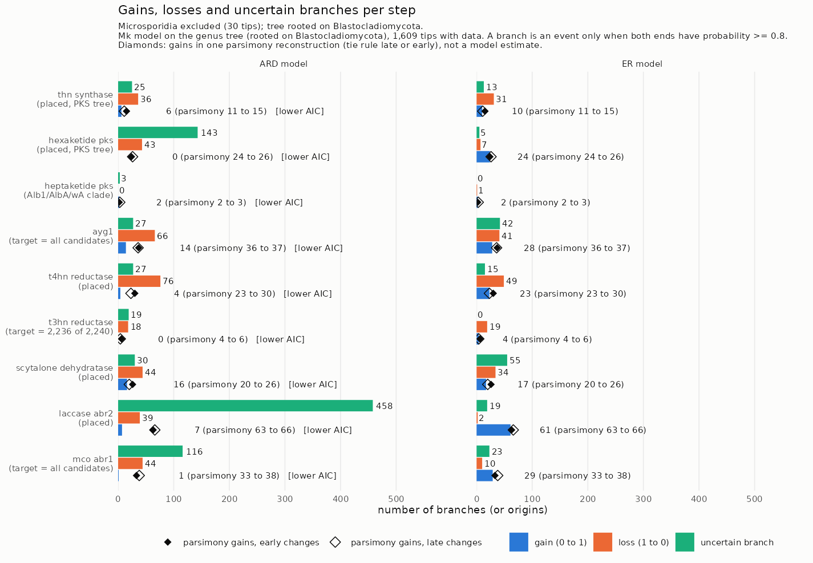

# DHN melanin and L-DOPA melanin genes in 23,376 BFD fungal genomes

::: {.callout-important}
## What this is, and where it stops being reliable

- **This is a working census of candidate genes, not a map of melanin production.** Nothing here was tested at the bench. No call shows that a protein has the function of its step, and no absence call shows that a genome lacks the step. Both pathway files have `verified: false`, so every result is PROVISIONAL.
- A `target` call means that a protein sits in a tree region bounded by the labelled leaves put in that step's tree (references, decoys, named members, outgroups). The call depends on which leaves were chosen. It is not an ortholog call. For `ayg1`, `mco_abr1`, `hmga`, `laccase_diphenol`, `tyrosinase` and `hppd` the target holds almost every candidate, so the call carries little or no information beyond "the HMM hit".
- The tyrosinase and hppd trees have only 3 and 4 labelled leaves outside the target. "Tyrosinase placed" and "hppd placed" read as "family present".
- The PKS steps share one joint tree at identity 0.8. Its sampling is labelled **not yet adequate** (criterion C4 failed for 200 of 8,842 domains, section 4.2). Bootstrap support is from NNI-only searches, which are less optimised than standard searches. The effect on each support value is unverified. There is no outgroup in the PKS tree.
- The tree for `scytalone_dehydratase` (v2) drops one leaf after the first tree was seen (selection with hindsight). The `omt` placement belongs to the mycosporine report and is not covered here.
- The per-species comparison (section 6) uses placed-step calls only. Its presence rules are PROPOSED. A different reasonable rule moves the counts by thousands of species (section 6.3). The comparison reports counts only.
- Gain and loss (section 7) cover the placed steps only. Co-loss of `t4hn_reductase` with four other DHN steps exceeds the matched null, with q floor 0.036 at N = 2,000. Model choice (ARD against ER) changes gain counts strongly.
- Labels: **MEASURED** is read from a file named in the text. **PROPOSED** is a choice or a rule. **UNVERIFIED** is not checked.
:::

## 1. Findings so far

All numbers are MEASURED unless marked. Denominators: 23,376 searched genomes and 7,387 species with at least one searched genome (section 6.1).

1. **The search covers every genome with proteins.** 18 HMMs (15 are melanin steps) ran on 244,451,875 proteins in 23,376 genomes with no missing or duplicate genome. Of the 15 melanin steps, 12 are placed on a tree, 3 are PKS steps placed on one joint tree, and none is left as a search-hit step (section 3).
2. **Step presence differs by clade.** Placed `tyrosinase` calls are in 14,219 of 23,376 genomes (60.8 %), `thn_synthase` in 3,124 (13.4 %), `heptaketide_pks` in 2,091 (8.9 %), `hexaketide_pks` in 600 (2.6 %). Placed PKS calls are almost all in Ascomycota; placed tyrosinase calls are in Ascomycota (12,643 of 19,203) and Basidiomycota (1,491 of 3,242) (section 5).
3. **The headline per-species comparison.** Under the PROPOSED headline rules (`D_pks`, `L_route`), of 7,387 species: DHN only 133, L-DOPA only 2,933, both 1,725, neither 2,596. At genome level (23,376): 316, 9,232, 5,207, 8,621 (section 6).
4. **The result depends on the rule.** The strict yaml-route rule gives DHN only 2, L-DOPA only 3,969, both 689, neither 2,727 species. The wide rule (any placed step) gives 162, 1,714, 2,949, 2,562. The strict rule is small because no genome has all placed steps of the hexaketide or heptaketide route: 1,214 genomes have `heptaketide_pks`, `ayg1`, `t4hn_reductase` and `scytalone_dehydratase` placed and none of them has a placed `t3hn_reductase` (section 6.3).
5. **The L-DOPA side is dominated by the tyrosinase family.** `L_route` is positive in 14,439 genomes, of which 14,219 have placed `tyrosinase`. Without the tyrosinase family only 250 genomes are positive (`laccase_diphenol` 215 genomes, and 35 more genomes with both Asp-melanin steps; section 6.3).
6. **The heptaketide PKS step has no target under the union decoy rule.** Alb1, AlbA and wA cannot be separated in the tree (separated in 2 of 100 NNI bootstrap trees and 0 of 2 standard trees). The headline uses the per-step rule (the Alb1/AlbA/wA clade, target of 22 leaves, 2,123 of 2,200 candidate proteins in 2,091 genomes). The wA placement is unresolved (section 4.2).

## 2. The pathways, references and decoys

::: {.callout-note}
## Sources
`pathways/melanin_dhn.yaml` (9 steps, 22 references, 40 decoy records) and `pathways/melanin_ldopa.yaml` (6 steps, 15 references, 33 decoy records); counts from `docs/superpowers/notes/2026-11-23-melanin-mycosporine-step2.md`, section 2 and section 9. Decoys of five steps were fetched from UniProt on 2026-11-23 (28 decoys; owner decision of the same day).
:::

**DHN melanin.** The yaml has three PKS routes to 1,8-dihydroxynaphthalene and a polymerisation group. Route (a) `pks_thn`: `thn_synthase`, `t4hn_reductase`, `scytalone_dehydratase`, `t3hn_reductase`, `scytalone_dehydratase`. Route (b) `pks_hexaketide`: `hexaketide_pks`, `ayg1`, then the same four enzyme steps. Route (c) `pks_heptaketide`: `heptaketide_pks`, `ayg1`, then the same. The three PKS steps are alternatives, never consecutive. `laccase_abr2` and `mco_abr1` form the polymerisation group; the yaml says the order is not settled and the evidence is a colour phenotype only. The polymer is not a compound in the tables.

**L-DOPA melanin.** The yaml has four routes. `tyrosinase_dopa`: `tyrosinase`. `laccase_exogenous`: `laccase_diphenol`; its substrate comes from outside the fungus, so gene presence alone shows nothing about a pigment. `pyomelanin`: `hppd`. `tyrosine_degradation`: `hppd`, `hmga`; the yaml declares it "so that hmgA counts against pyomelanin". `asp_melanin`: `aspulvinone_e_synthase`, `asp_melanin_tyrosinase`. Owner decision 6: `hppd` is reported as "family present", not as a placed step. This report treats `hmga` the same way, because its placement carries no information (decision of 2026-11-24, "keep as is").

**Steps defined by reaction.** The PKS steps are defined by reaction (`thn_synthase`, `hexaketide_pks`, `heptaketide_pks`; owner decision 9), plus an "any DHN PKS" column (`D_pks`, section 6). The owner did not answer whether to define them by pathway role instead; the yaml definition stays (open, section 8).

### 2.1 Steps, references and cutoffs

`min_score` is the step cutoff. The rule is the lowest leave-one-out score of the references, or the highest decoy score for a one-reference step ("decoy floor"). Hit rows are rows at or above `min_score` in the full search (all 23,376 genomes; `summary.txt` of `results/search/melanin_myco_full`). The genome column counts genome prefixes of the hit rows and includes the 3 unmapped prefixes of the re-annotated genomes (section 3).

<!-- BEGIN steps -->
| Step | Pathway | Route (yaml) | Refs | `min_score` | Basis | Hit rows | Genomes with a hit row |
|---|---|---|---:|---:|---|---:|---:|
| `thn_synthase` | DHN | pks_thn | 1 | 1908.6 | decoy floor | 7,286 | 6,535 |
| `hexaketide_pks` | DHN | pks_hexaketide | 1 | 1839.0 | decoy floor | 8,604 | 7,819 |
| `heptaketide_pks` | DHN | pks_heptaketide | 2 | 3656.7 | leave-one-out | 2,200 | 2,168 |
| `ayg1` | DHN | (b), (c) | 3 | 374.2 | leave-one-out | 11,836 | 8,526 |
| `t4hn_reductase` | DHN | (a), (b), (c) | 5 | 356.0 | leave-one-out | 10,010 | 8,092 |
| `t3hn_reductase` | DHN | (a), (b), (c) | 3 | 550.4 | leave-one-out | 2,240 | 2,203 |
| `scytalone_dehydratase` | DHN | (a), (b), (c), twice | 4 | 240.5 | leave-one-out | 8,604 | 7,511 |
| `laccase_abr2` | DHN | polymerisation | 1 | 464.3 | decoy floor | 9,631 | 4,923 |
| `mco_abr1` | DHN | polymerisation | 2 | 638.2 | leave-one-out | 1,918 | 1,897 |
| `tyrosinase` | L-DOPA | tyrosinase_dopa | 7 | 63.6 | leave-one-out | 50,452 | 14,220 |
| `laccase_diphenol` | L-DOPA | laccase_exogenous | 3 | 1127.7 | leave-one-out | 402 | 215 |
| `aspulvinone_e_synthase` | L-DOPA | asp_melanin | 1 | 1205.5 | decoy floor | 168 | 127 |
| `asp_melanin_tyrosinase` | L-DOPA | asp_melanin | 1 | 320.5 | decoy floor | 2,471 | 1,847 |
| `hppd` | L-DOPA | pyomelanin (family present) | 1 | 164.3 | decoy floor | 20,103 | 16,847 |
| `hmga` | L-DOPA | tyrosine_degradation (family present) | 2 | 983.2 | leave-one-out | 2,313 | 2,280 |
<!-- END steps -->

Table 1. Steps of the two pathways. MEASURED (`min_scores.combined.omt100.6.PROVISIONAL.tsv`, the yaml files, `summary.txt`). The `omt` override of 100.6 belongs to mycosporine and is not in this table.

Reading notes on the cutoffs (MEASURED, step 2 note, section 3):

- `thn_synthase` and `hexaketide_pks` have the decoy wA (Q03149) as floor (1,908.6 and 1,839.0). Two PKS references of other steps score above these floors.
- `heptaketide_pks`: wA scores 3,904.0, above the lowest leave-one-out score of its two references (3,656.7). **No cutoff separates wA from the heptaketide references.** The decoy files never held wA for `heptaketide_pks` (correction of 2026-11-25 in the PKS note); wA is a decoy of `thn_synthase` and `hexaketide_pks`.
- `t4hn_reductase`: the margin to the best decoy is 13.1 bits, and a `t3hn_reductase` reference (A7DWM6, 357.1) scores above the `t4hn_reductase` cutoff. The two SDR steps are paralogues; 583 proteins hit both HMMs (section 4.3).
- `tyrosinase`: the cutoff 63.6 is set by one reference (Q00234, melO). The next lowest leave-one-out score is 239.8. 3,475 of 50,452 rows (6.9 %) score below 127.2 (2 x the cutoff).
- `hppd`, `aspulvinone_e_synthase` and `asp_melanin_tyrosinase` have floors set by one decoy each (HmaS O52791, atrA Q0CT94, ivoB Q5BGU9). The `aspulvinone_e_synthase` floor is 54 % of the reference score and does not separate atromentin synthetases from the step.
- `scytalone_dehydratase` and `hmga`: the decoys score nothing on the HMM, so no check of separation exists at the HMM level.

## 3. The genome-wide search (step 4)

- 18 HMMs (3 pathways), one combined cutoff table, 6 chunks of 4,000 genomes (the last has 3,376). The union of the searched lists is 23,376 genomes, 0 duplicates, 0 missing and 0 extra against `has_proteins` in `genomes.tsv.zst`. 244,451,875 proteins were searched (MEASURED, `summary.txt`).
- Rows: DHN 62,329 rows in 53,024 proteins; L-DOPA 75,909 rows in 75,909 proteins. Genomes with at least one hit row: DHN 11,254, L-DOPA 19,073 (prefix counts; MEASURED).
- **The 5 re-annotated genomes.** 39,700 proteins in 5 genomes have an id prefix that is not the locus tag of the genome table (F8B45790, FE750E90, FE41F6C9, FF465DA3, F6D07108; new prefixes F7CB232C, F317F9F5, FB9275E9, F629B7B9, FAD1592B). These genomes were re-annotated from new assembly versions and got new locus tags. The search covered all their proteins. Our copy maps the new prefixes to the old table rows with `analysis/pathway_census/prefix_aliases.tsv`; 13 of 13 unmapped hit rows map (11 to FE41F6C9, 1 to F8B45790, 1 to F6D07108). BUSCO and N50 in those rows describe the OLD assembly, and for FF465DA3 the new assembly has another accession. The BFD owner decides the real fix; this report does not change BFD files. Details: `docs/superpowers/notes/2026-11-24-genome-prefix-mismatch.md`.
- Rows lost in placement (MEASURED, step 5 note, section 6): 11 melanin hit rows were not placed because the protein file for the new prefix is missing or the coordinates no longer match (`ayg1` 1, `hppd` 5, `tyrosinase` 5). The 5 genomes have no placed call for any step (Table 8, section 6.4).
- A pathway is not "present" because of a hit. Many step HMMs are broad families: 84 % of genomes have a hit row for some step of the three pathways (19,645 of 23,376; including mycosporine steps).

## 4. Placement per step (step 5)

### 4.1 Calls per step

Each step has one tree. The 12 non-PKS steps use `epa-ng`, with all placements kept for the steps rerun on 2026-11-25 (owner decision 7). Run used per step (owner decisions): `_allplace` where it exists, `v2` for `scytalone_dehydratase`, `tyrosinase` and `hppd`. `hppd_v2` has no all-placements run; `hppd_allplace` belongs to the first (300-representative) tree and is not used. Other-side calls are decoy-side or outgroup-side placements. "Unassigned" is a clade weight below 0.5. Genomes with a placed call are genomes with at least one protein labelled `assigned`.

<!-- BEGIN placement -->
| Step | Run used | Candidate proteins | Target | Other side | Unassigned | Genomes with a placed call | Genomes searched |
|---|---|---:|---:|---:|---:|---:|---:|
| `thn_synthase` | PKS joint tree, identity 0.8, per-step decoys | 7,286 | 3,163 | 4,005 | 118 | 3,124 | 23,376 |
| `hexaketide_pks` | PKS joint tree, identity 0.8, per-step decoys | 8,604 | 609 | 7,838 | 157 | 600 | 23,376 |
| `heptaketide_pks` | PKS joint tree, identity 0.8, per-step decoys | 2,200 | 2,123 | 7 | 70 | 2,091 | 23,376 |
| `ayg1` | `ayg1` | 11,836 | 11,835 | 0 | 0 | 8,525 | 23,376 |
| `t4hn_reductase` | `t4hn_reductase` | 10,010 | 8,457 | 666 | 887 | 7,852 | 23,376 |
| `t3hn_reductase` | `t3hn_reductase` | 2,240 | 2,236 | 0 | 4 | 2,199 | 23,376 |
| `scytalone_dehydratase` | `scytalone_dehydratase_v2_allplace` | 8,604 | 8,050 | 533 | 21 | 7,408 | 23,376 |
| `laccase_abr2` | `laccase_abr2` | 9,631 | 3,809 | 5,822 | 0 | 3,411 | 23,376 |
| `mco_abr1` | `mco_abr1` | 1,918 | 1,918 | 0 | 0 | 1,897 | 23,376 |
| `tyrosinase` | `tyrosinase_v2_allplace` | 50,452 | 50,447 | 0 | 0 | 14,219 | 23,376 |
| `laccase_diphenol` | `laccase_diphenol_v2_allplace` | 402 | 402 | 0 | 0 | 215 | 23,376 |
| `aspulvinone_e_synthase` | `aspulvinone_e_synthase` | 168 | 83 | 85 | 0 | 49 | 23,376 |
| `asp_melanin_tyrosinase` | `asp_melanin_tyrosinase` | 2,471 | 42 | 2,429 | 0 | 42 | 23,376 |
| `hppd` | `hppd_v2` | 20,103 | 20,083 | 1 | 14 | 16,830 | 23,376 |
| `hmga` | `hmga` | 2,313 | 2,313 | 0 | 0 | 2,280 | 23,376 |
<!-- END placement -->

Table 2. Calls per step. MEASURED: PKS rows from `pks_joint_id0.8/joint_report/calls_per_step.tsv`; other rows from `other_steps_summary.tsv`, `.v2.tsv` and `.allplace.tsv`. The `aspulvinone_e_synthase` row is the main run (identity 0.95, 38 representatives); the `_id50_allplace` run is a diagnostic with 2 representatives and is not used. The candidate column is rows at the cutoff; 5 `tyrosinase` and 5 `hppd` rows were not placed (section 3).

Reading traps for Table 2:

- **A large target is not a result.** `tyrosinase`: target 1,007 of 1,010 leaves (3 vertebrate outgroups outside); 50,447 of the 50,452 candidate rows are target (5 rows were not placed). `hppd_v2`: target 662 of 667 leaves. `ayg1` 11,835 of 11,835, `mco_abr1` 1,918 of 1,918, `hmga` 2,313 of 2,313 (one archaeal outgroup). In these steps the target says "near the references in a tree with few neighbours".
- **The `hppd` split depends on the tree.** With 300 representatives 5,850 candidates were target and 14,216 were on the decoy side. With all 662 clusters 14,212 of those 14,216 move into the target (MEASURED, step 5 note, 10.3). The v1 split was a property of the 300-representative tree.
- **`tyrosinase` v1 and v2 differ by 13 of 50,447 calls.** The 1,000 representatives cover 48.3 % of the 50,447 domains by cluster. The all-placements run puts every one of the 14 earlier-unassigned queries into the target.
- **`t3hn_reductase`: the target has 5 leaves** (3 references, 2 representatives), yet holds 2,236 of 2,240 candidates. Of its 250 representatives, 52 are nearest to a reference and 196 to a named member.
- **`laccase_diphenol`: the default epa-ng setting gave 204 of 402 `unassigned`.** All placements give 402 target. The `v2` row of `other_steps_summary.tsv` (198 target) is a record of the artefact. The all-placements row is used. The 402 proteins are 67 distinct sequences, and all lie in *Cryptococcus* (215 genomes).
- **`aspulvinone_e_synthase` and `asp_melanin_tyrosinase`.** 83 of 168 and 42 of 2,471 candidates are target. The `asp_melanin_tyrosinase` floor is the score of the decoy ivoB, so most candidates (2,429) are on the decoy side; the 42 target proteins score 466.3 to 878.6. All target genomes of both steps are in Eurotiomycetes (49 and 42 genomes; step 5 note, section 3).
- **`laccase_abr2`** is rooted on one aligned decoy (P17489): 3,809 target, 5,822 decoy side.
- **`scytalone_dehydratase` v2**: the first run (4 references, 8 named members) stopped, because the references did not form a clade free of a named member. The owner chose to drop that leaf (A0A2I2F2K6, cfoI) and rerun. The v2 target is bounded by 7 named members, with no decoy and no outgroup. **This is selection with hindsight.** It is UNVERIFIED whether another leaf choice would also separate the references.
- **`hmga` and `hppd`** are family present. The only alignable non-target leaf for `hmga` is one archaeal protein of unknown function; the placement carries no information.

### 4.2 The three PKS steps on one joint tree

- **Tree and sampling.** 559 leaves (identity 0.8: 532 cluster representatives, none drawn), 4,118 alignment columns, LG+G4, 2 raxml-ng starts, no outgroup (LovB, EryA1, yeast FAS1 and FAS2 failed the alignability rule). 9,374 candidate proteins: 994 hit one of the three PKS HMMs, 8,044 two, 336 all three (MEASURED).
- **Sampling label: not yet adequate.** The criterion was written before the comparison (`SAMPLING_CRITERION.txt`). C1 (under 2 % of protein-step pairs change target status) passed with 0 of 15,890. C2 and C3 passed. **C4 failed**: 200 of 8,842 non-representative domains (2.3 %) lie outside identity 0.8 and coverage 0.8 of their representative (194 on identity, minimum 0.758; 6 on coverage). The criterion was not changed afterwards. Owner decision 10 accepted the label; no identity-0.9 rerun.
- **Bootstrap is NNI-only.** One standard replicate takes 4.1 to 4.7 h; 100 would take about 70 to 80 h. The 100 replicates are NNI searches. On the same two resampled alignments the NNI tree differs from the standard tree by relative RF 0.113 and 0.129 and has a lower log-likelihood (by 727 and 522). NNI trees are less optimised than standard trees. The effect on each support value is unverified. Owner decision 2 accepted this for now.
- **Support (100 NNI replicates; FBP percent, TBE fraction).** `thn_synthase` target node (240 leaves) FBP 88, TBE 0.997. `hexaketide_pks` target (56 leaves) FBP 99, TBE 0.999. The node that bounds the heptaketide target (22 leaves) FBP 100, TBE 1.000. The node that joins the four references of the three steps: FBP 66, TBE 0.965.
- **Heptaketide headline (owner decision 3).** The heptaketide target is the **Alb1/AlbA/wA clade** under the per-step decoy rule: 22 leaves (Alb1, AlbA, wA and 19 representatives). It holds 2,123 of 2,200 candidate proteins in 2,091 genomes (Table 2). Beside it, the union rule (decoys of all three PKS steps pooled) gives **no target**. The union rule gives a target in 2 of 100 bootstrap trees, and the per-step rule in 100 of 100.
- **The wA placement is unresolved.** Alb1 and AlbA are separated from wA in 2 of 100 NNI trees and in 0 of 2 standard trees. In the best tree the node of Alb1 and wA with 8 other leaves has FBP 50 and TBE 0.836, inside a 13-leaf node of all three (FBP 100). This supports "wA is unresolved as an outgroup of Alb1 and AlbA". It does not show that wA makes YWA1 in any sense. wA stays in the target because the per-step rule does not use it as a boundary.
- **Per-step decoys do not change `thn_synthase` and `hexaketide_pks`.** Their decoy sets equal the union (5 decoys), so the `assign` files are identical under both rules (`cmp`, MEASURED).
- **HMM hit and tree call differ.** Of 6,316 proteins that hit both the `thn_synthase` and `hexaketide_pks` HMMs, 2,741 are in the `thn_synthase` target, 523 in the `hexaketide_pks` target and 3,052 in neither (0.7 run, `hit_pattern_vs_target.tsv`; the 0.8 run has the same pattern). No protein is target for two steps (0 of 9,374).
- **Dothideomycetes reading trap.** 2,550 Dothideomycetes genomes have a `thn_synthase` hit row, and 5 have a placed call (0.7 run, PKS note section 6). Their proteins lie next to named leaves (nearest labelled leaf A7UMW1 for 13 of 24 representatives), which are outside every target by rule. So a missing PKS placed call in a class does not show that the class lacks a PKS.
- **Not covered by the epa-ng cap.** The 2026-11-25 all-placements rerun changed 0 of 7,286, 8,604 and 2,200 PKS calls: the maximum number of placements per query was 6, so the PKS unassigned fractions (1.6 % to 3.2 % at identity 0.8) are not a cap artefact.

### 4.3 Overlaps between steps

MEASURED (`tyrosinase_v2_laccase_target_overlap.tsv`, `sdr_target_overlap.tsv`, the PKS `target_overlap.tsv`):

- `tyrosinase` shares 0 proteins with the target sets of `laccase_abr2`, `mco_abr1`, `laccase_diphenol` and `asp_melanin_tyrosinase`. `laccase_diphenol` shares 0 proteins with `laccase_abr2` or `mco_abr1`. `laccase_abr2` and `mco_abr1` share the same 4 proteins in 3 genomes.
- At genome level (from the per-genome table of section 6): 0 genomes have both a placed `tyrosinase` and a placed `laccase_diphenol`; 0 genomes have a placed `laccase_diphenol` and a placed `laccase_abr2`; 3,205 genomes have a placed `tyrosinase` and a placed `laccase_abr2` (different proteins).
- **For the comparison in section 6**: `laccase_abr2` and `mco_abr1` are DHN steps (polymerisation group) and are not counted as L-DOPA evidence. The L-DOPA rules use only `tyrosinase`, `laccase_diphenol`, `aspulvinone_e_synthase` and `asp_melanin_tyrosinase`. So no protein is counted as evidence for both pathways through a shared target.
- `t4hn_reductase` and `t3hn_reductase`: 583 proteins hit both HMMs; their target sets share 0 proteins (8,457 and 2,236); 974 of 11,667 candidate proteins are in neither.
- No protein is a `target` for more than one PKS step (0 of 9,374).

## 5. Step presence by clade

Presence here is the fraction of searched genomes with at least one placed call in the step (an `assigned` row, with the 5 re-annotated genomes mapped through the alias file). Denominator: genomes of the group, from `species.parquet` joined to the searched list. Genomes without proteins are not in any denominator (section 6.1). `hppd` and `hmga` are family present.

<!-- BEGIN phylum_steps -->
| Phylum | Genomes | `thn_synthase` | `hexaketide_pks` | `heptaketide_pks` | `ayg1` | `t4hn_reductase` | `t3hn_reductase` | `scytalone_dehydratase` | `laccase_abr2` | `mco_abr1` | `tyrosinase` | `laccase_diphenol` | `aspulvinone_e_synthase` | `asp_melanin_tyrosinase` | `hppd` | `hmga` |
|---|---:|---:|---:|---:|---:|---:|---:|---:|---:|---:|---:|---:|---:|---:|---:|---:|
| Ascomycota | 19,203 | 3,123 (16.3) | 600 (3.1) | 2,091 (10.9) | 8,524 (44.4) | 7,851 (40.9) | 2,198 (11.4) | 7,406 (38.6) | 3,411 (17.8) | 1,897 (9.9) | 12,643 (65.8) | 0 (0.0) | 49 (0.3) | 42 (0.2) | 16,119 (83.9) | 2,280 (11.9) |
| Basidiomycota | 3,242 | 0 (0.0) | 0 (0.0) | 0 (0.0) | 0 (0.0) | 0 (0.0) | 0 (0.0) | 1 (0.0) | 0 (0.0) | 0 (0.0) | 1,491 (46.0) | 215 (6.6) | 0 (0.0) | 0 (0.0) | 24 (0.7) | 0 (0.0) |
| Mucoromycota | 292 | 0 (0.0) | 0 (0.0) | 0 (0.0) | 0 (0.0) | 0 (0.0) | 0 (0.0) | 0 (0.0) | 0 (0.0) | 0 (0.0) | 1 (0.3) | 0 (0.0) | 0 (0.0) | 0 (0.0) | 277 (94.9) | 0 (0.0) |
| Kickxellomycota | 177 | 0 (0.0) | 0 (0.0) | 0 (0.0) | 0 (0.0) | 0 (0.0) | 0 (0.0) | 0 (0.0) | 0 (0.0) | 0 (0.0) | 0 (0.0) | 0 (0.0) | 0 (0.0) | 0 (0.0) | 136 (76.8) | 0 (0.0) |
| Microsporidia | 133 | 0 (0.0) | 0 (0.0) | 0 (0.0) | 0 (0.0) | 0 (0.0) | 0 (0.0) | 0 (0.0) | 0 (0.0) | 0 (0.0) | 0 (0.0) | 0 (0.0) | 0 (0.0) | 0 (0.0) | 0 (0.0) | 0 (0.0) |
| Mortierellomycota | 100 | 0 (0.0) | 0 (0.0) | 0 (0.0) | 0 (0.0) | 0 (0.0) | 0 (0.0) | 0 (0.0) | 0 (0.0) | 0 (0.0) | 23 (23.0) | 0 (0.0) | 0 (0.0) | 0 (0.0) | 95 (95.0) | 0 (0.0) |
| Chytridiomycota | 83 | 0 (0.0) | 0 (0.0) | 0 (0.0) | 1 (1.2) | 0 (0.0) | 0 (0.0) | 0 (0.0) | 0 (0.0) | 0 (0.0) | 22 (26.5) | 0 (0.0) | 0 (0.0) | 0 (0.0) | 77 (92.8) | 0 (0.0) |
| Glomeromycota | 59 | 0 (0.0) | 0 (0.0) | 0 (0.0) | 0 (0.0) | 0 (0.0) | 0 (0.0) | 0 (0.0) | 0 (0.0) | 0 (0.0) | 24 (40.7) | 0 (0.0) | 0 (0.0) | 0 (0.0) | 49 (83.1) | 0 (0.0) |
| all searched genomes | 23,376 | 3,124 (13.4) | 600 (2.6) | 2,091 (8.9) | 8,525 (36.5) | 7,852 (33.6) | 2,199 (9.4) | 7,408 (31.7) | 3,411 (14.6) | 1,897 (8.1) | 14,219 (60.8) | 215 (0.9) | 49 (0.2) | 42 (0.2) | 16,830 (72.0) | 2,280 (9.8) |
<!-- END phylum_steps -->

Table 3. Genomes with a placed call, by phylum (phyla with 50 or more genomes). Each cell is the count and the percent of the genomes in the row. MEASURED (`tables/step_presence_by_phylum.tsv`). The 8 phyla listed have 23,289 of the 23,376 searched genomes; the other 87 genomes are in smaller phyla or have no phylum label.

*Percent of searched genomes with a placed call, by class (classes with 25 or more genomes; class size in brackets). Blue panels are placed steps. The grey panel is family present, not a placed step. This figure is evidence for where each step has placed calls, not for pathway presence: a blank cell is "no placed call", and the placement targets are bounded by the labelled leaves (section 4). Read the Dothideomycetes row with section 4.2: 2,550 genomes have a PKS hit row and 5 have a placed call. Classes with no label (177 genomes) are drawn as "(no label)". [PDF](figures/out/fig1_step_presence_by_class.pdf)*

Counts behind the figure, as genome counts per class, are in `tables/step_presence_by_class.tsv`.

## 6. DHN melanin and L-DOPA melanin per species

Owner request of 2026-11-25. This section reports counts of species and genomes in four classes: DHN only, L-DOPA only, both, neither. It makes no claim about pigment production. All counts are MEASURED from `tables/`, and all rules are PROPOSED.

### 6.1 The unit: species from the BFD taxonomy

- Species names come from `SPECIES` in `Fungi_BFD_runs/tables/species.parquet`, joined to the searched genomes by locus tag. The names are the BFD names; they were not re-curated.
- **Collapse rule (PROPOSED).** A species is positive for a pathway when at least one of its searched genomes is positive (`any`). Sensitivity: positive only when all its searched genomes are positive (`all`); and species with one searched genome only (no collapse needed).
- Genomes without proteins (987) were not searched. They are not assessed. They are not "neither". They are out of every genome and species denominator. 181 species have no searched genome and are out of the species denominator. A species whose searched genomes are all negative counts as "neither" even when it also has unsearched genomes (`neither` is a statement about searched genomes only).

<!-- BEGIN collapse -->
| Quantity | Value |
|---|---:|
| Genomes in the BFD species table | 24,363 |
| Genomes searched (have proteins); the denominator of every genome count | 23,376 |
| Genomes not searched (no proteins); not assessed, left out of all denominators | 987 |
| Species in the table | 7,568 |
| Species with at least one searched genome; the denominator of every species count | 7,387 |
| Species with no searched genome (not assessed) | 181 |
| Species with one searched genome | 5,545 |
| Species with 2 to 9 searched genomes | 1,609 |
| Species with 10 or more searched genomes | 233 |
| Searched genomes inside those 10-or-more species | 12,677 |
| Median / maximum searched genomes per species | 1 / 1,260 |
| Species whose genomes carry more than one class label / order label | 0 / 0 |
| Searched genomes with no phylum / class / order label | 2 / 177 / 255 |
| Re-annotated genomes among the searched (mapped through the alias file) | 5 |
| Species with most genomes | Saccharomyces cerevisiae 1,260; Candidozyma auris 951; Fusarium oxysporum 811; Pyricularia oryzae 494; Macrophomina phaseolina 466 |
<!-- END collapse -->

Table 4. Genomes per species and genomes not assessed. MEASURED (`tables/species_collapse.tsv`, `species_most_genomes.tsv`).

**Reading trap: genome counts and species counts differ by design.** 233 species have 10 or more searched genomes and hold 12,677 of the 23,376 genomes. *Saccharomyces cerevisiae* alone has 1,260 genomes. Genome-level counts weigh heavily sequenced species; species-level counts weigh each species once. The two tables below give both. Neither is an estimate of how common a pathway is among fungi.

### 6.2 The presence rule per genome

Rules are built from placed-step calls only. No step in either pathway is a search-hit-only step (`atp_grasp_ligase` is mycosporine). `hppd` and `hmga` are family present and are not counted. The PKS steps count by reaction, with the "any DHN PKS" column. A search-hit level rule is shown once, as a contrast, and is not a placed call.

<!-- BEGIN rules -->
| Rule | Definition | Genomes positive |
|---|---|---:|
| `D_any` | any placed call in any of the 9 DHN steps | 10,992 of 23,376 (47.0 %) |
| `D_pks` | any placed call in a DHN PKS step (thn_synthase, hexaketide_pks or heptaketide_pks) (headline) | 5,523 of 23,376 (23.6 %) |
| `D_route` | all placed steps of at least one yaml PKS route (strict) | 1,892 of 23,376 (8.1 %) |
| `D_route_ox` | D_route and a placed laccase_abr2 or mco_abr1 | 82 of 23,376 (0.4 %) |
| `D_hit_any` | search-hit level: at least one hit row in any of the 9 DHN steps (not placed) | 11,254 of 23,376 (48.1 %) |
| `L_any` | any placed call in tyrosinase, laccase_diphenol, aspulvinone_e_synthase or asp_melanin_tyrosinase | 14,449 of 23,376 (61.8 %) |
| `L_dopa` | tyrosinase or laccase_diphenol placed (the two routes that oxidise L-tyrosine or L-DOPA or diphenols) | 14,434 of 23,376 (61.7 %) |
| `L_tyr` | tyrosinase placed | 14,219 of 23,376 (60.8 %) |
| `L_nontyr` | laccase_diphenol placed, or both Asp-melanin steps placed (excludes the tyrosinase family) | 250 of 23,376 (1.1 %) |
| `L_route` | complete route: tyrosinase, or laccase_diphenol, or both Asp-melanin steps (headline) | 14,439 of 23,376 (61.8 %) |
| `L_hit_any` | search-hit level: at least one hit row in the 4 pigment-forming L-DOPA steps (not placed) | 14,674 of 23,376 (62.8 %) |
| `route_pks_thn` | all placed steps of yaml route pks_thn | 1,892 of 23,376 (8.1 %) |
| `route_pks_hexaketide` | all placed steps of yaml route pks_hexaketide | 0 of 23,376 (0.0 %) |
| `route_pks_heptaketide` | all placed steps of yaml route pks_heptaketide | 0 of 23,376 (0.0 %) |
<!-- END rules -->

Table 5. Presence rules and the number of searched genomes positive for each. PROPOSED rules, MEASURED counts (`tables/rule_counts.tsv`). Definitions from the yaml routes of section 2: `D_route` uses the step lists of routes `pks_thn`, `pks_hexaketide`, `pks_heptaketide` (the `scytalone_dehydratase` step is listed twice in the yaml and counted once). `D_pks` is the "any DHN PKS" column: the three PKS genome counts sum to 5,815 and the union is 5,523 genomes (`tables/pks_union.tsv`). The `L_route` rule is "complete route" for the L-DOPA yaml: one step for `tyrosinase_dopa` and `laccase_exogenous`, two for `asp_melanin`.

**Headline rules (PROPOSED): `D_pks` and `L_route`.** Reason: every yaml DHN route starts with a PKS step, so a genome with no placed PKS is not counted as DHN. The strict rule `D_route` is shown beside it, because it needs all placed enzyme steps of one route. **I chose the headline after seeing that `D_route` is nearly empty outside route (a)** (Table 5: 1,892 genomes for `pks_thn`, 0 for the hexaketide and heptaketide routes). That choice is made with hindsight, and the strict result stays in the tables.

Why `D_route` is small (MEASURED, `tables/route_gap_t3hn.tsv`): 1,214 genomes have `heptaketide_pks`, `ayg1`, `t4hn_reductase` and `scytalone_dehydratase` placed, and 0 of them has a placed `t3hn_reductase`. For the hexaketide route the numbers are 491 and 0. For route (a), 2,593 genomes have `thn_synthase`, `t4hn_reductase` and `scytalone_dehydratase`, and 1,892 of them also have `t3hn_reductase`. The `t3hn_reductase` target holds 2,187 Sordariomycetes genomes of its 2,199 genomes.

### 6.3 Four classes: species and genomes

<!-- BEGIN sensitivity -->
| Rule pair (DHN / L-DOPA) | Unit | n | DHN only | L-DOPA only | Both | Neither |
|---|---|---:|---:|---:|---:|---:|
| `D_pks` / `L_route` | species, any genome positive | 7,387 | 133 | 2,933 | 1,725 | 2,596 |
| `D_pks` / `L_route` | species, all genomes positive | 7,387 | 150 | 2,929 | 1,657 | 2,651 |
| `D_pks` / `L_route` | species with one genome | 5,545 | 107 | 2,169 | 1,293 | 1,976 |
| `D_pks` / `L_route` | genomes | 23,376 | 316 | 9,232 | 5,207 | 8,621 |
| `D_any` / `L_any` | species, any genome positive | 7,387 | 162 | 1,714 | 2,949 | 2,562 |
| `D_any` / `L_any` | species, all genomes positive | 7,387 | 193 | 1,735 | 2,856 | 2,603 |
| `D_any` / `L_any` | species with one genome | 5,545 | 130 | 1,340 | 2,125 | 1,950 |
| `D_any` / `L_any` | genomes | 23,376 | 426 | 3,883 | 10,566 | 8,501 |
| `D_route` / `L_route` | species, any genome positive | 7,387 | 2 | 3,969 | 689 | 2,727 |
| `D_route` / `L_route` | species, all genomes positive | 7,387 | 2 | 3,944 | 642 | 2,799 |
| `D_route` / `L_route` | species with one genome | 5,545 | 2 | 2,959 | 503 | 2,081 |
| `D_route` / `L_route` | genomes | 23,376 | 2 | 12,549 | 1,890 | 8,935 |
| `D_pks` / `L_nontyr` | species, any genome positive | 7,387 | 1,858 | 20 | 0 | 5,509 |
| `D_pks` / `L_nontyr` | species, all genomes positive | 7,387 | 1,807 | 17 | 0 | 5,563 |
| `D_pks` / `L_nontyr` | species with one genome | 5,545 | 1,400 | 12 | 0 | 4,133 |
| `D_pks` / `L_nontyr` | genomes | 23,376 | 5,523 | 250 | 0 | 17,603 |
| `D_route_ox` / `L_route` | species, any genome positive | 7,387 | 1 | 4,631 | 27 | 2,728 |
| `D_route_ox` / `L_route` | species, all genomes positive | 7,387 | 1 | 4,565 | 21 | 2,800 |
| `D_route_ox` / `L_route` | species with one genome | 5,545 | 1 | 3,443 | 19 | 2,082 |
| `D_route_ox` / `L_route` | genomes | 23,376 | 1 | 14,358 | 81 | 8,936 |
| `D_hit_any` / `L_hit_any` | species, any genome positive | 7,387 | 105 | 1,610 | 3,124 | 2,548 |
| `D_hit_any` / `L_hit_any` | species, all genomes positive | 7,387 | 116 | 1,634 | 3,048 | 2,589 |
| `D_hit_any` / `L_hit_any` | species with one genome | 5,545 | 86 | 1,263 | 2,258 | 1,938 |
| `D_hit_any` / `L_hit_any` | genomes | 23,376 | 218 | 3,638 | 11,036 | 8,484 |
<!-- END sensitivity -->

Table 6. DHN only, L-DOPA only, both and neither, for six rule pairs and four units. MEASURED (`tables/sensitivity_four_class.tsv`). Each row sums to its `n`. The first block is the headline.

*Species level (any genome positive) and genome level for each rule pair. This figure is evidence that the split between the four classes depends on the rule, not that any rule is right. Read the wide rule (any placed step) and the headline against the strict route: the strict rule moves 1,036 species from "both" to "L-DOPA only" because it needs `t3hn_reductase`. The `D_pks / L_nontyr` pair shows how much of the L-DOPA column is the tyrosinase family: without it, "L-DOPA only" is 20 species and "both" is 0. [PDF](figures/out/fig3_rule_sensitivity.pdf)*

What the sensitivity shows (counts only):

- **Collapse rule.** Under the headline, `any` and `all` differ by 17 species in DHN only (133 and 150), by 68 in both (1,725 and 1,657) and by 55 in neither (2,596 and 2,651). 5,545 of the 7,387 species have one searched genome, so the collapse matters for 1,842 species.
- **Pathway rule.** "Both" ranges from 0 (`D_pks / L_nontyr`) through 689 (strict route) and 1,725 (headline) to 2,949 species (wide rule). "DHN only" ranges from 2 to 1,858 species.
- **Search-hit level versus placed level.** The wide placed rule and the search-hit rule differ by 175 species in "both" (2,949 and 3,124) and by 56 in "L-DOPA only" (1,714 and 1,610). Placement changes the species classes by a small amount under the wide rule. This is a count comparison; it does not show that the placed calls are right.
- **The 5 re-annotated genomes.** Dropping them changes the headline genome counts from 316 / 9,232 / 5,207 / 8,621 to 316 / 9,232 / 5,207 / 8,616 (n 23,371) and the species counts from 2,596 to 2,594 neither (n 7,385; two species, *Blastobotrys sasensis* and *Sugiyamaella casensis*, have only a re-annotated genome). They have no placed call (Table 8), so they fall into "neither" under every placed rule.

#### By clade

Species counts use the headline rules and the `any` collapse. Genome counts use the same rules per genome. Groups with fewer than 20 species (class) or 100 species (order) are in `tables/four_class_by_*.tsv` and not here.

<!-- BEGIN four_phylum -->
| Phylum | Genomes | Species | Sp. DHN only | Sp. L-DOPA only | Sp. both | Sp. neither | Gen. DHN only | Gen. L-DOPA only | Gen. both | Gen. neither |
|---|---:|---:|---:|---:|---:|---:|---:|---:|---:|---:|
| Ascomycota | 19,203 | 5,155 | 133 | 1,907 | 1,724 | 1,391 | 316 | 7,442 | 5,206 | 6,239 |
| Basidiomycota | 3,242 | 1,655 | 0 | 960 | 0 | 695 | 0 | 1,706 | 0 | 1,536 |
| Kickxellomycota | 177 | 157 | 0 | 0 | 0 | 157 | 0 | 0 | 0 | 177 |
| Mucoromycota | 292 | 118 | 0 | 1 | 0 | 117 | 0 | 1 | 0 | 291 |
| Microsporidia | 133 | 93 | 0 | 0 | 0 | 93 | 0 | 0 | 0 | 133 |
| Chytridiomycota | 83 | 59 | 0 | 16 | 0 | 43 | 0 | 22 | 0 | 61 |
| Mortierellomycota | 100 | 55 | 0 | 17 | 0 | 38 | 0 | 23 | 0 | 77 |
| Glomeromycota | 59 | 31 | 0 | 18 | 0 | 13 | 0 | 24 | 0 | 35 |
| Basidiobolomycota | 18 | 17 | 0 | 12 | 0 | 5 | 0 | 12 | 0 | 6 |
| Zoopagomycota | 11 | 11 | 0 | 2 | 0 | 9 | 0 | 2 | 0 | 9 |
| Neocallimastigomycota | 25 | 9 | 0 | 0 | 0 | 9 | 0 | 0 | 0 | 25 |
| Blastocladiomycota | 14 | 9 | 0 | 0 | 0 | 9 | 0 | 0 | 0 | 14 |
| Entomophthoromycota | 9 | 8 | 0 | 0 | 0 | 8 | 0 | 0 | 0 | 9 |
| Monoblepharomycota | 3 | 3 | 0 | 0 | 0 | 3 | 0 | 0 | 0 | 3 |
| (no label) | 2 | 2 | 0 | 0 | 1 | 1 | 0 | 0 | 1 | 1 |
| Aphelidiomycota | 2 | 2 | 0 | 0 | 0 | 2 | 0 | 0 | 0 | 2 |
| Calcarisporiellomycota | 1 | 1 | 0 | 0 | 0 | 1 | 0 | 0 | 0 | 1 |
| Olpidiomycota | 1 | 1 | 0 | 0 | 0 | 1 | 0 | 0 | 0 | 1 |
| Rozellomycota | 1 | 1 | 0 | 0 | 0 | 1 | 0 | 0 | 0 | 1 |
<!-- END four_phylum -->

Table 7a. Four classes by phylum, headline rules. MEASURED (`tables/four_class_by_phylum.tsv`). "Sp." = species; "Gen." = genomes.

<!-- BEGIN four_class -->
| Class | Phylum | Genomes | Species | Sp. DHN only | Sp. L-DOPA only | Sp. both | Sp. neither | Gen. DHN only | Gen. L-DOPA only | Gen. both | Gen. neither |
|---|---|---:|---:|---:|---:|---:|---:|---:|---:|---:|---:|
| Sordariomycetes | Ascomycota | 5,981 | 1,613 | 3 | 754 | 850 | 6 | 3 | 3,477 | 2,476 | 25 |
| Agaricomycetes | Basidiomycota | 1,844 | 1,171 | 0 | 926 | 0 | 245 | 0 | 1,454 | 0 | 390 |
| Eurotiomycetes | Ascomycota | 3,201 | 742 | 86 | 193 | 425 | 38 | 262 | 750 | 2,072 | 117 |
| Pichiomycetes | Ascomycota | 2,929 | 666 | 0 | 2 | 0 | 664 | 0 | 2 | 0 | 2,927 |
| Dothideomycetes | Ascomycota | 2,724 | 611 | 1 | 593 | 14 | 3 | 2 | 2,700 | 13 | 9 |
| Lecanoromycetes | Ascomycota | 478 | 406 | 16 | 126 | 262 | 2 | 17 | 142 | 316 | 3 |
| Saccharomycetes | Ascomycota | 2,560 | 366 | 0 | 0 | 0 | 366 | 0 | 0 | 0 | 2,560 |
| Leotiomycetes | Ascomycota | 429 | 236 | 26 | 41 | 165 | 4 | 31 | 76 | 317 | 5 |
| Tremellomycetes | Basidiomycota | 556 | 220 | 0 | 14 | 0 | 206 | 0 | 221 | 0 | 335 |
| Dipodascomycetes | Ascomycota | 393 | 210 | 0 | 0 | 0 | 210 | 0 | 0 | 0 | 393 |
| Kickxellomycetes | Kickxellomycota | 158 | 141 | 0 | 0 | 0 | 141 | 0 | 0 | 0 | 158 |
| (no label) | (mixed) | 177 | 122 | 0 | 15 | 6 | 101 | 0 | 20 | 10 | 147 |
| Pezizomycetes | Ascomycota | 171 | 121 | 0 | 116 | 0 | 5 | 0 | 166 | 0 | 5 |
| Mucoromycetes | Mucoromycota | 273 | 106 | 0 | 0 | 0 | 106 | 0 | 0 | 0 | 273 |
| Microbotryomycetes | Basidiomycota | 318 | 78 | 0 | 1 | 0 | 77 | 0 | 1 | 0 | 317 |
| Chytridiomycetes | Chytridiomycota | 82 | 58 | 0 | 16 | 0 | 42 | 0 | 22 | 0 | 60 |
| Mortierellomycetes | Mortierellomycota | 100 | 55 | 0 | 17 | 0 | 38 | 0 | 23 | 0 | 77 |
| Ustilaginomycetes | Basidiomycota | 133 | 54 | 0 | 0 | 0 | 54 | 0 | 0 | 0 | 133 |
| Exobasidiomycetes | Basidiomycota | 91 | 37 | 0 | 2 | 0 | 35 | 0 | 10 | 0 | 81 |
| Lipomycetes | Ascomycota | 59 | 35 | 0 | 0 | 0 | 35 | 0 | 0 | 0 | 59 |
| Glomeromycetes | Glomeromycota | 59 | 31 | 0 | 18 | 0 | 13 | 0 | 24 | 0 | 35 |
| Orbiliomycetes | Ascomycota | 67 | 30 | 0 | 30 | 0 | 0 | 0 | 67 | 0 | 0 |
| Pucciniomycetes | Basidiomycota | 116 | 28 | 0 | 1 | 0 | 27 | 0 | 1 | 0 | 115 |
| Cystobasidiomycetes | Basidiomycota | 29 | 22 | 0 | 12 | 0 | 10 | 0 | 15 | 0 | 14 |
| Malasseziomycetes | Basidiomycota | 82 | 22 | 0 | 0 | 0 | 22 | 0 | 0 | 0 | 82 |
<!-- END four_class -->

Table 7b. Four classes by class (25 classes with 20 or more species; 7,181 of 7,387 species). The class "(no label)" collects genomes with no class label and mixes phyla. MEASURED (`tables/four_class_by_class.tsv`). The same table for the wide and strict rules is in `tables/four_class_by_class.D_any.L_any.tsv` and `.D_route.L_route.tsv`.

<!-- BEGIN four_order -->
| Order | Phylum | Genomes | Species | Sp. DHN only | Sp. L-DOPA only | Sp. both | Sp. neither | Gen. DHN only | Gen. L-DOPA only | Gen. both | Gen. neither |
|---|---|---:|---:|---:|---:|---:|---:|---:|---:|---:|---:|
| Hypocreales | Ascomycota | 3,515 | 756 | 0 | 738 | 13 | 5 | 0 | 3,440 | 54 | 21 |
| Eurotiales | Ascomycota | 2,480 | 564 | 86 | 117 | 328 | 33 | 261 | 272 | 1,839 | 108 |
| Serinales | Ascomycota | 2,345 | 475 | 0 | 2 | 0 | 473 | 0 | 2 | 0 | 2,343 |
| Agaricales | Basidiomycota | 818 | 440 | 0 | 316 | 0 | 124 | 0 | 590 | 0 | 228 |
| Boletales | Basidiomycota | 505 | 409 | 0 | 336 | 0 | 73 | 0 | 412 | 0 | 93 |
| Pleosporales | Ascomycota | 1,011 | 277 | 1 | 271 | 4 | 1 | 2 | 1,004 | 3 | 2 |
| Dipodascales | Ascomycota | 393 | 210 | 0 | 0 | 0 | 210 | 0 | 0 | 0 | 393 |
| (no label) | (mixed) | 255 | 190 | 1 | 41 | 27 | 121 | 1 | 50 | 35 | 169 |
| Helotiales | Ascomycota | 368 | 188 | 0 | 38 | 150 | 0 | 0 | 66 | 302 | 0 |
| Saccharomycetales | Ascomycota | 2,230 | 181 | 0 | 0 | 0 | 181 | 0 | 0 | 0 | 2,230 |
| Lecanorales | Ascomycota | 191 | 176 | 15 | 18 | 143 | 0 | 16 | 19 | 156 | 0 |
| Pichiales | Ascomycota | 564 | 173 | 0 | 0 | 0 | 173 | 0 | 0 | 0 | 564 |
| Xylariales | Ascomycota | 256 | 163 | 0 | 2 | 161 | 0 | 0 | 3 | 253 | 0 |
| Sordariales | Ascomycota | 429 | 160 | 2 | 3 | 155 | 0 | 2 | 6 | 419 | 2 |
| Glomerellales | Ascomycota | 566 | 149 | 0 | 2 | 146 | 1 | 0 | 12 | 553 | 1 |
| Kickxellales | Kickxellomycota | 158 | 141 | 0 | 0 | 0 | 141 | 0 | 0 | 0 | 158 |
| Phaffomycetales | Ascomycota | 184 | 128 | 0 | 0 | 0 | 128 | 0 | 0 | 0 | 184 |
| Pezizales | Ascomycota | 171 | 121 | 0 | 116 | 0 | 5 | 0 | 166 | 0 | 5 |
| Polyporales | Basidiomycota | 198 | 118 | 0 | 104 | 0 | 14 | 0 | 180 | 0 | 18 |
| Mycosphaerellales | Ascomycota | 408 | 107 | 0 | 102 | 5 | 0 | 0 | 403 | 5 | 0 |
| Mucorales | Mucoromycota | 273 | 106 | 0 | 0 | 0 | 106 | 0 | 0 | 0 | 273 |
<!-- END four_order -->

Table 7c. Four classes by order (orders with 100 or more species). The order "(no label)" mixes classes and phyla. MEASURED (`tables/four_class_by_order.tsv`; 35 orders with 50 or more species are in figure 2).

<!-- BEGIN dominant -->
| Class | Rank | Groups with 90 % or more of their species in the class (species in the class of species in the group) |
|---|---|---|
| DHN only | class | none |
| L-DOPA only | class | Dothideomycetes (593 of 611); Pezizomycetes (116 of 121); Orbiliomycetes (30 of 30) |
| both | class | none |
| neither | class | Pichiomycetes (664 of 666); Saccharomycetes (366 of 366); Tremellomycetes (206 of 220); Dipodascomycetes (210 of 210); Kickxellomycetes (141 of 141); Mucoromycetes (106 of 106); Microbotryomycetes (77 of 78); Ustilaginomycetes (54 of 54); Exobasidiomycetes (35 of 37); Lipomycetes (35 of 35); Pucciniomycetes (27 of 28); Malasseziomycetes (22 of 22) |
| DHN only | order | none |
| L-DOPA only | order | Hypocreales (738 of 756); Pleosporales (271 of 277); Pezizales (116 of 121); Mycosphaerellales (102 of 107); Onygenales (73 of 78); Cladosporiales (54 of 55); Botryosphaeriales (48 of 50) |
| both | order | Xylariales (161 of 163); Sordariales (155 of 160); Glomerellales (146 of 149); Microascales (81 of 84); Ophiostomatales (78 of 81); Chaetothyriales (78 of 80); Diaporthales (79 of 79); Amphisphaeriales (66 of 67) |
| neither | order | Serinales (473 of 475); Dipodascales (210 of 210); Saccharomycetales (181 of 181); Pichiales (173 of 173); Kickxellales (141 of 141); Phaffomycetales (128 of 128); Mucorales (106 of 106); Trichosporonales (70 of 70); Ustilaginales (50 of 50) |
<!-- END dominant -->

Table 7d. Groups in which 90 % or more of the species fall in one class (classes with 20 or more species, orders with 50 or more; groups with no label left out). MEASURED, computed from Tables 7b and 7c. No group reaches 90 % in "DHN only" or, among classes, in "both". The largest "DHN only" share is Eurotiales, 15.2 % of species (86 of 564), and among classes Eurotiomycetes, 11.6 % (86 of 742).

*Percent of species in each class, headline rules, `any` collapse; the number in brackets is the species count of the group. This figure is evidence that the four classes are lineage-structured under these rules; it does not show why. Read it with Figure 3: under the strict route rule the blue and green segments change, and under the wide rule they grow. Groups with few species have coarse percentages (an order with 50 species moves 2 points per species). Numbers in the bars are percent; segments under 8 % are not labelled. [PDF](figures/out/fig2_four_class_by_clade.pdf)*

Counts that stand out (MEASURED; counts only, no biological reading):

- Under the headline rules, DHN only is positive in Eurotiomycetes (86 species), Leotiomycetes (26), Lecanoromycetes (16), Sordariomycetes (3) and Dothideomycetes (1) among the classes of Table 7b, and is 0 in every other class listed there.
- "Both" is positive in Sordariomycetes (850 of 1,613 species), Eurotiomycetes (425 of 742), Lecanoromycetes (262 of 406), Leotiomycetes (165 of 236) and Dothideomycetes (14 of 611).
- "Neither" is 100 % or nearly so in Pichiomycetes (664 of 666), Saccharomycetes (366 of 366), Dipodascomycetes (210 of 210), Mucoromycetes (106 of 106) and Kickxellomycetes (141 of 141).
- Basidiomycota: 960 of 1,655 species are L-DOPA only and 0 are DHN-positive (no Basidiomycota genome has a placed PKS call, Table 3).

### 6.4 The five re-annotated genomes

<!-- BEGIN reannot -->
| Locus tag (table) | Species | Class | Steps with a placed call | `D_pks` | `L_route` |
|---|---|---|---|---:|---:|
| FE750E90 | Arxiozyma pintolopesii | Saccharomycetes | none | 0 | 0 |
| F8B45790 | Blastobotrys sasensis | Dipodascomycetes | none | 0 | 0 |
| FE41F6C9 | Fusarium oxysporum | Sordariomycetes | none | 0 | 0 |
| FF465DA3 | Saccharomyces cerevisiae | Saccharomycetes | none | 0 | 0 |
| F6D07108 | Sugiyamaella casensis | Dipodascomycetes | none | 0 | 0 |
<!-- END reannot -->

Table 8. The five genomes whose protein ids changed prefix. MEASURED (`tables/reannotated_5_genomes.tsv`). No step has a placed call. Among the melanin steps, FE41F6C9 (*Fusarium oxysporum*) has hit rows for `ayg1`, `tyrosinase` and `hppd`, and F8B45790 and F6D07108 have a hit row for `hppd` (`tables/reannotated_5_hit_rows.tsv`). These proteins were not placed (the protein file for the new prefix is missing), so no placed call exists. FE750E90 and FF465DA3 have no melanin hit row. *Fusarium oxysporum* has 811 searched genomes, so the species call does not depend on this genome.

### 6.5 What this comparison does not show

- It does not show pigment production or that a pathway is intact. A placed call is "a protein in a tree region". The strict route rule needs 4 or 5 steps placed; the headline needs one PKS placed.
- It does not separate tyrosinase from other members of the tyrosinase family (section 4.1). L-DOPA only = 2,933 species is mostly "tyrosinase family placed".
- It does not show absence. "Neither" is "no placed call under the PROPOSED rule" in genomes that were searched. The cutoffs are PROVISIONAL, and the targets are bounded by labelled leaves.
- Gain and loss for this comparison is in the separate gain and loss job (section 7).

## 7. Gain and loss

::: {.callout-important}
## Limits of this section

- Only placed steps are modelled. `hppd` is "family present" and is excluded. Three L-DOPA steps are not modelled, because fewer than 5 genus tips have them present (`laccase_diphenol` 1, `asp_melanin_tyrosinase` 0, `aspulvinone_e_synthase` 0). The 5-tip rule is PROPOSED.
- The `ayg1`, `mco_abr1`, `tyrosinase` and `hmga` calls are close to search hits: placed target equals nearly all candidates. For those steps a "loss" is an absent call.
- PKS calls carry the label "sampling not yet adequate" and an NNI-only bootstrap. `heptaketide_pks` is the Alb1/AlbA/`wA` clade.
- `hmga` was modelled before the owner set it to "family present" (decision 15). Its row is in the results folder. It is not interpreted here.
- DHN and L-DOPA are modelled separately. 1,609 genus tips with data. Method as in the carotenoid report (6g, 6h); ARD beat ER for all 13 modelled steps, so gain counts depend heavily on the model (for example `hexaketide_pks`: 0 gains under ARD, 24 under ER). Commands and jobs: `results/gainloss/<set>/RUN.md`; note `docs/superpowers/notes/2026-11-25-gainloss-melanin-myco.md`.
:::

### DHN melanin

| Step | Gains | Losses | Uncertain |
|---|---:|---:|---:|
| `thn_synthase` | 6 | 36 | 25 |
| `hexaketide_pks` | 0 | 43 | 143 |
| `heptaketide_pks` | 2 | 0 | 3 |
| `ayg1` | 14 | 66 | 27 |
| `t4hn_reductase` | 4 | 76 | 27 |
| `t3hn_reductase` | 0 | 18 | 19 |
| `scytalone_dehydratase` | 16 | 44 | 30 |
| `laccase_abr2` | 7 | 39 | 458 |
| `mco_abr1` | 1 | 44 | 116 |

**Five of 72 co-event tests have q below 0.05 against the prevalence-matched null.** Co-loss of `t4hn_reductase` with `thn_synthase` is 17 against a null mean of 3.10, with `ayg1` 20 against 6.01, with `laccase_abr2` 9 against 1.26 and with `mco_abr1` 17 against 2.72. Co-gain of `t4hn_reductase` with `scytalone_dehydratase` is 4 against 0.11. The BH q is over 144 tests. With N = 2,000 the q cannot go below 0.036 for two tests at the p floor.

"Any DHN PKS" is present in 402 of 1,609 tips (7 gains, 41 losses). Its co-loss with `t4hn_reductase` is 21 against 3.85 (q 0.014), and with `ayg1` 17 against 3.24 (q 0.025), over 84 tests. `heptaketide_pks` (9 present tips) shares no event. Pagel: 36 of 36 pairs ran, 29 with p below 0.05, 3 fits did not converge. These are not read as shared events.

### L-DOPA melanin

`tyrosinase` is present in 1,146 tips (14 gains, 47 losses, 68 uncertain). Only one step is modelled as a pigment step, so no co-event test is possible for L-DOPA. A species comparison with the tyrosinase-free column is in section 6.

### Negative results and not done

- No heptaketide co-event. Three DHN Pagel fits did not converge (reason UNVERIFIED).
- The as-specified null of the any-PKS run was stopped at 500 of 2,000 replicates; only its matched null is complete.
- Not done: a larger N for the DHN null (the owner has not decided; a rerun at N = 20,000 would remove the q floor), a BUSCO check of the co-loss tips, why `t4hn_reductase` carries the signal, the effect of PKS sampling on these counts.

## 8. Owner decisions

All apply and keep the PROVISIONAL stamp. Source: `docs/superpowers/notes/2026-11-24-owner-decisions-melanin-myco.md` (quotes verbatim). Items of the mycosporine pathway are left out.

| Date | Item | Owner's words | Applied as |
|---|---|---|---|
| 2026-11-23 | Step 2 decisions 3 to 9 | "accept 3-9 as listed" | PKS rule values kept, joint PKS tree; t4hn and t3hn rule values kept, one SDR tree; tyrosinase cutoff 63.6 kept; no lowering; decoys added for `ayg1`, `scytalone_dehydratase`, `hmga` |
| 2026-11-23 | Decoys for `hppd` and `aspulvinone_e_synthase` | "add decoys if you can identify them" | 28 decoys fetched from UniProt for five steps |
| 2026-11-24 | Step 5 order | "step 5 with PKS tree ... fix tables makes sense if they are needed" | PKS joint tree; genome prefix fix in our copy only (alias file) |
| 2026-11-24 | `heptaketide_pks` and wA | "can report wA as unresolved but need more details on how to rescure this information as it is still a valid gene to include"; then "wA - yes per-step decoys" | per-step decoys in the joint tree; wA reported unresolved. The owner did not answer the question of step definition (by reaction or by pathway role); the yaml definition (by reaction) stays |
| 2026-11-24 | PKS outgroup | "leave it as no outgroup with note to return to this" | no outgroup; separate investigation later |
| 2026-11-24 | PKS rerun | "yes do this with identity 0.8 and bootstrap of the tree if we believe we have a good sampling" | rerun at identity 0.8 with bootstrap |
| 2026-11-24 | `scytalone_dehydratase` | "drop cfoI leaf and rerun. can you regen the tree?" | leaf A0A2I2F2K6 dropped after seeing the tree; tree regenerated |
| 2026-11-24 | `hmga` | "keep as is" | placed; read as "family present" |
| 2026-11-24 | Target rule, 2 or more references | "accept largest side-rule or steps with 2 or more references" | largest-side rule accepted as PROVISIONAL |
| 2026-11-24 | `tyrosinase` and `hppd` | "yes address this with high rep cap" | rerun with a high representative cap |
| 2026-11-25 | PKS tree support | (decision 2 of the 2026-11-25 list; no quote in the note) | NNI-only bootstrap accepted for now; stated in the opening callout |
| 2026-11-25 | `heptaketide_pks` headline | (decision 3) | per-step decoy rule; wording "the Alb1/AlbA/wA clade", with the union-rule result (no target) and the unresolved wA placement beside it |
| 2026-11-25 | `scytalone_dehydratase` v2 | (decision 4) | accepted as PROVISIONAL with the hindsight disclosure |
| 2026-11-25 | `hppd` | (decision 6) | "family present", not a placed step |
| 2026-11-25 | epa-ng | (decision 7) | keep all placements for steps with few distinct sequences; the `_allplace` rows are used |
| 2026-11-25 | `tyrosinase` representative cap | (decision 8) | stays at 1,000 |
| 2026-11-25 | PKS steps | (decision 9) | defined by reaction, plus an "any DHN PKS" column |
| 2026-11-25 | PKS sampling label | (decision 10) | "not yet adequate" accepted and stated; no identity-0.9 rerun |
| 2026-11-25 | BFD re-annotation message | (decision 11) | written as a note by the owner (`Fungi_BFD_runs/docs/NOTE_reannotated_genome_prefixes_2026-11-25.md`, not committed there) |
| 2026-11-25 | Report layout | (decision 12) | DHN and L-DOPA melanin in one report; mycosporine separate |
| 2026-11-25 | Per-species comparison | owner request to the report agent | section 6 (rules PROPOSED, not owner-approved) |

Decisions 2 to 4, 6 to 12 of 2026-11-25 are summarised from the notes' list; the notes give the owner's decisions without verbatim quotes.

**Open (not decided).** (1) Step definition for `heptaketide_pks` by reaction or by pathway role. (2) BFD data fix for the five re-annotated genomes (the BFD owner's call). (3) The identity rule for clustering (lowest identity giving at least 100 clusters) is a choice of the step-5 agent. (4) Merge of PR #22 (the owner). (5) PKS outgroup definition (separate investigation).

## 9. Negative and unresolved results

- **No target for `heptaketide_pks` under the union decoy rule.** wA scores above the heptaketide cutoff (3,904.0 against 3,656.7) and sits inside the smallest clade of Alb1 and AlbA.
- **The strict route rule finds 0 genomes for the hexaketide and heptaketide routes** (section 6.2). The cause is the `t3hn_reductase` step, not the PKS steps.
- **`scytalone_dehydratase` first run stopped** (4 references, 8 named members; the references did not form a clade free of a named member; exit 3). The v2 run is selection with hindsight.
- **`atp_grasp_ligase`, `omt`**: mycosporine steps, see the mycosporine report.
- **`hmga` placed with no information**: one archaeal outgroup, all 2,313 candidates target.
- **`hppd` split was an artefact of the 300-representative tree**: 14,212 of 14,216 other-side calls moved to target with 662 representatives.
- **PKS sampling not adequate** (C4: 200 of 8,842, 2.3 %). Rarefaction showed 0 target/non-target changes in 6 subsets, which is expected from the rule and is not independent evidence of topology stability.
- **Standard bootstrap did not finish in a useful time** (4.1 and 4.7 h per replicate; 4 of 6 started tasks cancelled at 1 h 45 min).
- **The node joining the four PKS references has low support** (FBP 66).
- **Step 4 projection**: observed rows were 1.07 times the projection from a 200-genome pilot overall, with `asp_melanin_tyrosinase` 1.63 and `aspulvinone_e_synthase` 0 projected against 168 observed (MEASURED).
- **`laccase_diphenol_v2` default epa-ng setting**: 204 of 402 unassigned; an artefact of the 7-placement cap, repaired by all placements.
- **Disjoint classes under one rule pair**: the species-level "both" class is zero under `D_pks / L_nontyr`, because no species has both a PKS placed call and a placed `laccase_diphenol` or Asp-melanin pair (0 of 7,387). This is a count, not a test of independence.

## 10. What would change this, and what was not done

**What would change the conclusions.**

- A known-ortholog test set for each step. If a step's known members fall outside its target, the target boundary is wrong. If non-members fall inside, the call is too wide.
- More labelled leaves for `tyrosinase` and `hppd`. A target that separates tyrosinase from other family members would change `L_route` from "family present" to a step call. Decisive test: add reviewed tyrosinase-family members of known other function (for example hemocyanin-like and catechol oxidase) as outgroups; if the target shrinks by thousands of proteins, the L-DOPA columns of Table 6 shrink with it.
- A defined PKS outgroup (a separate investigation). Until then no statement about the order of divergence of the three PKS clades is supported.
- A standard (non-NNI) bootstrap, or identity 0.9. If standard replicates separate Alb1 and AlbA from wA more often than 2 of 100, the heptaketide union-rule result would change.
- A different step definition for the PKS steps (by pathway role). It would change which genomes count under `D_route`.

**Not done here.**

- Gain and loss for the DHN versus L-DOPA species comparison (section 7 models each pathway separately; no cross-pathway event test).
- PKS outgroup; resolution of wA; a hand check of the 157 + 118 unassigned PKS proteins.
- Ortholog naming of any candidate. No literature check of any labelled leaf. No bench test.
- The 45 other genomes whose protein file was rewritten with the same locus tag (the protein count differs between the carotenoid and melanin searches for 50 genomes: the 5 above and 45 more), and the 47 files newer than the genome table with an unchanged prefix, were not re-checked. Whether the 45 equal the 47 was not checked.
- No BUSCO filter. The carotenoid pipeline measured that a BUSCO filter of 90 removes whole lineages (MEASURED 2026-11-22: Saccharomycetes 2,560 genomes to 0, Pichiomycetes 2,929 to 2; `fig_presence_heatmap.py` docstring). It is not applied here; not re-measured for these pathways.
- No standard bootstrap for the PKS tree; no bootstrap for the 0.7 PKS tree. No second seed or tree for any non-PKS step. No tyrosinase tree above 1,000 representatives (the 1,000-representative tree covers 48.3 % of domains by cluster).
- Mycosporine (separate report).
- A test of the species collapse rule beyond `any`, `all` and single-genome species; no taxonomy re-curation of the BFD species names; no phylogenetic weighting.

## 11. Methods, tools, versions and files

All `results/` files are git-ignored. This report reads them by path (read only):

- `DeltaGain_Fungi_wt_melanin/analysis/pathway_census/results/`: `search/melanin_myco_full/` (`summary.txt`, `searched.chunk*.tsv`, `candidates.chunk*.PROVISIONAL.tsv.zst`), `step3/melanin_myco/min_scores.combined.omt100.6.PROVISIONAL.tsv`, `step5/melanin_dhn/pks_joint_id0.8/` (`assigned.*.PROVISIONAL.tsv`, `joint_report/calls_per_step.tsv`), `step5/other_steps_summary.tsv`, `.v2.tsv`, `.allplace.tsv`.
- `DeltaGain_Fungi_wt_step5b/analysis/pathway_census/results/step5/melanin_dhn/` and `melanin_ldopa/` (`assigned.PROVISIONAL.tsv` of each run listed in `reports/melanin/bin/steps.tsv`).
- `Fungi_BFD_runs/tables/species.parquet` (taxonomy and species names), `analysis/pathway_census/prefix_aliases.tsv`.

| Item | File |
|---|---|
| Per-genome calls and rules | `reports/melanin/bin/build_genome_calls.py`, `reports/melanin/bin/steps.tsv` |
| Summary tables | `reports/melanin/bin/summarise_calls.py` -> `reports/melanin/tables/*.tsv` |
| Generated tables of this file | `reports/melanin/bin/make_report_tables.py` (fills the blocks between `<!-- BEGIN ... -->` markers) |
| Figures | `reports/melanin/figures/bin/fig_melanin.py` -> `reports/melanin/figures/out/` |
| One command | `reports/melanin/bin/run_tables.sh` (set `OUT` to a scratch folder) |
| Tool versions | Python 3.12 (`/usr/bin/python3.12`), pandas, duckdb 1.5.5, matplotlib; hmmer 3.4, mafft 7.505, raxml-ng 2.0.4, epa-ng 0.3.8, mmseqs2 17-b804f, clipkit 1.3.0 (step 5 notes) |
| Notes used | `docs/superpowers/notes/2026-11-23-melanin-mycosporine-step2.md`, `2026-11-24-melanin-myco-step4-results.md`, `-step5-other-steps.md`, `-pks-placement.md`, `2026-11-24-wA-heptaketide-options.md`, `2026-11-25-epa-all-placements.md`, `2026-11-24-genome-prefix-mismatch.md`, `2026-11-24-owner-decisions-melanin-myco.md` |

Regenerate (run from `analysis/pathway_census`): `OUT=<scratch dir> reports/melanin/bin/run_tables.sh`.

The `mycosporine` and `carotenoid` reports are separate pages.
