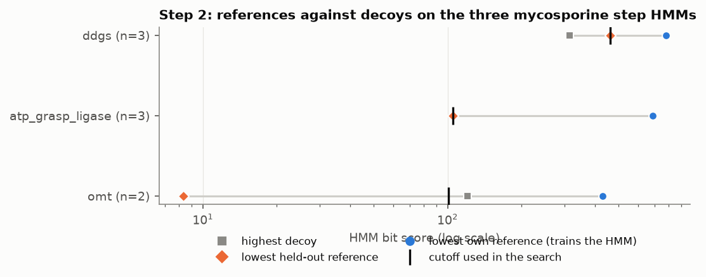
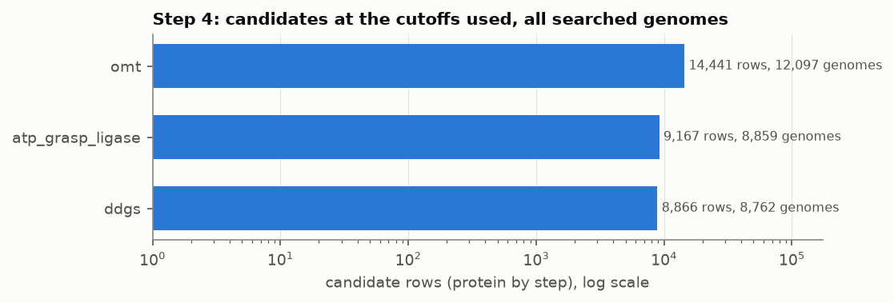
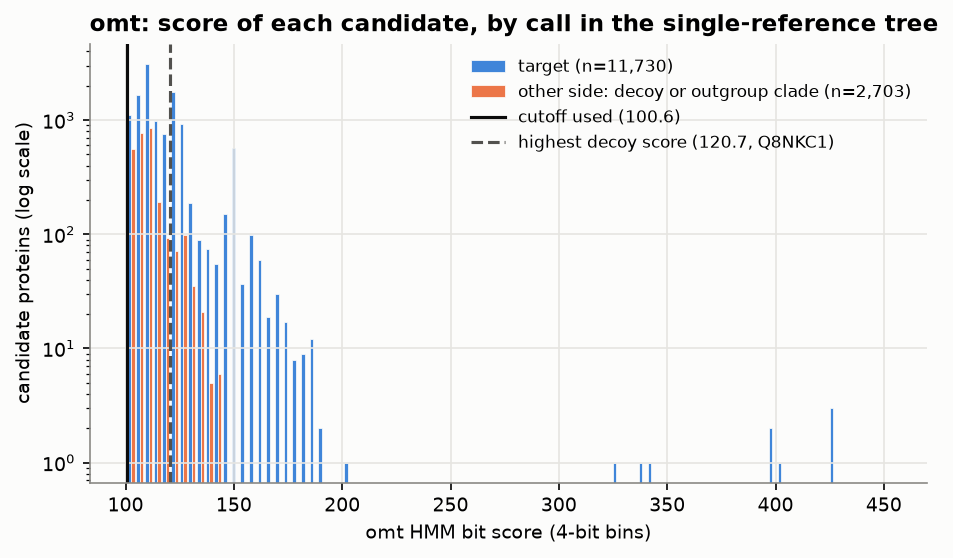
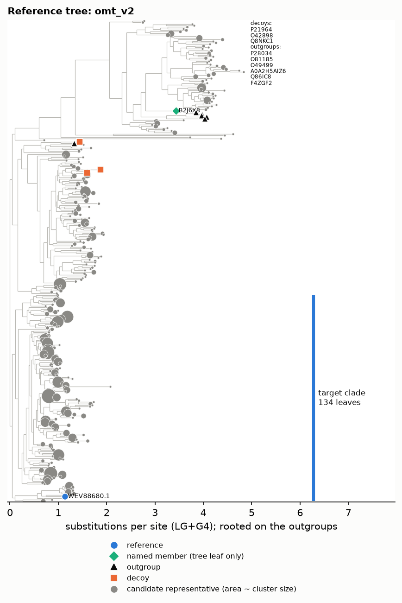
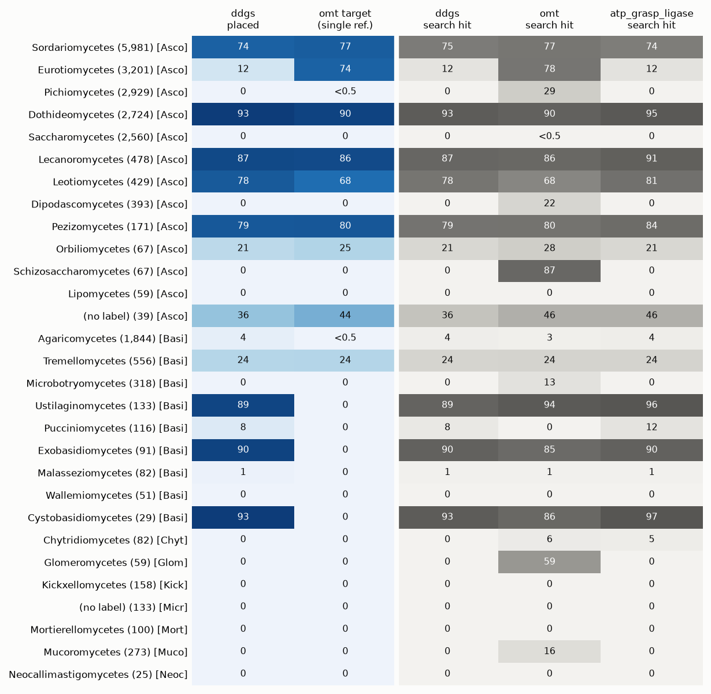

# Mycosporine biosynthesis genes in 23,376 BFD fungal genomes

::: {.callout-important}
## What this is, and where it stops being reliable

- This is a **working analysis of search hits and tree placements, not a gene census and not a map of mycosporine producers**. Steps 1 to 5 of the census plan are done for three steps: `ddgs`, `omt` and `atp_grasp_ligase`. The other two steps of the pathway file, `mg_glucosyltransferase` and `glutamicol_formation`, have no known gene and no reference. They were not searched (section 2). So no genome in this report can be called a producer of any mycosporine. The main fungal compound, mycosporine-glutaminol-glucoside, needs the glucosylation step, and that step cannot be searched.
- Every output is stamped `PROVISIONAL`. The pathway file has `verified: false`. **No step has a verified fungal reference**: 6 of the 8 references are not verified, and the verified two are cyanobacterial (`refs/mycosporine/UNVERIFIED.md`).
- Nothing was tested at the bench. The only fungal genes with an assay are the three genes of one cluster in *Phaffia rhodozyma* UCD 67-385 (PMID 36983003, abstract and full text read by the curator).
- Only one step has a tree placement that separates anything: `omt`, and only as a **single-reference placement**. The step has 2 references. The placement used the *Phaffia* OMT alone as the target and put the *Nostoc* MysB in the tree as a named leaf. The target is a region of a tree, bounded by 3 decoys and 6 outgroups. **It is not a set of tested mycosporine O-methyltransferases** (owner decision 5 of 2026-11-25).
- `ddgs` is placed, but 8,864 of 8,865 candidates fall in the target. The placement shows that the candidates lie near the references. It does not separate DDGS from other members of the family.
- `atp_grasp_ligase` is not placed. No alignable non-target sequence exists (section 5d). Its call is a search hit.
- Counts are genomes with at least one protein that passes the cutoff or the placement. A genome with no call may have an incomplete assembly or a diverged gene. Absence is not shown.
- Labels: MEASURED is read from a file named in the text. PROPOSED is a choice or an estimate. UNVERIFIED is not checked.
- **Owner decisions are listed in section 9.** All of them keep the `PROVISIONAL` stamp. Decisions of 2026-11-23, 2026-11-24 and 2026-11-25 apply. Two items are still open (section 9).
:::

## 1. Findings so far

- **The search covered every listed genome.** 23,376 of 23,376 genomes with a protein file were searched (244,451,875 proteins), with 0 duplicates, 0 missing and 0 extra genomes. 987 of the 24,363 rows of the genome table have no protein file and are excluded, not counted as absences (MEASURED, `results/search/melanin_myco_full/summary.txt`; the 24,363 is from `docs/superpowers/notes/2026-11-24-genome-prefix-mismatch.md`, section 4).
- **One check failed and was repaired in our copy only.** 39,700 proteins in 5 genomes carry a locus tag that is not the one in the genome table, because BFD re-annotated those genomes. All 39,700 were searched. An alias file maps 13 of 13 affected candidate rows back to their genome row (section 3).
- **The search returned 32,474 candidate rows for the three steps**, on 32,422 distinct proteins, in 12,739 of 23,376 genomes (54.5%): `omt` 14,441 rows, `atp_grasp_ligase` 9,167 rows and `ddgs` 8,866 rows. The counts match the 200-genome projection within a ratio of 0.91 to 0.99 (MEASURED, section 4). A row is one protein scored against one step HMM.
- **Cutoffs are weak for two of the three steps.** The `omt` cutoff is an owner override (100.6), not a value derived from references. The rule value is 8.3, and it is below all five decoys. The `atp_grasp_ligase` cutoff (105.0) is set by a cyanobacterial reference held out of its own HMM, and no decoy scores on that HMM. Only `ddgs` has a margin that a decoy test supports: lowest held-out reference 463.5 against highest decoy 315.5 (section 2).
- **`ddgs` is placed in 8,760 genomes (37.5% of 23,376) and `omt` in 10,446 (44.7%).** The `atp_grasp_ligase` hit is in 8,859 (37.9%). All three calls are present in 7,793 genomes (33.3%): 7,657 of 19,203 Ascomycota (39.9%) and 136 of 3,242 Basidiomycota (4.2%). No other phylum has a genome with all three. These are calls of protein families that are widely distributed. They are not mycosporine-pathway calls (section 7).
- **The `omt` placement does not follow the score.** Of 14,439 placed candidates, 11,730 are `target` and 2,703 are on the decoy side. The median score is 112.5 for the target and 108.6 for the other side. 10,097 of the 14,441 rows lie between 100.6 and 120.7, the band where the floor was moved (section 5c).
- **Genera named in the literature give a mixed picture.** In 12 *Phaffia* genomes, 7 have all three calls and 5 have none. In 16 *Cystobasidium* genomes, `ddgs` is placed in 16 and `omt` is a search hit in 16, but the `omt` target call is present in 0 (section 7).
- **Gain and loss (section 8) covers `ddgs` and `omt` only.** Co-loss is 79 branches against a matched null mean of 16.68 (q 0.002), but 73 of the 79 are tip edges and internal-edge co-loss is within the null interval. The null does not model missing data.

## 2. The pathway, its references, decoys and cutoffs

The pathway file has 5 steps and 3 routes (`pathways/mycosporine.yaml`, `routes:`). It lists 8 references. The step set follows the fungal paper (PMID 36983003), not the cyanobacterial gene list. Three steps have references. Two do not.

| Step | Reaction (as curated) | Fungal gene | References in the file | Searched |
|---|---|---|---|---|
| `ddgs` | sedoheptulose 7-phosphate to demethyl-4-deoxygadusol (RHEA:49560, EC 4.2.3.154) | DDGS of *Phaffia rhodozyma*, WEV88679.1 | 3: 1 *Phaffia*, 2 cyanobacterial | yes |
| `omt` | O-methylation to 4-deoxygadusol (curated, no Rhea reaction, no EC) | OMT of *Phaffia rhodozyma*, WEV88680.1 | 2: 1 *Phaffia*, 1 cyanobacterial (B2J6X8, 17% identical to the *Phaffia* protein) | yes |
| `atp_grasp_ligase` | ligation of 4-deoxygadusol with glutaminol to mycosporine-glutaminol (curated) | ATPG of *Phaffia rhodozyma*, WEV88681.1 | 3: 2 *Phaffia* (490 of 500 residues equal), 1 cyanobacterial (ligates glycine) | yes |
| `mg_glucosyltransferase` | glucosylation of mycosporine-glutaminol | not identified (tier T4) | 0 | no (no HMM possible) |
| `glutamicol_formation` | formation of mycosporine-glutamicol | not identified (tier T4) | 0 | no (no HMM possible) |

*Source: `pathways/mycosporine.yaml`, `kb/mycosporine/step_reaction.tsv`, `refs/mycosporine/UNVERIFIED.md`. The 17% and 490-of-500 values were measured by the curator on 2026-11-21 (global alignment) and are not re-measured here.*

The three routes are `mycosporine_glutaminol` (`ddgs`, `omt`, `atp_grasp_ligase`), `mycosporine_glutaminol_glucoside` (adds the unknown glucosylation) and `mycosporine_glutamicol` (adds the unknown glutamicol step). **In the knowledge-base tables no route gives a product**, because 4-deoxygadusol has no ChEBI entry (USER DECISION 6, `refs/mycosporine/UNVERIFIED.md`, D1). The pathway diagram script of the carotenoid report was not adapted: it needs the ChEBI cache, which this branch does not have.

### Step table

<!-- step-table:begin -->
| Step | References | Decoys | Cutoff of the rule | Cutoff used | Candidate rows | Genomes with a row |
|---|---:|---:|---:|---:|---:|---:|
| `atp_grasp_ligase` | 3 | 6 | 105 | 105 | 9,167 | 8,859 |
| `ddgs` | 3 | 6 | 463.5 | 463.5 | 8,866 | 8,762 |
| `omt` | 2 | 5 | 8.3 | 100.6 (owner override) | 14,441 | 12,097 |
<!-- step-table:end -->

*Source: `results/step2/mycosporine/step_scores.PROVISIONAL.tsv`, `results/step3/melanin_myco/min_scores.combined.omt100.6.PROVISIONAL.tsv` and `results/search/melanin_myco_full/candidates.chunk*.PROVISIONAL.tsv.zst` (worktrees named in section 12). Table made by `reports/mycosporine/bin/make_step_table.py`. "Genomes with a row" counts distinct locus-tag prefixes, out of 23,376 searched.*

### References and decoys

- **References.** 8 in the file. 2 are verified by the curator's rule (the cyanobacterial B2J6X9 and Q3M6C3, both `ddgs`). 6 are not: the 3 *Phaffia* GenBank proteins (no UniProtKB entry), the *Phaffia* strain VOH protein A0A9Y1GGR7 (no cited paper, strain not assayed) and the cyanobacterial B2J6X8 and B2J6X7 (unreviewed entries). **The three step HMMs mix fungal and cyanobacterial references.** The owner kept the mixed set on 2026-11-23 (decision 7).
- **Decoys.** `ddgs` 6: bacterial cyclases valA (H2K887), acbC (Q9ZAE9), Amir_2000 (C6WFL3) and btrC (Q9S5E2), *E. coli* AroB (P07639) and the *A. nidulans* pentafunctional AROM (P07547). `omt` 5: human COMT P21964, two *S. pombe* COMTs (O42898 and Q8NKC1), imqG (B8NI24) and ankF (A0A397HK53). `atp_grasp_ligase` 6: fsqD, uncJ, aveB, *E. coli* DdlB and GshB, and the cyanobacterial MysD (B2J6X6). Q8NKC1 was added on 2026-11-24 at the owner's request. It is annotated as a catechol O-methyltransferase and scores 120.7 on the `omt` HMM.
- **Decoys that score nothing do not test a cutoff.** None of the 6 `atp_grasp_ligase` decoys has a hit at E-value 10 or lower on the step HMM. The step has a cutoff and no decoy-based check of it.

### Cutoff rules and the overrides

| Step | Ref. range (own HMM) | Lowest held-out ref. | Highest decoy | Rule value | Used | Basis |
|---|---|---|---|---:|---:|---|
| `ddgs` | 779.4 to 827.6 | 463.5 (the *Phaffia* reference held out) | 315.5 (acbC, Q9ZAE9) | 463.5 | 463.5 | lowest leave-one-out score |
| `omt` | 430.0 to 481.0 | 8.3 (B2J6X8 held out); 9.7 (*Phaffia* held out) | 120.7 (Q8NKC1); 100.6 before Q8NKC1 | 8.3 | 100.6 | owner override of 2026-11-23 |
| `atp_grasp_ligase` | 688.7 to 1038.1 | 105.0 (B2J6X7 held out) | none scores | 105.0 | 105.0 | lowest leave-one-out score |

*Source: `results/step2/mycosporine/step_scores.PROVISIONAL.tsv`, `leave_one_out.PROVISIONAL.tsv`, `min_scores.PROVISIONAL.tsv`; `docs/superpowers/notes/2026-11-23-melanin-mycosporine-step2.md`, sections 3 and 9.*



*The blue dot is the lowest score of an own reference, the orange diamond the lowest score of a reference held out of its own HMM, the grey square the highest decoy, and the black bar the cutoff used in the search. **The figure is evidence that `ddgs` has a decoy margin and that `omt` and `atp_grasp_ligase` do not.** For `omt` the bar (100.6) sits between the held-out reference score (8.3) and the highest decoy score (120.7): the cutoff is below one decoy. For `atp_grasp_ligase` the bar sits on the held-out value because no decoy scores. The two cyanobacterial references of `ddgs` are 73% identical, so their held-out scores are not independent. [PDF](figures/out/fig1_step2_separation.pdf)*

**Two `omt` numbers look like a contradiction and are not.** The cutoff used in the search is 100.6. The file `results/step2/mycosporine/min_scores.PROVISIONAL.tsv` now holds 120.7, because it was rerun after Q8NKC1 was added. The search used the combined table made before that rerun (`min_scores.combined.omt100.6.PROVISIONAL.tsv`, sha256 `9b939123...b8fec`, `results/step3/melanin_myco/RUN.md`). The owner chose to keep the rows between 100.6 and 120.7 ("accept your reccomendation", 2026-11-24). Those rows are 10,097 of the 14,441.

## 3. Search coverage

The three mycosporine HMMs were searched together with 15 melanin HMMs in one run (18 HMMs, one cutoff table). This report uses only the three mycosporine steps. The run record is `results/search/melanin_myco_full/RUN.md`.

- 6 chunks of 4,000 genomes (the last has 3,376), 16 CPUs and 96 GB per chunk, partition `intel`, jobs 32427878 to 32427883. Script time per chunk was 5,224 to 6,438 s (MEASURED, step 4 note, section 1). `sacct` records were not readable after the run (UNVERIFIED: job state, elapsed time and memory).
- 23,376 genomes, 244,451,875 proteins, 0 duplicates, 0 missing, 0 extra (MEASURED, `summary.txt`).
- **Five re-annotated genomes.** F8B45790 (*Blastobotrys sasensis*), FE750E90 (*Arxiozyma pintolopesii*), FE41F6C9 (*Fusarium oxysporum* Foc035), FF465DA3 (*Saccharomyces cerevisiae* YJM1417) and F6D07108 (*Sugiyamaella casensis*) have new locus tags in their protein files. 39,700 proteins in the five files failed the prefix check. All were searched. `prefix_aliases.tsv` maps the new prefixes to the old table rows, and `bin/make_calls_table.py --prefix-aliases` reads it. 13 of 13 candidate rows of the shared search that had an unmapped prefix now map to a genome row (11 to FE41F6C9, 1 to F8B45790, 1 to F6D07108). The mapping is a fix in our copy only. BUSCO and N50 in the table row describe the old assembly, and for FF465DA3 the new assembly has a different accession. **The BFD owner's data fix is still open** (section 9).
- **Fifty genomes have different protein counts than in the carotenoid search.** The 5 above and 45 more (total +540 proteins). In the 45 the prefix is unchanged. Whether the protein ids of earlier candidates name different proteins was not checked (UNVERIFIED, prefix-mismatch note, section 3).
- **Rows lost before placement.** In the mycosporine steps: `ddgs` 1 row (8,865 of 8,866 placed) and `omt` 2 rows (14,439 of 14,441 placed). All three are from prefix FB9275E9, the re-annotated *Fusarium oxysporum* Foc035 (MEASURED, `other_steps_summary.tsv`, `omt_v2` and `ddgs` rows).



*Bars show rows (protein by step) at the cutoffs used, and the label gives the genomes with a row. **The figure counts search hits. It is not a count of genes of the pathway**: `omt` has the most rows, but its cutoff is an owner override at the decoy floor, and the `omt` HMM is a family HMM (section 5c). [PDF](figures/out/fig2_candidates_per_step.pdf)*

## 4. Search results per step

All numbers MEASURED from `results/search/melanin_myco_full/summary.txt`. The projection is the step 3 value (PROPOSED).

| Step | Rows | Distinct proteins | Genomes with a row | Max score | Projected rows | Ratio |
|---|---:|---:|---:|---:|---:|---:|
| `omt` | 14,441 | 14,441 | 12,097 | 427.1 | 14,610 | 0.99 |
| `atp_grasp_ligase` | 9,167 | 9,167 | 8,859 | 1,038.1 | 10,052 | 0.91 |
| `ddgs` | 8,866 | 8,866 | 8,762 | 776.3 | 9,467 | 0.94 |
| Pathway total | 32,474 | 32,422 | 12,739 | | | |

The pathway total has fewer distinct proteins than rows because 52 proteins have a row for more than one of the three steps (32,474 minus 32,422, derived).

- **`ddgs`.** The maximum score (776.3) is close to the range of the own references (779.4 to 827.6).
- **`omt`.** 10,097 rows lie in 100.6 <= score < 120.7 (8,829 genome prefixes) and 4,344 at 120.7 or above (4,282). The median score of the low band is 109.3. 10 rows score 200 or more. The maximum is 427.1, just below the lowest own-reference score of the *Phaffia* OMT on its own HMM (430.0). The low band spreads over the genera that have many genomes in BFD; the note did not test whether the band follows genome count. What these proteins are is not known.
- **`atp_grasp_ligase`.** The 6 decoys do not score on the HMM, so the 9,167 rows are not checked against a decoy.

## 5. Tree placement (step 5)

### 5a. Method, in short

Placements use the census tool chain: domain extraction, mmseqs2 clustering to representatives, mafft, clipkit, raxml-ng (LG+G4, 2 starting trees, one seed, no bootstrap) and epa-ng. A candidate is `target` when its best clade is the largest side of the tree that holds the references and no labelled leaf (decoy, outgroup or named member). "Support" is the epa-ng placement weight, not tree support. The owner accepted the largest-side rule for steps with 2 or more references as PROVISIONAL on 2026-11-24. The full method is in `docs/superpowers/notes/2026-11-24-melanin-myco-step5-other-steps.md`, section 2.

| Run | Floor | Clustering | Leaves (refs + decoys + named + outgroups + reps) | Reference clade free of labelled leaves | Target (largest side) |
|---|---:|---|---|---|---|
| `ddgs_allplace` | 463.5 | identity 0.8, 131 clusters | 156 (3 + 6 + 10 + 6 + 131) | yes | 133 leaves (smallest-side rule: 49) |
| `omt_v2` | 100.6 | 420 clusters, capped to 300 representatives | 311 (1 + 3 + 1 + 6 + 300) | yes | 134 leaves (smallest-side rule: 1) |
| `atp_grasp_ligase` | 105.0 | not run | none | not run | none |

*Source: `results/step5/other_steps_summary.tsv`, `other_steps_summary.allplace.tsv` (`ddgs_allplace`) and `other_steps_summary.v2.tsv` (`omt_v2`); run folders `results/step5/mycosporine/ddgs_allplace/` and `omt_v2/`. The identity of the `omt_v2` run (0.7) is from the step 5 note, section 10.2.*

### 5b. `ddgs`

Use the `_allplace` row. The default epa-ng setting keeps at most 7 placements per query. The rerun keeps all placements (`--filter-acc-lwr 0.999 --filter-max 10000`, PROPOSED). For `ddgs` the rerun is the control: 0 of 8,865 calls changed (owner decision 7 of 2026-11-25; `docs/superpowers/notes/2026-11-25-epa-all-placements.md`, section 3).

| Quantity | Value (MEASURED) |
|---|---|
| Candidates placed | 8,865 of 8,866 rows |
| Target / decoy side / unassigned | 8,864 / 1 / 0 |
| Lowest target support (placement weight) | 0.999 (0.95 under the default setting) |
| Assigned proteins; genomes | 8,864; 8,760 of 23,376 (37.5%) |
| Genomes with 1 copy; with 2 or more | 8,658; 102 |
| Cap hits (7 or more placements) | 90 queries (1.02% of 8,865) under the default; 161 with all placements, because the list is no longer cut |

- **What the placement shows.** 8,864 of 8,865 candidates are in the target. 130 of 131 representatives are nearest to a reference (median distance 2.29). The 6 decoys include the pentafunctional AROM protein of *A. nidulans*. The 10 named members are fungal AROM entries (108.1 to 122.4 bits). The 6 outgroups are one 2-epi-5-epi-valiolone synthase (317.1 bits), four bacterial 3-dehydroquinate synthases and one fungal AROM entry.
- **What it does not show.** That a target protein makes demethyl-4-deoxygadusol. The target is bounded by the labelled leaves, and almost every candidate is inside it. The AROM decoy scores 99.8 on the `ddgs` HMM, far below the cutoff (463.5). The placement reports that the candidates are not on the AROM side. It does not test other family members that are not in the tree.
- One tree, one seed, 2 starting trees, no bootstrap.

### 5c. `omt`, single-reference placement

The first `omt` run stopped. The two references (the *Phaffia* OMT and the *Nostoc* MysB, 17% identical) do not form a clade free of decoys and outgroups. The smallest side with both holds 210 leaves, 6 outgroups and 3 decoys (job 32435495, return code 3, 14,441 candidates not placed). The owner then chose a single-reference placement (decision of 2026-11-24, accepted as provisional on 2026-11-25): the *Phaffia* reference alone is the target, and *Nostoc* MysB (B2J6X8, cut to its domain) is a named leaf. `refs/` was not changed. The step still has 2 references in every other table of this report.

| Quantity | Value (MEASURED) |
|---|---|
| Candidates placed | 14,439 of 14,441 rows (2 rows: protein file missing, prefix FB9275E9) |
| Target / decoy side / unassigned | 11,730 / 2,703 / 6 |
| Lowest target support (placement weight) | 0.833 |
| Assigned proteins; genomes | 11,730; 10,446 of 23,376 (44.7%) |
| Genomes with 1 copy; with 2 or more | 9,237; 1,209 |
| MysB position | outside the target |
| Long pendant queries | 1 |
| Cap hits under the default setting | 104 queries, 0 of them unassigned; not rerun with all placements |

*Source: `results/step5/other_steps_summary.v2.tsv` (row `omt_v2`), `results/step5/mycosporine/omt_v2/`, and the step 5 note, section 10.2.*

- **Nearest labelled leaf.** 11,768 of 14,439 candidates (81.5%) are in the cluster of a representative. Of the 300 representatives, 136 are nearest to the reference (9,564 candidates in their clusters, median distance 1.99), 81 to a decoy (803; 1.43), 69 to a named member (450; 1.98) and 14 to an outgroup (951; 1.92).
- **All 2,703 other-side calls are on the decoy side.** No call is on an outgroup clade (computed from `placements_detail.tsv` of `omt_v2`).
- **The call and the score are nearly independent.** The medians are 112.5 for the target (range 100.6 to 427.1) and 108.6 for the other side (100.6 to 144.2). In the band 100.6 to under 120.7, 7,623 of 10,096 placed candidates (75.5%) are target calls. At 120.7 and above, 4,107 of 4,343 (94.6%) are (computed from `candidates_step.tsv` and `placements_detail.tsv`).



*Blue bars are candidates called `target`, orange bars candidates on the decoy side (4-bit bins, log counts). The black line is the cutoff used (100.6) and the dashed line the highest decoy score (120.7). **The figure is evidence that the tree call is not a score split**: both calls sit mostly between 100.6 and 150, and the target holds more candidates in most bins. It is not evidence that the target is made of true OMTs, and it does not show how many of the 10,097 low-band rows are mycosporine enzymes. [PDF](figures/out/fig_omt_score_by_call.pdf)*



*The blue dot is the *Phaffia* OMT (WEV88680.1), the green diamond the *Nostoc* MysB (B2J6X8), orange squares are decoys, black triangles are outgroups, and grey circles are candidate representatives (area is cluster size). The blue bar marks the target clade (134 leaves). **The tree is evidence for where the target region lies, not for a function**: the *Phaffia* OMT and MysB sit in different regions, but the note did not check that this is because they are different enzymes (UNVERIFIED). One tree, one seed, no bootstrap. [PDF](figures/out/fig_ref_tree_omt_v2.pdf)*

A tree for `ddgs` is in `figures/out/fig_ref_tree_ddgs_allplace.png` (same legend).

### 5d. `atp_grasp_ligase` is not placed

A tree needs a non-target leaf that aligns to the HMM. None exists. The 6 decoys pass 0 times the alignability rule (best domain 10 bits or more and 50% of the HMM or more). The 11 reviewed entries of PF02655 pass 0 (highest score 10.7 bits). 1,100 reviewed entries of five more ATP-grasp families (PF02222, PF02786, PF07478, PF08443, PF13535) pass 0 (highest 21.5 bits, coverage 0.216). Without a leaf, the target would be the whole tree, as for `carx` in the carotenoid report. The owner accepted that the step stays a search-hit step ("ok to not be rooted if that is what this means", 2026-11-24). A fungal ATP-grasp family member that is not a reviewed entry would have to be chosen to change this.

## 6. What each result does and does not show

| Step | Call used in section 7 | What the call shows | What it does not show |
|---|---|---|---|
| `ddgs` | placed (`ddgs_allplace`, target) | the protein scores 463.5 or more on the HMM and lies in a region bounded by AROM decoys and other cyclases | that it is a demethyl-4-deoxygadusol synthase; that a genome makes any mycosporine |
| `omt` | placed (`omt_v2`, target, single reference) | the protein lies in the tree region of the *Phaffia* OMT, away from 3 decoys, MysB and 6 outgroups | that it is an O-methyltransferase of mycosporine; that proteins on the decoy side are not (the tree has 1 named leaf and 3 decoys) |
| `atp_grasp_ligase` | search hit (105.0 or more) | the protein scores on the ATP-grasp ligase HMM, trained partly on a cyanobacterial reference | that it is an ATP-grasp ligase of mycosporine; other family members were not tested |
| `mg_glucosyltransferase`, `glutamicol_formation` | none | nothing | nothing; no gene is known |

## 7. Step presence by phylum and class

Counts are genomes with at least one call, out of 23,376 searched genomes. The calls tables come from `bin/make_calls_table.py --prefix-aliases prefix_aliases.tsv`, run with a list that holds every searched genome (the script was written for genus representatives). Placed calls use `assigned` rows. Hit calls use candidate rows. The taxonomy is `species.parquet`. A genome with no label forms its own row. The driver is `reports/mycosporine/bin/make_myco_calls.sh`. The totals match the step 4 and step 5 summaries: 8,762, 12,097 and 8,859 genomes with a hit; 8,760 and 10,446 with a placed call.

### By phylum

| Phylum | Genomes | `ddgs` placed | `omt` target | `ddgs` hit | `omt` hit | `atp_grasp_ligase` hit |
|---|---:|---:|---:|---:|---:|---:|
| Ascomycota | 19,203 | 8,310 (43.3%) | 10,304 (53.7%) | 8,312 | 11,516 (60.0%) | 8,377 (43.6%) |
| Basidiomycota | 3,242 | 447 (13.8%) | 141 (4.3%) | 447 | 466 (14.4%) | 469 (14.5%) |
| Mucoromycota | 292 | 0 | 0 | 0 | 48 (16.4%) | 0 |
| Kickxellomycota | 177 | 0 | 0 | 0 | 8 | 0 |
| Microsporidia | 133 | 0 | 0 | 0 | 0 | 0 |
| Mortierellomycota | 100 | 0 | 0 | 0 | 0 | 0 |
| Chytridiomycota | 83 | 0 | 0 | 0 | 5 | 4 |
| Glomeromycota | 59 | 0 | 0 | 0 | 35 | 0 |
| Neocallimastigomycota | 25 | 0 | 0 | 0 | 0 | 0 |
| Basidiobolomycota | 18 | 3 | 0 | 3 | 16 | 9 |
| Blastocladiomycota | 14 | 0 | 0 | 0 | 0 | 0 |
| Zoopagomycota | 11 | 0 | 0 | 0 | 2 | 0 |
| Entomophthoromycota | 9 | 0 | 0 | 0 | 0 | 0 |
| 6 smaller groups (no label 2, Monoblepharomycota 3, Aphelidiomycota 2, Calcarisporiellomycota 1, Olpidiomycota 1, Rozellomycota 1) | 10 | 0 | 1 | 0 | 1 | 0 |
| **All** | **23,376** | **8,760** | **10,446** | **8,762** | **12,097** | **8,859** |

*Source: `figures/out/presence_by_phylum.tsv`, made by `figures/bin/fig_presence_myco.py`. Percentages are of the genomes of the phylum in the second column. The only call among the 6 smaller groups is an `omt` call in one genome with no phylum label.*

### By class



*Each cell is the percent of the searched genomes of the class (the number is in the row label, the phylum in brackets). The first two columns (blue) are placed calls: `ddgs` in the target of `ddgs_allplace` and `omt` in the target of the single-reference `omt_v2`. The last three columns (grey) are search hits at the cutoffs used. 30 classes with at least 25 genomes are shown (23,148 of 23,376 genomes, 99.0%); the other 228 genomes are in smaller classes (`figures/out/presence_by_class.tsv`). **The figure is evidence that the three step families are present in many Ascomycota and some Basidiomycota classes and absent from yeast and early-diverging classes. It does not show that the genomes make mycosporines**, and the blue `omt` column depends on the single-reference target: Pichiomycetes have an `omt` hit in 29% of genomes and a target call in under 0.5%. Rows with a missing class label are split by phylum. [PDF](figures/out/fig_presence_by_class.pdf)*

What the table and figure show (counts of genomes; descriptive only):

- **Ascomycota.** `ddgs` is placed in 93% of Dothideomycetes (2,539 of 2,724), 87% of Lecanoromycetes (416 of 478), 79% of Pezizomycetes (135 of 171), 78% of Leotiomycetes (336 of 429) and 74% of Sordariomycetes (4,454 of 5,981). It is placed in 12% of Eurotiomycetes (372 of 3,201). It is not placed in Pichiomycetes (2,929), Saccharomycetes (2,560), Dipodascomycetes (393), Schizosaccharomycetes (67) or Lipomycetes (59).
- **`omt` in Eurotiomycetes.** The target call is present in 2,365 of 3,201 genomes (74%), while `ddgs` is placed in 372. In the other filamentous classes the two columns agree within a few points. The cause was not investigated. The `omt` target is a tree region, so it may hold O-methyltransferases of other pathways (UNVERIFIED).
- **Basidiomycota.** `ddgs` is placed in 89% of Ustilaginomycetes (118 of 133), 90% of Exobasidiomycetes (82 of 91), 93% of Cystobasidiomycetes (27 of 29), 24% of Tremellomycetes (131 of 556) and 4% of Agaricomycetes (70 of 1,844). The `omt` target call is in 134 of 556 Tremellomycetes and in at most 3 genomes of any other basidiomycete class shown. The `omt` search hit is present in 94% of Ustilaginomycetes (125 of 133) and 86% of Cystobasidiomycetes (25 of 29); those hits have no target call.
- **Mucoromycota and other early-diverging groups.** No `ddgs` call in 292 Mucoromycota. 48 have an `omt` hit and none has a target call. The three steps are not found together outside Dikarya, except 3 `ddgs` calls in Basidiobolomycota (18 genomes).
- **Joint presence.** 7,793 genomes (33.3%) have `ddgs` placed, `omt` in the target and an `atp_grasp_ligase` hit: 7,657 Ascomycota (39.9% of 19,203) and 136 Basidiomycota (4.2% of 3,242). 49 genomes have only `ddgs`, 2,349 only `omt` and 174 only `atp_grasp_ligase`. 11,954 genomes (51.1%) have none of the three. 11,422 genomes have at least one of the three (`ddgs` placed, `omt` target or `atp_grasp_ligase` hit), and 12,739 have at least one by search hit alone.

**Reading traps for this section.**

- **The `ddgs` and `omt` columns are not independent measures of a pathway.** The families are broad. Genome count follows sequencing effort: Sordariomycetes (5,981 genomes), Eurotiomycetes (3,201) and Pichiomycetes (2,929) are large because many strains were sequenced. A percent of genomes is not a percent of species.
- **The placed and hit columns of `ddgs` differ by 2 genomes** (8,760 and 8,762). That is the placement removing one protein and one genome losing its only call. It is not a test of the family.
- **The `omt` hit and `omt` target columns differ a lot in some classes.** A genome with a hit and no target call has no `omt` row in the target region. It may have an O-methyltransferase of another kind, or an ortholog too far from the *Phaffia* OMT to land in the target (UNVERIFIED which).
- **A class label can be missing.** The 133 Microsporidia and 39 Ascomycota genomes without a class label are separate rows. The carotenoid report counts 177 genomes with no class label, and this report has a different count because it splits by phylum. They were not reconciled.
- **The 5 re-annotated genomes are in the calls through the alias.** Without it, 13 rows in 3 prefixes would have no genome.

### Genera named in the literature (descriptive check)

The check counts genomes of genera and species named as mycosporine producers in `refs/mycosporine/fungal_lineages.tsv`. It is not a sensitivity test. The reports are on single strains, BFD genomes of the same genus are other strains, and the name in the paper may differ from the BFD name.

| Group in BFD | Genomes | `ddgs` placed | `omt` target | `omt` hit | `atp_grasp_ligase` hit | All three |
|---|---:|---:|---:|---:|---:|---:|
| *Phaffia* (genus) | 12 | 7 | 7 | 7 | 7 | 7 |
| *Phaffia rhodozyma* (species) | 10 | 5 | 5 | 5 | 5 | 5 |
| *Cystofilobasidium* | 8 | 0 | 0 | 0 | 0 | 0 |
| *Cystobasidium* | 16 | 16 | 0 | 16 | 16 | 0 |
| *Rhodotorula* | 215 | 0 | 0 | 19 | 0 | 0 |
| *Hortaea werneckii* | 75 | 61 | 68 | 68 | 75 | 60 |
| *Naganishia friedmannii* | 2 | 2 | 2 | 2 | 2 | 2 |
| *Colletotrichum graminicola* | 20 | 11 | 8 | 8 | 20 | 6 |

*Source: `figures/out/genus_check.tsv`, made by `reports/mycosporine/bin/genus_check.py`. Compounds and PMIDs are in `refs/mycosporine/fungal_lineages.tsv`. The TSV has more rows (Pyricularia, Pyrenophora, Parastagonospora and others).*

- **The positive side.** 7 of 12 *Phaffia* genomes have all three calls. The strain of the paper, UCD 67-385, was not identified among the 12. The 5 *Phaffia* genomes with no call are not explained here. The paper reports that strain CBS 6938 lacks the cluster (`refs/mycosporine/fungal_lineages.tsv`). Whether the 5 are CBS 6938 or related strains was not checked (UNVERIFIED).
- **The unresolved side.** In *Cystobasidium* (16 of 16 genomes) `ddgs` is placed and `atp_grasp_ligase` is a hit, but 0 of 16 have an `omt` target call. *Cystobasidium keelungensis* is reported to make mycosporine-glutaminol-glucoside (PMID 30182254). Whether the *Cystobasidium* OMT is a different enzyme or lies outside the target region was not tested. *Rhodotorula* (215 genomes) has no `ddgs` call. The names "*Rhodotorula minuta*" and "*R. slooffiae*" of PMID 15484286 may correspond to the BFD names *Cystobasidium minutum* (1 genome, `ddgs` placed) and *C. slooffiae* (3 genomes, `ddgs` placed). That this is the same taxon was not checked in a source (UNVERIFIED).
- **Genera with calls in most genomes.** *Pyrenophora* (89 of 90 with `ddgs` placed), *Parastagonospora* (186 of 186) and *Pyricularia* (501 of 521). The curator's note reports that the full text of PMID 36983003 names homologues of the *Phaffia* genes in *Pyrenophora tritici-repentis*, *Parastagonospora nodorum*, *Aspergillus clavatus* and *Magnaporthe oryzae* (`refs/mycosporine/UNVERIFIED.md`, item A3; not re-read here). The counts agree with those homologues existing. They do not show that those species make mycosporines.

## 8. Gain and loss

::: {.callout-important}
## Limits of this section

- Only `ddgs` and `omt` are modelled. `ddgs` is placed, but 8,864 of 8,865 candidates are in the target, so its call is close to a search hit. The `omt` target is one tree region from one reference, not a tested enzyme. `atp_grasp_ligase` is a search-hit step and is not modelled.
- 1,609 genus tips with data. No completeness filter. All calls are PROVISIONAL.
- Method as in the carotenoid report, sections 6g and 6h (genus FastTree rooted on Blastocladiomycota, Microsporidia dropped, ER and ARD by AIC, 0.8 rule, prevalence-matched simulation null with N = 2,000, no BUSCO filter). Commands and job ids: `results/gainloss/mycosporine/RUN.md`. Full note: `docs/superpowers/notes/2026-11-25-gainloss-melanin-myco.md`.
:::

**`ddgs` is present in 664 and absent in 945 of 1,609 genus tips. `omt` is present in 635 and absent in 974.** ARD fits better for both (delta AIC -151.1 and -247.9).

- `ddgs`: 8 gains, 139 losses and 111 uncertain branches under ARD (35 gains under ER). 123 of the 139 losses are on tip edges.
- `omt`: 3 gains, 152 losses and 93 uncertain (21 gains under ER). 137 of the 152 losses are on tip edges.

**Co-loss is 79 branches against a prevalence-matched null mean of 16.68 (95% interval 7 to 29), p 0.0005, q 0.002.** 73 of the 79 are tip edges. On internal edges co-loss is 6 against 2.19 (q 0.124). Co-gain is 1 against 0.06 (q 0.118). The null simulates each step alone. It does not model missing data or a link between the steps. Pagel: likelihood ratio 312.0, p 2.8e-66. This is not read as a link between the steps, because presence is clustered by clade.


**Negative results.** No co-gain is shown. Co-loss on internal edges is within the null interval.

**Not done.** The other pathway steps. A BUSCO check of the 73 tip co-losses. A test that the `omt` region holds mycosporine methyltransferases.

## 9. Owner decisions that apply

All decisions are in `docs/superpowers/notes/2026-11-24-owner-decisions-melanin-myco.md`. Quotes are from that file. Every result stays `PROVISIONAL`. Items for the DHN and L-DOPA melanin pathways are in the melanin report and are not listed.

| Date | Item | Owner's words | Applied as |
|---|---|---|---|
| 2026-11-23 | Step 2 decisions 3 to 9 (includes decision 6, no lowering of cutoffs, and decision 7, mycosporine references) | "accept 3-9 as listed" | mixed fungal and cyanobacterial references kept; no cutoff lowered |
| 2026-11-23 | `omt` floor | "use 100 but we may need to investigate again in a second round" | floor override 100.6 (highest decoy score at the time) |
| 2026-11-24 | Q8NKC1 as `omt` decoy | "step 3 first then add Q8NKC1 as omt decoy" | step 3 timing job on the 100.6 table, then Q8NKC1 added (new floor would be 120.7) |
| 2026-11-24 | Search floor for `omt` | "accept your reccomendation" | full search at 100.6; rows between 100.6 and 120.7 kept |
| 2026-11-24 | Genome prefix fix | "step 5 with PKS tree ... fix tables makes sense if they are needed" | alias file in our copy only |
| 2026-11-24 | `omt` placement | "try only Phaffia reference alone" | single-reference placement, *Nostoc* MysB as a named leaf |
| 2026-11-24 | `atp_grasp_ligase` | "ok to not be rooted if that is what this means" | stays a search-hit step |
| 2026-11-24 | Target rule, 2 or more references | "accept largest side-rule or steps with 2 or more references" | largest-side rule accepted as PROVISIONAL |
| 2026-11-25 | `omt` (decision 5) | as recorded in the decisions file (not a quote) | accepted as provisional; the target is a tree region, not a tested mycosporine enzyme |
| 2026-11-25 | epa-ng (decision 7) | as recorded (not a quote) | keep all placements for steps with few distinct sequences; use `_allplace` rows (here `ddgs_allplace`) |
| 2026-11-25 | BFD re-annotation message (decision 11) | as recorded (not a quote) | written as a note at `Fungi_BFD_runs/docs/NOTE_reannotated_genome_prefixes_2026-11-25.md` (not committed there) |
| 2026-11-25 | Report layout (decision 12) | as recorded (not a quote) | mycosporine in a separate report from DHN and L-DOPA melanin |

**Open, not decided** (from the decisions file): the BFD data fix for the five re-annotated genomes (the BFD owner's call, prefix-mismatch note) and the merge of PR #22 (Jason). The identity rule for clustering (lowest identity giving at least 100 clusters) is a choice of the step 5 agent, not an owner decision. The `omt` "second round" that the owner mentioned on 2026-11-23 was not run (section 11).

## 10. Negative and unresolved results

- **The first `omt` placement stopped.** The references do not form a clade free of decoys and outgroups, because the *Phaffia* OMT and MysB are 17% identical (job 32435495, return code 3). This was a property of the reference set, not a failed run. The single-reference placement replaces it and changes what the target means (section 5c).
- **The `omt` floor is a decoy floor, not a derived cutoff.** The rule value (8.3) is below all five decoys. 48 of 50 sampled reviewed fungal O-methyltransferases have no hit at E-value 1000 or lower on the `omt` HMM. Of 801 reviewed fungal entries with EC 2.1.1, 5 hit and 1 (Q8NKC1) scores at or above 100.6. No true mycosporine OMT other than the *Phaffia* protein is known, so this does not measure how many real orthologs the floor loses (UNVERIFIED; step 2 note, section 9.5).
- **The `omt` tree call is not a score split.** Medians differ by 3.9 bits (112.5 and 108.6), and 75.5% of the low-band candidates are in the target. The tree has 3 decoys, 6 outgroups and 1 named leaf. A larger set of labelled O-methyltransferases could move candidates between sides. This was not tested.
- **`atp_grasp_ligase` cannot be placed.** 0 of 6 decoys and 0 of 1,111 reviewed ATP-grasp entries align (section 5d).
- **`ddgs` placement separates almost nothing.** 8,864 of 8,865 are target. This happens when the labelled leaves are few. It is not a pass of a specificity test.
- **The `atp_grasp_ligase` and `ddgs` cutoffs rest on one fungal reference each.** For `ddgs` the lowest held-out score is the *Phaffia* reference (463.5). For `atp_grasp_ligase` it is a cyanobacterial reference (105.0). The two *Phaffia* ATPG sequences are 98% identical, so they are not independent.
- **A search without a cutoff shows no near-miss in *Rhodotorula* (MEASURED, 2026-11-26).** All 215 *Rhodotorula* genomes with protein files have a best `ddgs` domain score of 68.5 to 109.8 bits (median 102.2). The cutoff is 463.5, so the best score is 353.7 bits below it. The best hits cover 0.57 to 0.64 of the HMM, and genomes with a `ddgs` call cover about 0.98. Lowering the cutoff by 10%, 25% or 50% adds 0 *Rhodotorula* genomes. 5 of 12 *Phaffia* genomes show the same pattern (94.3 bits, coverage 0.58), as do *Cystofilobasidium* (8 of 8), *Rhodosporidiobolus* (14 of 14) and *Sporobolomyces* (22 of 22). This does not show that these genomes lack a `ddgs` gene: only predicted proteins were searched, and the best 100-bit hit was not identified. Details: `docs/superpowers/notes/2026-11-26-rhodotorula-ddgs-check.md`.
- **The literature check of genera gives a mixed result.** *Cystobasidium* has no `omt` target call, and *Rhodotorula* has no `ddgs` call (section 7). Both could mean a cutoff or target that is too narrow for non-*Phaffia* lineages, or different enzymes. No test separates the two readings.
- **No bench or metabolomics support.** The mycosporine genes of non-*Phaffia* fungi are not assayed. No metabolomics data were used for mycosporines here.
- **The PKS tree support caveat does not apply** (no PKS step in this pathway). Placement trees here are single-seed trees with no bootstrap.

## 11. What would change this, and what was not done

**What would change the findings.** A second fungal mycosporine OMT, DDGS or ATPG with an assay would show whether the cutoffs and the `omt` target region reach it. More labelled O-methyltransferases (fungal, reviewed, of other functions) in the `omt` tree would test whether the target holds non-mycosporine enzymes. A fungal ATP-grasp family member of known other function would give `atp_grasp_ligase` a leaf. A protein that scores above the cutoff and sits on the decoy side of a tree with more leaves would show that the HMM cannot separate the step.

**Not done here:**

- Gain and loss (section 8). The root, the tree and the null are not chosen for this pathway.
- A placement for `atp_grasp_ligase`, and any search for `mg_glucosyltransferase` and `glutamicol_formation` (no gene, no HMM).
- A second round on the `omt` floor; a rerun of `omt_v2` with all epa-ng placements (104 cap-hit queries, 0 unassigned; no change is expected, but it is untested); bootstrap or a second seed for any tree; a test of the target rule against the number of labelled leaves.
- A known-ortholog test of the *Phaffia* reference as the `omt` target, and a test of why *Cystobasidium* has no `omt` target call.
- Copy-number tables beyond the 1-copy and 2-or-more counts of sections 5b and 5c; a quality filter (BUSCO); contamination flags; a comparison with deposited proteins; a tblastn absence check; triage (steps 7 to 12 of the census plan).
- A check of the 45 genomes whose protein file changed with the same locus tag (section 3), and the BFD fix of the five locus tags.
- A check of taxonomic synonymy between the names in the papers and BFD (section 7).
- The PKS steps and the melanin pathways (separate report).

## 12. Methods, tools and files

| What | Where |
|---|---|
| Pathway, references, decoys | `pathways/mycosporine.yaml`, `refs/mycosporine/*.faa`, `refs/mycosporine/decoys/`, `refs/mycosporine/UNVERIFIED.md`, `kb/mycosporine/` |
| Step HMMs (3) | `results/hmms/mycosporine/*.PROVISIONAL.hmm`, `bin/build_step_hmms.py` |
| Step 2 scores | `results/step2/mycosporine/` (job 32415136 for the run with Q8NKC1); `bin/score_refs_decoys.py`, `bin/make_min_scores.py --floor-override omt=100.6` |
| Cutoff table used in the search | `results/step3/melanin_myco/min_scores.combined.omt100.6.PROVISIONAL.tsv`, `RUN.md` |
| Step 4 search | `results/search/melanin_myco_full/` (`RUN.md`, `summary.txt`, `searched.chunk*.tsv`, `candidates.chunk*.PROVISIONAL.tsv.zst`); `bin/search_chunk.py`; jobs 32427878 to 32427883 |
| Step 5 placement | `results/step5/mycosporine/ddgs_allplace/`, `omt_v2/` (also `ddgs/`, `ddgs_id50/`, `omt/`); `results/step5/other_steps_summary*.tsv`, `other_steps_RUN.md`, `epa_allplace_transitions.tsv`; `bin/step5_multi_ref_clades.py`, `bin/select_family_leaves.py`, `bin/screen_outgroups.py` |
| Genome prefixes | `prefix_aliases.tsv`, `bin/apply_prefix_aliases.py`, `bin/check_genome_prefixes.py` |
| Calls tables | `bin/make_calls_table.py --prefix-aliases`, `reports/mycosporine/bin/make_myco_calls.sh` |
| Figures | `reports/mycosporine/figures/bin/fig_census_search.py` (figures 1 and 2; carotenoid script with a `--steps` filter), `fig_omt_scores.py` (figure 3), `fig_ref_tree.py` (figure 4 and the `ddgs` tree), `fig_presence_myco.py` (figure 5 and the phylum and class TSV); `reports/mycosporine/bin/genus_check.py` |
| Step table | `reports/mycosporine/bin/make_step_table.py` |
| Notes | `docs/superpowers/notes/2026-11-23-melanin-mycosporine-step2.md`, `2026-11-24-melanin-myco-step4-results.md`, `2026-11-24-melanin-myco-step5-other-steps.md`, `2026-11-25-epa-all-placements.md`, `2026-11-24-genome-prefix-mismatch.md`, `2026-11-24-owner-decisions-melanin-myco.md` |
| Tool versions | hmmer 3.4, mafft 7.505, raxml-ng 2.0.4, epa-ng 0.3.8, mmseqs2 17-b804f, clipkit 1.3.0, Python 3.12, zstd 1.5.6 (copied from the carotenoid report; not re-checked for the melanin and mycosporine runs, UNVERIFIED) |

All `results/` files are git-ignored. The files used here are in two worktrees, read only: `DeltaGain_Fungi_wt_melanin/analysis/pathway_census/results/` (step 2, step 3, the search, the summary tables) and `DeltaGain_Fungi_wt_step5b/analysis/pathway_census/results/` (the genome table and the `step5/mycosporine/` run folders).

Regenerate the figures and tables (run from `analysis/pathway_census`):

```sh
R1=/bigdata/stajichlab/shared/projects/BFD/DeltaGain_Fungi_wt_melanin/analysis/pathway_census/results
R2=/bigdata/stajichlab/shared/projects/BFD/DeltaGain_Fungi_wt_step5b/analysis/pathway_census/results
SPECIES=/bigdata/stajichlab/shared/projects/BFD/Fungi_BFD_runs/tables/species.parquet
/usr/bin/python3.12 reports/mycosporine/figures/bin/fig_census_search.py \
  --step2-dir $R1/step2/mycosporine --search-dir $R1/search/melanin_myco_full \
  --min-scores $R1/step3/melanin_myco/min_scores.combined.omt100.6.PROVISIONAL.tsv \
  --steps ddgs omt atp_grasp_ligase --out-dir reports/mycosporine/figures/out
/usr/bin/python3.12 reports/mycosporine/bin/make_step_table.py \
  --step2-dir $R1/step2/mycosporine --search-dir $R1/search/melanin_myco_full \
  --min-scores $R1/step3/melanin_myco/min_scores.combined.omt100.6.PROVISIONAL.tsv \
  --refs-dir refs/mycosporine --report reports/mycosporine/REPORT.md --steps ddgs omt atp_grasp_ligase
/usr/bin/python3.12 reports/mycosporine/figures/bin/fig_omt_scores.py \
  --omt-dir $R2/step5/mycosporine/omt_v2 --out-dir reports/mycosporine/figures/out
for s in omt_v2 ddgs_allplace; do
  /usr/bin/python3.12 reports/mycosporine/figures/bin/fig_ref_tree.py --step5-dir $R2/step5/mycosporine/$s \
    --out-dir reports/mycosporine/figures/out --name fig_ref_tree_$s --title "Reference tree: $s"
done
R1=$R1 R2=$R2 SPECIES=$SPECIES TMP=$SCRATCH/myco_calls reports/mycosporine/bin/make_myco_calls.sh
/usr/bin/python3.12 reports/mycosporine/bin/genus_check.py --genomes $R2/genomes.tsv.zst \
  --calls-hits $SCRATCH/myco_calls/hits/calls.tsv --calls-placed $SCRATCH/myco_calls/placed/calls.tsv \
  --out reports/mycosporine/figures/out/genus_check.tsv
```
